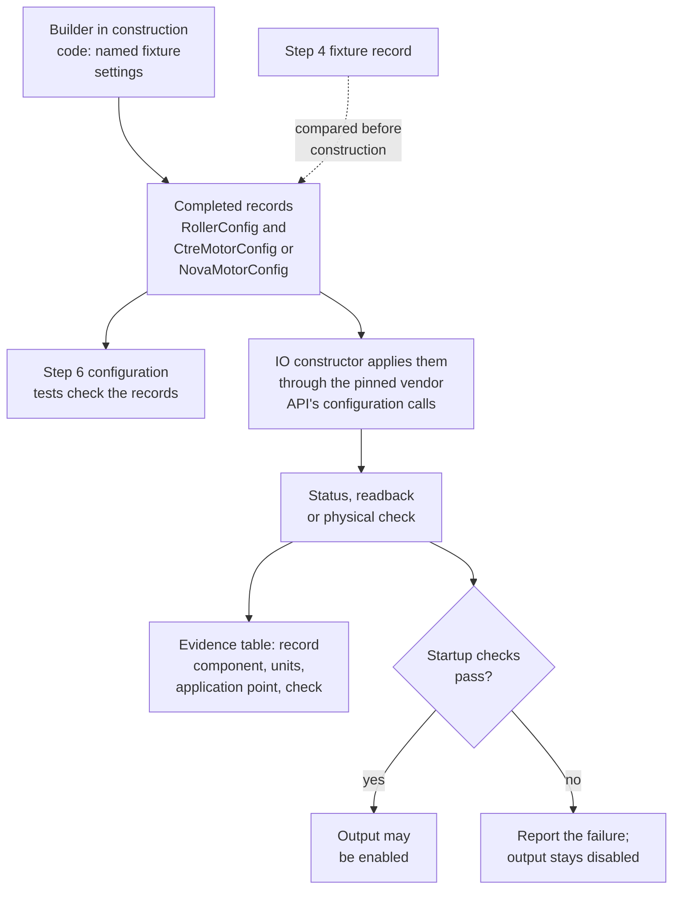
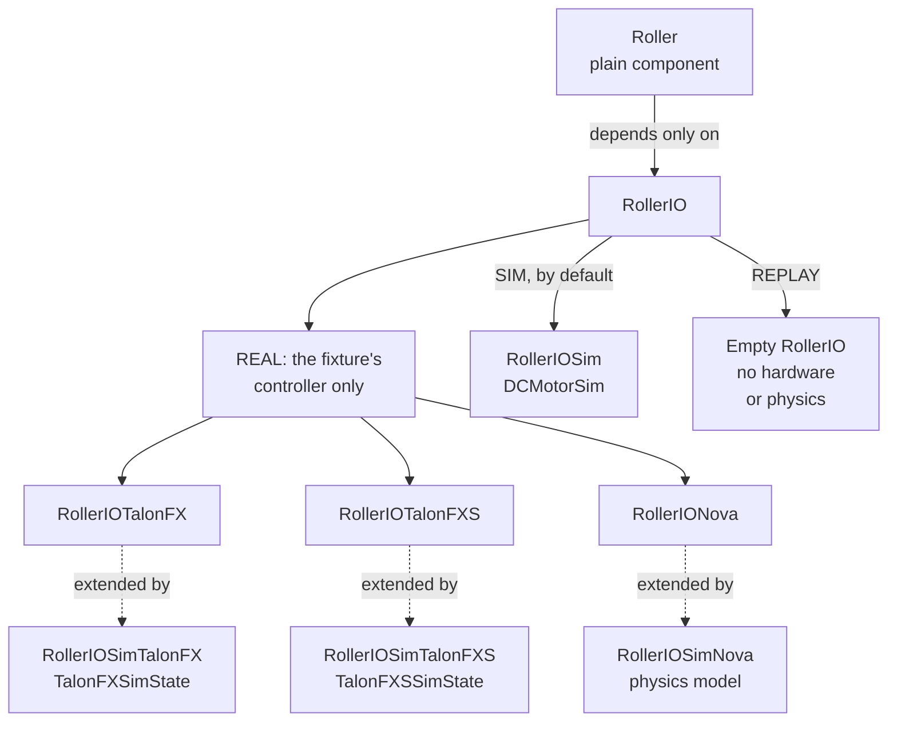
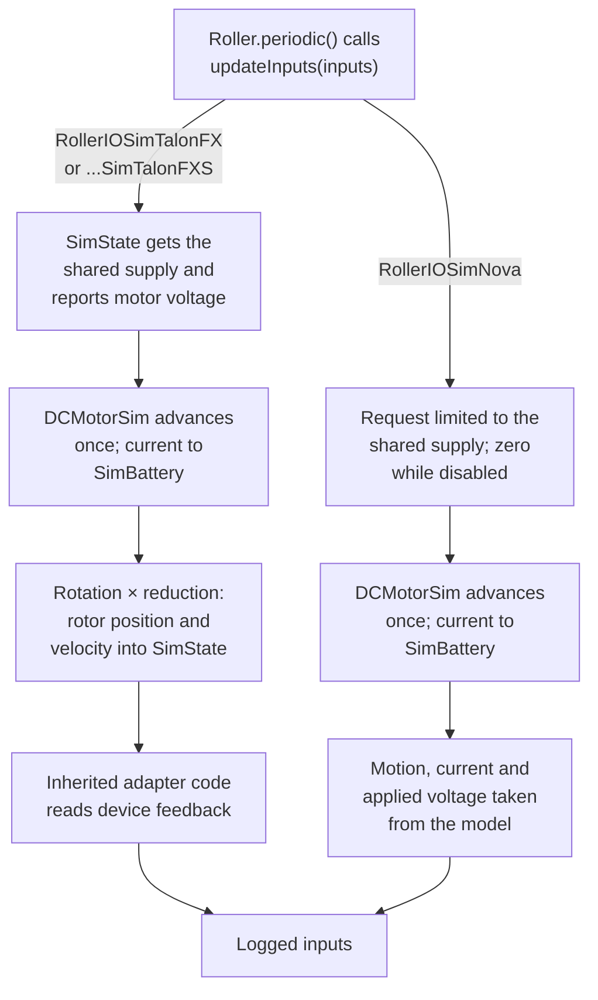
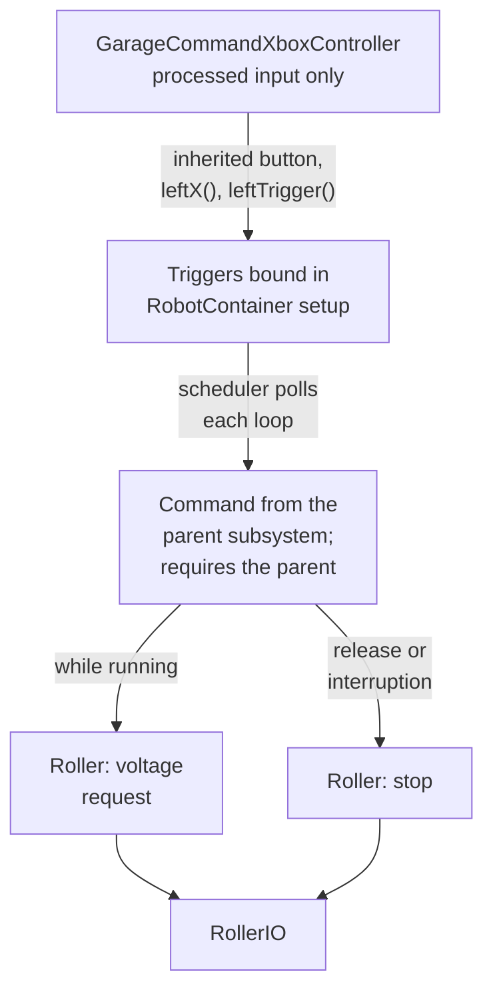

Step 7 builds one roller from a command to a measured response. The student first proves the
component in simulation, then runs the same component on the provided Talon FX, Talon FXS or Thrifty
Nova. The mentor helps with the first setup and asks the student to explain one independent change.

Complete [Testing Fundamentals](/badges/badge-2-testing) and the
[hardware preparation in Step 4](/badges/badge-2-hardware#complete-the-setup-sheet). Talon FX is one
of the supported Badge 2 physical routes. All of this step's work happens in `Badge2Bench`, the
project the student created from the Skeleton template in
[Step 5](/badges/badge-2-io-and-generated-code#create-the-bench-project): the same code runs in
simulation on the laptop and on the physical fixture.

## References to Review

- [Rollers](/frc/roller-example) and [Physics in the IO Layer](/frc/physics-in-the-io-layer)
- [Composing Mechanism Subsystems: Why the Components Are Plain Objects](/frc/composing-mechanism-subsystems#why-the-components-are-plain-objects),
  for the parent subsystem that owns the roller; Step 9 uses the rest of that lesson
- [Commands](/frc/commands) and [RobotContainer and Bindings](/frc/robot-container-and-bindings),
  for the controller bindings added in this step
- [Units and Interpolation](/frc/math-toolbox-units-and-interpolation#the-units-library)
- [AdvantageKit](/frc/advantagekit) and [Unit Tests in Simulation](/frc/unit-tests-in-simulation)
- [Talon FX](/hardware/ctre-talon-fx), [Talon FXS](/hardware/ctre-talon-fxs) and
  [Thrifty Nova, Motor Runner, and Motor Choices](/hardware/thrifty-nova-and-motors)
- [Bring-Up Checklist](/hardware/hardware-bring-up-checklist)

## Prepare for Simulation

The student distinguishes a general physics model from a simulated vendor device. All students
implement a general roller, Talon FX and Talon FXS vendor simulation paths, and a ThriftyNova IO
adapter with a SimThriftyNova physics path. Those paths exchange device output and sensor feedback
with physics; they do not prove wiring, mechanical assembly or physical configuration.
`SimThriftyNova` names the student-built physics path in this lesson, implemented as
`RollerIOSimNova` in the solution. It does not imply a ThriftyLib
firmware simulator.

The two CTRE simulations use corresponding FX and FXS voltage IO adapters even when Nova is supplied
physically. Each configuration runs separately with its documented motor model, reduction and sensor
arrangement. Extra physical controller ports and additional mechanism-by-controller combinations
remain extensions.

## Guided Example

The student builds the roller under `org/<name>/mechanisms/roller/` in `Badge2Bench`. These are
proposed student class names:

- `Roller` owns the requested voltage, stop behavior, cached measurements, and log path.
- `RollerIO` defines requests and the input snapshot.
- `RollerIOInputsAutoLogged` is generated from the inputs class annotated with `@AutoLog`.
- `RollerIOSim` implements the interface using WPILib's `DCMotorSim`.
- `RollerIOTalonFX` supplies the voltage IO used by the physical Talon FX controller.
- `RollerIOSimTalonFX` extends `RollerIOTalonFX` and connects `TalonFXSimState` to the physics
  model.
- `RollerIOTalonFXS` supplies the voltage IO used by the physical Talon FXS controller.
- `RollerIOSimTalonFXS` extends `RollerIOTalonFXS` and connects `TalonFXSSimState` to the physics
  model.
- `RollerIONova` supplies the voltage IO used by the physical Thrifty Nova controller. It sends each
  voltage request through ThriftyLib's native voltage control and converts feedback to mechanism
  units.
- `RollerIOSimNova` extends `RollerIONova`, reuses its requests and feedback conversion, and applies
  the requested voltage to the physics model.
- `RollerTest` checks behavior through the same measurements that the component reads.

For the Nova pair, `RollerIONova` constructs ThriftyLib's `Nova` (`com.thrifty.nova.Nova`) from
the configuration record. `RollerIOSimNova` calls the same constructor, then takes motion, current
and applied voltage from the physics model instead of the device status.

The component is a plain Java object. A small parent subsystem calls its `periodic()` once per robot
loop and gives its commands one WPILib requirement. Step 9 extends that ownership pattern. The
component contains no vendor imports and does not create a motor controller or a command.

## Cobra2026 Connection

Read these pairs in order and trace a single voltage request and measured response:

- [`SingleRollerIO.java`](https://github.com/frc4451/Cobra2026Private/blob/main/src/main/java/org/robotzgarage/frc2026/subsystems/rollers/single/SingleRollerIO.java)
  and
  [`SingleRoller.java`](https://github.com/frc4451/Cobra2026Private/blob/main/src/main/java/org/robotzgarage/frc2026/subsystems/rollers/single/SingleRoller.java):
  the IO contract and the plain component that processes its inputs.
- [`SingleRollerIOTalonFX.java`](https://github.com/frc4451/Cobra2026Private/blob/main/src/main/java/org/robotzgarage/frc2026/subsystems/rollers/single/SingleRollerIOTalonFX.java)
  and
  [`SingleRollerIOSimTalonFX.java`](https://github.com/frc4451/Cobra2026Private/blob/main/src/main/java/org/robotzgarage/frc2026/subsystems/rollers/single/SingleRollerIOSimTalonFX.java):
  a hardware adapter and the simulation subclass that feeds physics results back into the device.
- [`SingleRollerIOTalonFXS.java`](https://github.com/frc4451/Cobra2026Private/blob/main/src/main/java/org/robotzgarage/frc2026/subsystems/rollers/single/SingleRollerIOTalonFXS.java)
  and
  [`SingleRollerIOSimTalonFXS.java`](https://github.com/frc4451/Cobra2026Private/blob/main/src/main/java/org/robotzgarage/frc2026/subsystems/rollers/single/SingleRollerIOSimTalonFXS.java):
  the corresponding FXS adapter and simulation inheritance.
- [`SingleRollerIONova.java`](https://github.com/frc4451/Cobra2026Private/blob/main/src/main/java/org/robotzgarage/frc2026/subsystems/rollers/single/SingleRollerIONova.java):
  Nova construction, configuration and feedback conversion. Cobra uses ThriftyLib's `ThriftyNova`
  class (`com.thethriftybot.devices`) and sends volts with its `setVoltage` method; the badge's
  pinned release uses `com.thrifty.nova.Nova` and `MotorControl.voltage`. SimThriftyNova remains the
  student design described below; this file is the hardware reference.

Cobra's CTRE simulation adapters show notifier timing and rotor feedback; retain only the
rotor-feedback pattern here, because Notifier-based mechanism updates belong to Badge 3. Their
per-model battery updates are not the badge's shared battery-owner design. Retain the badge's single
update owner, summed current draw, synchronization and cleanup checks. Likewise, check each Nova
method's units against the pinned release instead of assuming a method name proves them: a voltage
request takes volts, and a percent request takes a fraction of output.

## Start with the Physics Model

`RollerIOSim` owns a `DCMotorSim` configured with the selected motor model, reduction, and load
inertia. The student uses `Voltage` for requests, `Angle` for position, `AngularVelocity` for speed,
and `Current` for current. Numeric conversions belong at the model or vendor boundary. For example,
a voltage becomes a number in volts only when a method needs that number.

On each 20 ms input update, the simulation applies the bounded voltage request, advances the model
once, and copies its measurements into the inputs. Disabled operation applies zero voltage. The
student identifies that one update owner; advancing the same model again in `simulationPeriodic()`
would advance its motion twice.

The simulation reports current draw to one robot-level battery owner. That owner sums the active
mechanism loads, calculates loaded voltage with `BatterySim`, and updates `RoboRioSim.setVInVoltage`
once per cycle. Each model reads the shared supply on its next update. A component does not
overwrite the battery with its own load alone.
[Physics in the IO Layer](/frc/physics-in-the-io-layer#the-vendor-sim-state-pattern) shows a
proposed owner class, `SimBattery`, that the general, CTRE and SimThriftyNova roller simulations
register with.

The first demonstration is positive voltage, reverse voltage, stop, and disable. Positive voltage
should produce positive measured velocity under the documented direction convention. Stop removes
applied effort; a roller may continue coasting. A second run changes reduction or inertia after the
student predicts the effect.

## IO and Logging

Before implementing this flow, the student reviews
[IO Layers: The Interface](/frc/io-layers#the-interface) for the IO methods and input snapshot,
[AdvantageKit Subsystem Structure](/frc/advantagekit#advantagekit-subsystem-structure) for the
`updateInputs` and `Logger.processInputs` sequence, and
[AdvantageKit Logging](/frc/advantagekit#logging) for recording outputs alongside the inputs. Apply
that structure inside the plain `Roller` component; its parent subsystem still owns the commands and
calls the component once per loop.

`Roller.periodic()` calls `io.updateInputs(inputs)` and then
`Logger.processInputs(logPath, inputs)`. The component reads the resulting snapshot. In REPLAY, the
empty IO constructs no hardware or physics, and AdvantageKit restores recorded measurements before
the component uses them.

The student logs requested voltage separately from feedback. The input record identifies position,
velocity, supply information, current, device status, and whether an applied-voltage value is
measured or estimated. Unsupported feedback has an explicit validity flag or documented absence. A
requested voltage copied into a feedback field does not establish the motor's applied voltage.

## Configuration to Hardware

Carry the tested motor configuration record from Steps 5 and 6 into the roller implementation. The
constructor is `RollerIOTalonFX(RollerConfig config, CtreMotorConfig motor)`,
`RollerIOTalonFXS(RollerConfig config, CtreMotorConfig motor)` or
`RollerIONova(RollerConfig config, NovaMotorConfig motor)`. The robot's
construction code supplies the fixture's named settings through the builder and passes the completed
records into that constructor. The component continues to depend only on `RollerIO`.

Before constructing or enabling the hardware, the student and mentor compare those settings with the
Step 4 fixture record. The IO constructs the device and translates the record into the pinned vendor
API's configuration calls. For every required setting, keep an evidence table with the record
component, units, application point, and available readback or physical check. A setting controlled
only through a vendor tool is identified in the fixture record; an unused record field does not
count as an applied setting. Apply and verify configuration using the selected release's documented
status or readback support, report failure clearly, and keep output disabled until the startup
checks pass.

The student traces one setting from the builder method through configuration tests to its
application and observed result. Building the record prepares values; constructing and initializing
the IO applies them. Normal voltage commands and measurements still pass through the existing IO
methods and logged inputs.

The trace for one setting, from the builder to the evidence table:

`RollerIOSim` receives its own model configuration, including motor model, reduction, and inertia.
Shared physical values agree with the hardware setup, but a simulation record does not need a CAN
ID. REPLAY constructs neither motor nor model. Record the selected configuration values or a
reproducible configuration revision with the run evidence so the logs can be compared later.

In `Badge2Bench`'s `RobotContainer`, construct the physical IO for the actual fixture in `REAL`, the
selected simulation IO in `SIM` (the general `RollerIOSim` unless a CTRE device simulation or
SimThriftyNova is chosen by name), and an empty `RollerIO` in `REPLAY`. `REAL` constructs only the
fixture's devices, so the same project deploys to the bench roboRIO without constructing anything
that is not wired.

The roller classes and what each mode constructs. In `SIM`, `RobotContainer` builds `RollerIOSim`
unless one of the three vendor simulation classes is chosen by name; those classes extend the
hardware adapters, and [Simulation Loop](#simulation-loop) covers them.

## Implement the Provided Controller

The student reads all three controller introductions. Implement FX, FXS and ThriftyNova voltage
adapters, then select the supplied-controller route for the physical check. Review the ThriftyNova
adapter and its configuration trace even when the physical fixture uses FX or FXS. One physical
controller demonstration is required; physical demonstrations on additional controllers are
extensions.

For Talon FX and Talon FXS, the IO configures the actual motor and feedback arrangement, direction,
current limits and reduction. FXS additionally requires its supported motor arrangement to be
selected explicitly. The voltage request uses `VoltageOut`. The student explains whether a reported
position is already in mechanism units before applying another reduction. The device and the
component must not both divide the same measurement by the reduction.

For Thrifty Nova, the IO uses the pinned ThriftyLib release and the motor selection established with
Thrifty Config. The student identifies the encoder source and checks its position and velocity units
against that release. The mentor reviews one rotation-to-mechanism conversion before the powered
check.

ThriftyLib 2026.2.2, the pinned release, has native voltage control. `MotorControl.voltage` takes a
`Voltage` and selects the Nova's voltage control type, so `RollerIONova` passes the typed request
through unchanged, the same contract as `VoltageOut` on the Talons. The student cites that API in
the IO and logs the Nova's reported applied voltage separately from the requested voltage.

A percent request is different. The pinned release's `MotorControl.percent` takes a fraction of
output between minus one and one, not volts; Cobra's `ThriftyNova` calls the same request
`setPercent`. An adapter that uses a percent request implements voltage compensation at the IO
boundary: read the supply voltage, reject a nonfinite or nonpositive supply, clamp the voltage
request to the approved bound and available supply, then divide it by supply voltage to obtain the
fraction. Invalid input produces zero output and a recorded fault. Stop sends zero. The student
records the source of the supply reading; using roboRIO battery voltage is an approximation of the
controller's supply. Requested duty multiplied by that supply is an estimated output, and the log
names it accordingly.

The student tests that conversion independently: a 3 V request with a 12 V supply produces a 0.25
fraction; the same request at 10 V produces 0.30. The negative cases preserve direction. A zero or
invalid supply produces zero, and a request beyond the configured bound is limited. A numeric
voltage is never passed unchanged to a percent request.

## Simulation Loop

First prove the general `RollerIOSim` and its fixed 20 ms update. Then follow
[TalonFX Simulation](/frc/talonfx-simulation), including its FXS section, to implement both
`RollerIOSimTalonFX` and `RollerIOSimTalonFXS`. These are required paths for every student,
including a student using Nova physically. They reuse the matching voltage IO configuration and
measurement code. Apply the Step 6 constructor/builder validation tests to any configuration records
added for these adapters. Select one path at a time; do not advance several models for one roller.

For each CTRE path, record the supported device/motor arrangement, supply, reduction, direction and
model inertia. Read the device's simulated motor voltage into the physics model, advance that model
through one owner, and feed rotor position and velocity back through the appropriate `SimState`. The
general model's mechanism-side rotation must be converted to rotor rotation with the documented
reduction; the device then applies its configured feedback ratio. Check the orientation and avoid
applying the reduction twice.

Badge 2 advances each roller model synchronously from its IO update with
`TimedRobot.kDefaultPeriod`. Keep one owner of the physics step and logging on the robot thread;
do not add a Notifier or shared-state locks. Phoenix device communication still needs the vendor's
test timing and status refresh procedure. A paused-clock general-model test alone does not prove
device behavior. Badge 3 introduces Notifier-based mechanism simulation.

For both CTRE paths, demonstrate positive voltage, reverse voltage, stop, disable, and a changed
reduction. Record requested and device-reported output, rotor feedback and mechanism measurements
with units. Predict the conversion before running. Compare each result with a general model using
matching motor and load parameters; FX and FXS may use different motors, so equal traces between
those devices are not an acceptance criterion.

### ThriftyNova and SimThriftyNova

Implement `RollerIONova` using ThriftyLib's `Nova` class, its native voltage control, and the
configuration and feedback checks above. Implement `RollerIOSimNova` as a subclass that reuses that
constructor, its request methods and its feedback conversion, and drives a `DCMotorSim` from the
requests, so the simulation exercises the same request path as the hardware.

On each 20 ms update, SimThriftyNova reads the shared simulated supply, limits the requested voltage
to that supply while enabled or uses zero while disabled, then applies the result to the physics
model. Advance the model once, then populate the normal logged inputs from the model's motion,
current and applied voltage. Report current to the shared battery owner. Label modeled feedback and
the model's applied voltage explicitly; the simulation does not provide device-status or
configuration-readback evidence.

Both device simulations do their work inside `updateInputs`, once per 20 ms loop. The CTRE paths
exchange voltage and rotor feedback with the device's `SimState`; SimThriftyNova takes its inputs
from the model.

Test positive and negative requests, stop, disable, a request beyond the simulated supply, a reduced
supply, and a changed reduction. Compare the motion with the general roller using matching motor,
reduction and inertia, and save a log showing requests, supply, applied voltage and measured model
motion. Restore Driver Station and battery state after each test.

The CTRE simulations establish the IO/device/physics connection. SimThriftyNova establishes that the
Nova adapter's requests and feedback conversion drive the physics model; it does not emulate Nova
firmware or prove CAN communication. The physical demonstration establishes the actual fixture
behavior. Only the supplied physical controller must be demonstrated.

## First Test

The student initializes the WPILib test environment as described in
[Unit Tests in Simulation](/frc/unit-tests-in-simulation), starts with the
[general roller binding fixture](/frc/unit-tests-in-simulation#a-roller-binding-with-general-simulation),
supplies enabled or disabled Driver Station state, and advances the general model through its normal
20 ms path. A fixed-step general model does not need Phoenix's real-time device test setup. Both
required CTRE simulations use the vendor's documented timing procedure separately. Run their checks
with distinct device identities and close every device after each test.

The assertions read cached inputs or public component accessors. They check positive and negative
motion, zero applied effort after stop, and zero applied effort while disabled. Each test restores
Driver Station and battery state and closes resources it created. The test also checks the reduction
and unit conversion using expected values calculated before running.

## Extend the Controller Bindings

Reuse the `GarageCommandXboxController` built and tested in
[Step 6: Testing Fundamentals](/badges/badge-2-testing#build-a-robot-controller-class). The
processed axes and the inheritance demonstration are already complete. This step adds commands, so
the roller can be operated and tested in simulation before the physical check.

Add `leftX()` returning a `Trigger` whose callback reads whether the processed axis is nonzero.
Build and bind it during container setup so the callback reads changing input during scheduler
polling.

Override the no-argument `leftTrigger()` to delegate to the inherited overload that takes the
configured threshold. The student explains why overriding that signature and calling a different
overload are separate Java operations.

Timed rumble is an optional extension. For that extension, add `rumble(strength)` with
`Commands.startEnd`: start sets both rumble outputs, and end clears them. Add
`rumbleSeconds(strength, seconds)` by applying `withTimeout` to that command. Use a strength between
zero and one and a positive duration. Keep one rumble command active at a time in the exercise;
these factories do not claim a mechanism subsystem, so subsystem requirements alone will not prevent
competing rumble commands.

In `RobotContainer`, use an inherited button and the added triggers to schedule commands from the
roller's parent subsystem. Demonstrate a processed axis setting a roller voltage through a command
that requires the parent, with stop behavior on release or interruption. The controller class
processes operator input and produces driver feedback; it does not construct mechanisms or reach
into their IO. If the student completes the rumble extension, bind it to a documented feedback
event.

The controller class stops at the trigger. Everything after it belongs to the bindings and the
roller's parent subsystem:

### Prove the Behavior

Use `XboxControllerSim` with the controller's underlying HID and notify new input data before
polling. Reuse the paused-clock scheduler setup from
[Unit Tests in Simulation](/frc/unit-tests-in-simulation#a-command-against-a-paused-clock), with the
general `RollerIOSim` behind the parent. Robot hardware and a physical gamepad are not required.

- Keep the Step 6 axis and runtime-dispatch tests passing.
- Check the added stick trigger at rest and during movement, the analog trigger below and above its
  configured threshold, and one inherited button binding.
- For the optional rumble extension, schedule timed rumble, inspect both simulated rumble outputs
  while active, and verify zero after timeout. Repeat with early cancellation and with robot
  disable. Enable simulated teleop for the active-command checks and restore scheduler, Driver
  Station, and simulation state during teardown.
- Operate the simulated roller through the student's controller class. Show the input, command
  request, and measured response, then release or interrupt the command and show the stopped roller.

The README links the added bindings, tests, and simulation evidence.
[Step 9](/badges/badge-2-mechanism-composition) binds the same controller to the composed
subsystems.

## Add the Roller Drawing

After the motion and stop tests pass, the student builds a measured-speed roller spinner using
[Step 8: Read the Four Mechanisms in 2D](/badges/badge-2-mechanism-library#read-the-four-mechanisms-in-2d).
It uses only logged 2D lines. Verify forward, reverse and coasting against the velocity plot. The
voltage-controlled roller has no speed goal; never animate the requested voltage as though it were
measured speed. This introduces the drawing pattern used by the other families in Step 8.

## Check the Result

The mentor and student complete the Step 4 fixture record before applying power. The mechanism is
secured, its travel is clear, its limits are configured, and the mentor identifies the disable
operator and power disconnect. The student deploys `Badge2Bench`, configured for the actual fixture.
The swerve template's device IDs and constants are not a bench configuration.

The student demonstrates a bounded positive request, stops, then demonstrates a bounded reverse
request. The mentor checks motor direction and feedback direction separately. The same controller
bindings tested in [Extend the Controller Bindings](#extend-the-controller-bindings) then prove stop
on release, interruption, and disable on the fixture. The student saves the physical log and
compares requested effort, measured speed, and available current and supply readings with the
simulation log.

An unexpected sign or scale is a reason to stop and check configuration and conversion. The mentor
helps identify the cause; the student repeats the affected check after the correction. A successful
vendor-tool or Motor Runner test does not replace the robot-code demonstration.

## Independent Change

The student changes reduction or inertia in simulation, predicts the result, and explains the saved
comparison. On the physical fixture, the mentor selects a permitted output bound or command duration
to change. The student predicts and demonstrates that change without altering unrelated
configuration.

## Rows

Earlier evidence is reviewed by
behavior, as explained in [Sign-Off](/badges/badge-2-sign-off#required-sheet).

| # | Work | Done When |
| --- | --- | --- |
| HW.3 | Identify simulation boundaries | The student distinguishes general physics, FX/FXS device simulation and physical evidence, and records the two CTRE simulation configurations before implementation. |
| 6.1 | Component and ownership | The plain `Roller` has typed voltage requests, stop behavior, cached measurements, and one parent owner. |
| 6.2 | Inputs and replay | Inputs pass through `updateInputs` and `Logger.processInputs`; requested, measured, and estimated values are distinguishable. |
| 6.2a | General physics | `RollerIOSim` has one update owner, a documented model, shared battery handling, and zero disabled output. |
| 6.3 | Hardware IO | The supplied FX, FXS or Nova adapter accepts the tested configuration record; each required setting has an application and verification trace; the student explains startup failure handling and the voltage boundary. |
| 6.4 | Conversion tests | Direction, reduction, equivalent units, and any voltage-to-duty conversion pass independent checks, including invalid input. |
| 6.5 | Update ownership | The student names the model and battery owners; tests restore state and close resources. Both CTRE simulation paths have verified timing, shared-state handling and cleanup. |
| 6.6 | Run and stop tests | Positive, reverse, stop, and disable behavior pass through the normal input path. |
| 6.7 | Simulation log | Requested effort, motion, current, and battery behavior can be explained from the saved run. |
| 6.8 | Independent change | The simulation prediction, changed configuration, tests, and observed result are recorded. |
| 6.9 | Physical demonstration | The provided FX, FXS or Nova runs from the bench robot code; direction, feedback, release, interruption, and disable are demonstrated to the mentor. |
| 6.10 | Physical comparison | The fixture record, physical log, independent hardware change, and comparison with simulation are saved. |
| 6.11 | Talon FX roller simulation | The FX voltage adapter and device simulation pass direction, conversion, stop and disable checks; the student traces device voltage to physics and rotor feedback to logged inputs. |
| 6.12 | Talon FXS roller simulation | The FXS path repeats the checks with its supported motor arrangement, documented model and feedback units; the student explains the differences and verifies cleanup. |
| 6.13 | ThriftyNova IO | `RollerIONova` uses ThriftyLib's `Nova`, accepts the tested configuration record, sends voltage through the pinned release's native voltage control, and shares its tested feedback conversion with SimThriftyNova; configuration application and verification are documented. Physical operation is required when Nova is the supplied fixture. |
| 6.14 | SimThriftyNova roller simulation | `RollerIOSimNova` passes direction, conversion, reduced-supply, output-limit, stop, disable and changed-reduction checks; one model update owner and the shared battery owner are identified; the saved log distinguishes modeled feedback from hardware evidence. |
| 8.9 | Controller bindings and feedback | The Step 6 controller gains a stick trigger and a configured analog-trigger threshold; timed rumble is optional; inherited and added controls schedule commands from the roller's parent subsystem. |
| 8.10 | Controller evidence | Required input checks pass without hardware; any optional rumble checks also pass; the bindings operate the simulated roller; release, interruption, and disable have verified outcomes. |

Rows 8.9 and 8.10 keep their identifiers from when the bindings were part of Step 9.

A stop check verifies zero requested drive effort immediately. Measured speed can coast down or
brake according to the model and neutral behavior; it need not become zero in the same loop.

## Badge Check

<StepsBox title="One Complete Mechanism Badge Check">

1. The student builds from a clean clone and runs the general, FX, FXS and SimThriftyNova simulation
   checks and conversion tests, naming each selected implementation.
2. The student shows the ThriftyNova IO, its voltage request and its shared feedback conversion,
   then traces a builder setting through configuration tests, the selected IO constructor, and its
   application evidence, then traces a command through the component, measurement, and log.
3. The student shows the simulation prediction and explains the changed response.
4. The student operates the simulated roller from the controller bindings, shows the passing binding
   tests, and traces a processed input through its binding into the parent subsystem.
5. With the mentor, the student runs the physical checks using the recorded fixture configuration.
6. The mentor selects a signal from the physical log. The student explains its units, source, and
   whether it is measured or estimated.
7. The student explains what the simulation established and what required the physical check.

</StepsBox>

<Sources items={[
  {"source": "cobra", "path": "src/main/java/org/robotzgarage/frc2026/subsystems/rollers/single/SingleRollerIO.java", "note": "Implementation reading for the Cobra2026 comparison in this lesson."},
  {"source": "cobra", "path": "src/main/java/org/robotzgarage/frc2026/subsystems/rollers/single/SingleRoller.java", "note": "Implementation reading for the Cobra2026 comparison in this lesson."},
  {"source": "cobra", "path": "src/main/java/org/robotzgarage/frc2026/subsystems/rollers/single/SingleRollerIOTalonFX.java", "note": "Implementation reading for the Cobra2026 comparison in this lesson."},
  {"source": "cobra", "path": "src/main/java/org/robotzgarage/frc2026/subsystems/rollers/single/SingleRollerIOSimTalonFX.java", "note": "Implementation reading for the Cobra2026 comparison in this lesson."},
  {"source": "cobra", "path": "src/main/java/org/robotzgarage/frc2026/subsystems/rollers/single/SingleRollerIOTalonFXS.java", "note": "Implementation reading for the Cobra2026 comparison in this lesson."},
  {"source": "cobra", "path": "src/main/java/org/robotzgarage/frc2026/subsystems/rollers/single/SingleRollerIOSimTalonFXS.java", "note": "Implementation reading for the Cobra2026 comparison in this lesson."},
  {"source": "cobra", "path": "src/main/java/org/robotzgarage/frc2026/subsystems/rollers/single/SingleRollerIONova.java", "note": "Implementation reading for the Cobra2026 comparison in this lesson."},
  {
    "source": "cobra",
    "path": "src/main/java/org/robotzgarage/frc2026/util/GarageCommandXboxController.java",
    "note": "The source design for the controller's added triggers, trigger threshold and rumble factories."
  },
  {
    "source": "wpilib-javadoc",
    "path": "edu/wpi/first/wpilibj2/command/button/CommandXboxController.html",
    "note": "The parent controller API, inherited buttons, and trigger overloads."
  },
  {
    "source": "wpilib-javadoc",
    "path": "edu/wpi/first/wpilibj/simulation/XboxControllerSim.html",
    "note": "Simulated Xbox inputs and inherited notification and rumble inspection methods."
  },
  {
    "source": "wpilib",
    "path": "docs/software/wpilib-tools/robot-simulation/physics-sim.html",
    "note": "General motor physics, model inputs, and simulation updates."
  },
  {
    "source": "wpilib",
    "path": "docs/software/basic-programming/java-units.html",
    "note": "Typed mechanism requests and measurements."
  },
  {
    "source": "advantagekit",
    "path": "data-flow/recording-inputs/io-interfaces/",
    "note": "Cached inputs and the common replay boundary."
  },
  {
    "source": "ctre",
    "path": "docs/hardware-reference/talonfxs/index.html",
    "note": "FXS motor arrangement and supported hardware."
  },
  {
    "source": "ctre",
    "path": "docs/api-reference/device-specific/talonfx/open-loop-requests.html",
    "note": "Voltage-output requests on the CTRE implementation."
  },
  {
    "source": "thrifty",
    "path": "software/thriftylib/latest/control-types",
    "note": "Nova control types; the voltage-to-duty rule for a percent adapter and its tests are a curriculum design."
  },
  {
    "source": "thrifty-javadoc",
    "path": "com/thrifty/core/MotorControl.html",
    "note": "The native <code>voltage</code> request and the fractional <code>percent</code> request; the badge pins ThriftyLib 2026.2.2."
  },
  {
    "source": "thrifty",
    "path": "software/thriftylib/latest/status-and-telemetry",
    "note": "Nova rotational feedback and conversion conventions."
  },
  {
    "source": "wpilib",
    "path": "docs/software/wpilib-tools/robot-simulation/unit-testing.html",
    "note": "HAL and simulated Driver Station preparation for tests."
  },
  {
    "source": "wpilib-javadoc",
    "path": "edu/wpi/first/wpilibj/simulation/BatterySim.html",
    "note": "Combining mechanism current draws into one simulated supply."
  },
  {
    "source": "ctre",
    "path": "docs/api-reference/simulation/simulation-intro.html",
    "note": "Required FX and FXS vendor simulation, feedback units and timing."
  },
  {
    "source": "advantagekit",
    "path": "getting-started/common-issues/multithreading/",
    "note": "Main-thread logging and background IO ownership."
  }
]} />
