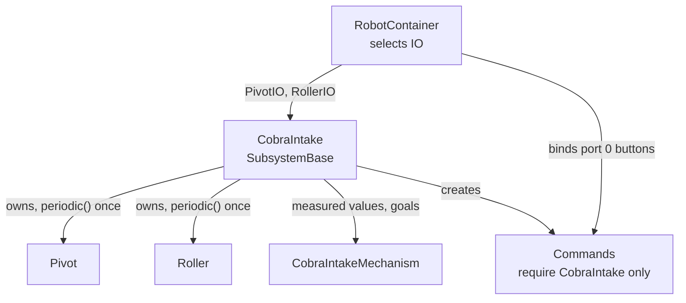
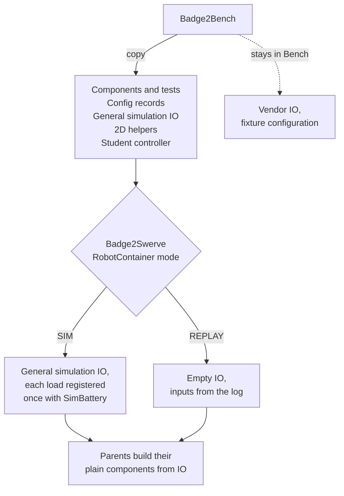
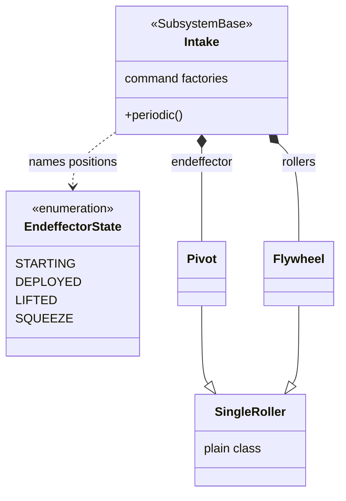
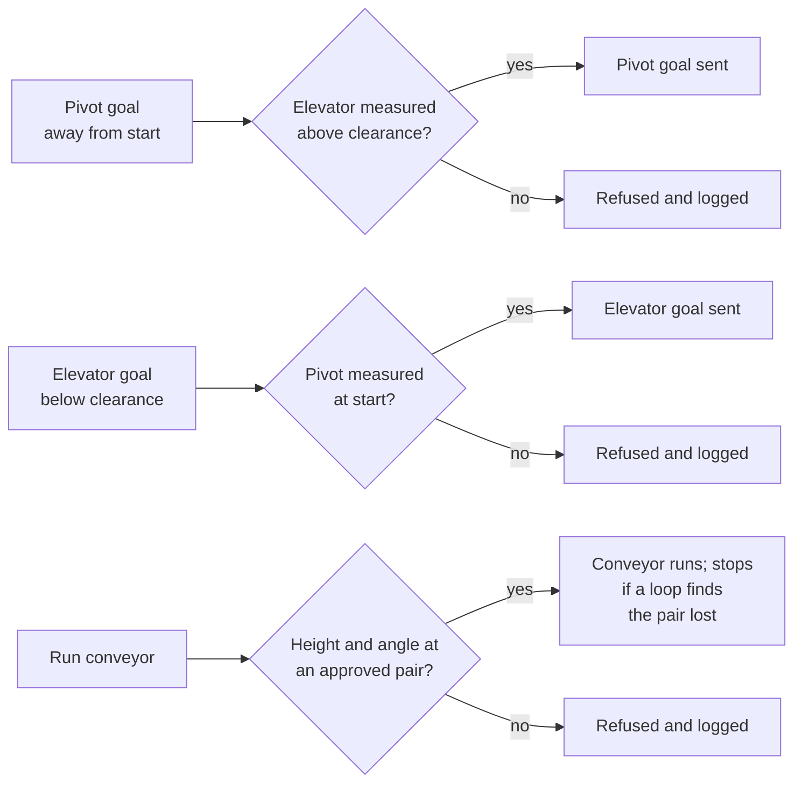
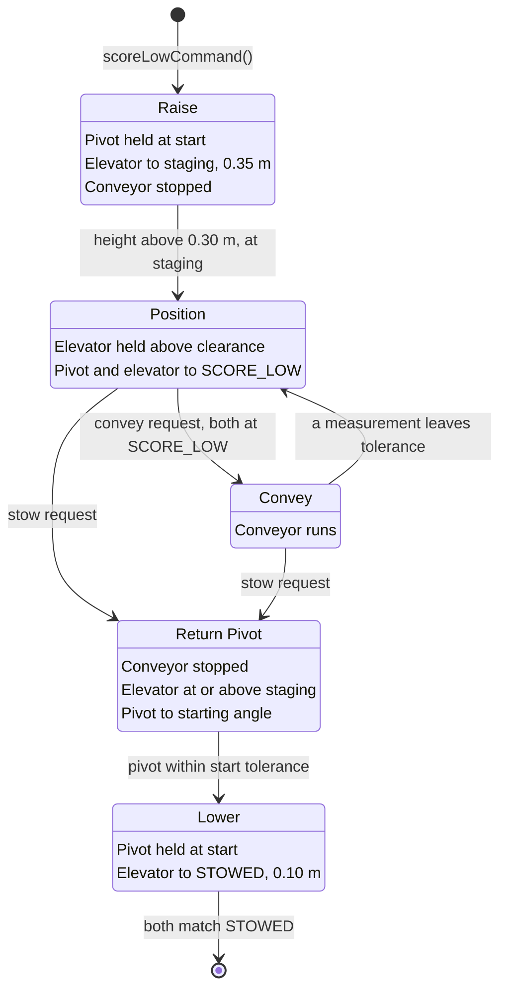
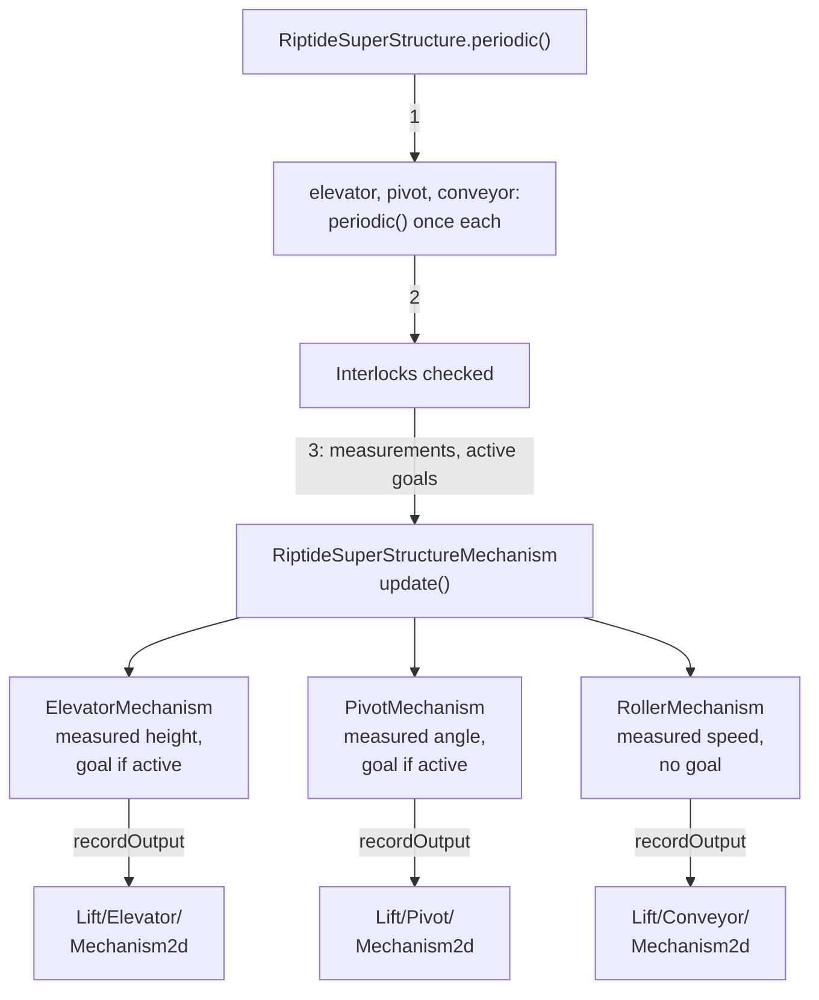
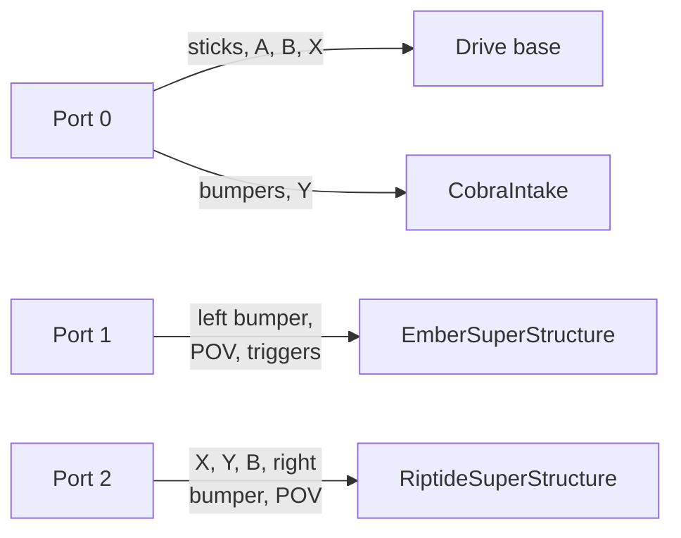

Build three composed subsystems in `Badge2Swerve`, in this order: **CobraIntake, then
EmberSuperStructure, then RiptideSuperStructure**. Complete and test each before starting the next.
The sequence starts with basic parent ownership, adds measured shooting readiness, and finishes
with multi-axis clearance interlocks.

| Order | Build | Owned components | Driver Station port | Goal |
| --- | --- | --- | --- | --- |
| 1 | `CobraIntake` | Pivot and intake roller | 0, shared with the drive base | Deploy, wait for measured angle, intake or eject, then stow. |
| 2 | `EmberSuperStructure` | Pivot, flywheel, feeder and possession IO | 1 | Recreate Ember's pivoting shooter with measured angle/speed readiness and valid possession. |
| 3 | `RiptideSuperStructure` | Elevator, pivot and conveyor | 2 | Reach named scoring pairs while enforcing clearance and conveyor interlocks. |

All three are required simulation exercises. `Badge2Bench` remains the individual-mechanism and
physical-motor project. Build the composed parents directly in `Badge2Swerve`; leave the drivetrain
idle while first testing each assembly. Step 11 reuses their commands in autonomous routines.
Do not deploy `Badge2Swerve` to the physical bench.

Each parent owns plain components, calls each component's `periodic()` once, assigns log paths,
and creates commands that require only that parent. Interlocks stay inside the parent. A controller
chooses an action; it does not own the motor control or bypass the parent's interlocks.

CobraIntake shows the pattern the other two parents repeat with more components:



## Prepare Badge2Swerve

Copy the Step 8 reusable component library, general simulation IO, configuration records, 2D
visualizations and their tests from `Badge2Bench`. Bring the student controller and required build
dependencies, including Lombok. Record the source revision in your README. Keep physical vendor IO
and fixture configuration in Bench; the composed exercises use general WPILib physics in `SIM`
and empty IO with recorded inputs in `REPLAY`.

Construct the simulation IO in `RobotContainer` and pass it into the parents. Register every
mechanism load with the shared `SimBattery` once and update the supply once per robot simulation
loop. Keep display constants and named states in each parent's constants file. Reusable 2D helpers
belong in `org.robotzgarage.frc2027.mechanisms.visualizations`. Construct IO explicitly in the
mode branches; a separate mechanism factory is not needed. The parents construct their plain
components from that IO.

What moves to `Badge2Swerve`, what stays behind, and how the IO reaches the parents:



Build and test each superstructure's behavior first, then add its local visualizer in the same
folder. The visualizer constructs the reusable Step 8 views and records their outputs. It receives
typed measurements and active goals from its parent; it does not select IO or command motors.

| Folder under `frc.robot.subsystems` | Behavior | Configuration | Visualization |
| --- | --- | --- | --- |
| `CobraIntake` | `CobraIntake.java` | `CobraIntakeConstants.java` | `CobraIntakeMechanism.java` |
| `EmberSuperStructure` | `EmberSuperStructure.java` | `EmberSuperStructureConstants.java` | `EmberSuperStructureMechanism.java` |
| `RiptideSuperStructure` | `RiptideSuperStructure.java` | `RiptideSuperStructureConstants.java` | `RiptideSuperStructureMechanism.java` |

Only the behavior class extends `SubsystemBase`. The local visualizer is a plain Java object,
owned once by the parent in a field named `mechanism`. Keep robot-specific display dimensions in
the parent's constants file; reusable visualization classes must not import those constants.

## References to Review

- [Composing Mechanism Subsystems](/frc/composing-mechanism-subsystems)
- [Subsystems](/frc/subsystems)
- [Commands](/frc/commands)
- [Command Groups](/frc/command-groups)
- [Unit Tests in Simulation](/frc/unit-tests-in-simulation)
- [What a Mechanism Drawing Shows](/frc/what-a-mechanism-drawing-shows),
  [Mechanisms per Subsystem](/frc/mechanisms-per-subsystem), and
  [Measured Against Goal](/frc/measured-against-goal)

## Cobra2026 Connection

Read
[`Intake.java`](https://github.com/frc4451/Cobra2026Private/blob/main/src/main/java/frc/robot/subsystems/intake/Intake.java)
alongside
[`SingleRoller.java`](https://github.com/frc4451/Cobra2026Private/blob/main/src/main/java/org/robotzgarage/frc2026/subsystems/rollers/single/SingleRoller.java).
Find the parent's component fields, its calls to both components' `periodic()`, and the command
factories. This is the ownership pattern used for the required elevator assembly and
pivoting-shooter work: one parent coordinates plain components and owns the command requirement.

Cobra's classes, as they stand in `Intake.java` and the library. Badge 2 keeps the shape and swaps
`Flywheel` for the student's `Roller`:



Cobra's intake is a pivot-and-roller example, not the required elevator/conveyor clearance solution.
Use its structure while implementing the lesson's measured-position interlocks and voltage requests.
Start with the CobraIntake exercise below, then apply that ownership pattern to Ember and Riptide.

## 1. Build CobraIntake

Build `CobraIntake` and `CobraIntakeConstants` under `frc.robot.subsystems.CobraIntake`.
This is the required first composition exercise; demonstrate it before starting Ember.

A pivot and a roller, after Cobra 2026's `Intake`. That subsystem owns two library components, a
`Pivot` named `endeffector` and a `Flywheel` named `rollers`, names its pivot positions in an
`EndeffectorState` enum (`STARTING`, `DEPLOYED`, `LIFTED`, `SQUEEZE`), calls both components'
`periodic()` from its own, and exposes one command factory per position plus factories that run the
rollers. The [composition lesson](/frc/composing-mechanism-subsystems#build-a-pivoting-intake) has a
version built on the same component types.

Two differences from Cobra to keep in mind. Cobra's roller is typed `Flywheel` because that class
adds velocity control on top of the roller behavior; the Badge 2 version uses the student's
`Roller`, since the intake roller has no velocity goal. Cobra runs its rollers on percent output and
torque current, while Badge 2 uses voltage throughout for the reasons in
[Step 8: Mechanism Library](/badges/badge-2-mechanism-library#voltage-control).

Required behavior:

- Named `STOWED`, `INTAKE` and `EJECT` pivot positions, as constants or an enum.
- Roller requests for intake, eject, hold and stop, each a voltage from a named constant.
- A command that deploys the pivot and runs the roller to intake.
- A command that stops the roller and stows the pivot.
- Completion based on the measured pivot angle through `atGoal`, not on a timer.
- One requirement, the parent `CobraIntake`, on every command.

The required behavior as states, with the port 0 buttons from
[Bind the Composed Subsystems](#bind-the-composed-subsystems). The roller waits for the measured
angle in both directions:

```mermaid
stateDiagram-v2
  accTitle: CobraIntake states
  accDescr: CobraIntake rests in Stow, with the pivot held at STOWED and the roller stopped. The left bumper moves it to Deploying, where the roller stays stopped and the pivot moves to INTAKE; when the pivot's atGoal reports the measured angle it moves to Intaking and the roller runs at the intake voltage. The right bumper moves it to Moving to Eject, where the pivot moves to EJECT before the roller runs; at atGoal it moves to Ejecting and the roller runs at the eject voltage. Releasing the bumper, or pressing Y, returns it to Stow from any state.
  state "Stow" as Stow
  state "Deploying" as Deploying
  state "Intaking" as Intaking
  state "Moving to Eject" as ToEject
  state "Ejecting" as Ejecting
  [*] --> Stow
  Stow : Pivot to STOWED
  Stow : Roller stopped
  Stow : Release or Y returns here
  Stow : from any state
  Stow --> Deploying : left bumper
  Deploying : Roller stopped
  Deploying : Pivot to INTAKE
  Deploying --> Intaking : pivot atGoal
  Intaking : Roller at intake voltage
  Intaking --> Stow : release
  Stow --> ToEject : right bumper
  ToEject : Roller waits
  ToEject : Pivot to EJECT
  ToEject --> Ejecting : pivot atGoal
  Ejecting : Roller at eject voltage
  Ejecting --> Stow : release
```



## 2. Build EmberSuperStructure

Read Ember's
[PivotSubsystem](https://github.com/frc4451/Ember2024/blob/main/src/main/java/frc/robot/subsystems/pivot/PivotSubsystem.java),
[ShooterSubsystem](https://github.com/frc4451/Ember2024/blob/main/src/main/java/frc/robot/subsystems/shooter/ShooterSubsystem.java),
[FeederSubsystem](https://github.com/frc4451/Ember2024/blob/main/src/main/java/frc/robot/subsystems/feeder/FeederSubsystem.java)
and their bindings in
[RobotContainer](https://github.com/frc4451/Ember2024/blob/main/src/main/java/frc/robot/RobotContainer.java).
Trace how the pivot goal, shooter speed and feeder possession describe one shooting action.

Ember keeps those functions in separate subsystems and controls two shooter wheels. Its
`shooterNearTarget()` checks both measured wheel speeds. For this exercise, recreate the behavior
with `EmberSuperStructure` owning a `Pivot`, one `Flywheel`, one feed `Roller` and possession IO.
One flywheel is the simplified shooter model. The parent ownership and combined readiness rule below
are Badge 2 requirements; they are not a claim that Ember uses this exact architecture or interlock.


This is an intentional redesign of Ember: combine the pivot, shooter and feeder responsibilities
into one superstructure rather than recreate three independently scheduled subsystems. Inside
`EmberSuperStructure`, use plain mechanism components named `pivot`, `flywheel` and `feeder`.
Do not nest `PivotSubsystem`, `ShooterSubsystem` or `FeederSubsystem` objects inside it. Only the
superstructure extends `SubsystemBase` and owns a scheduler requirement.

Keep `EmberSuperStructure.java` and `EmberSuperStructureConstants.java` together under
`frc.robot.subsystems.EmberSuperStructure`. Put named shot presets, tolerances and mechanism
configuration in that constants file. `RobotContainer` selects the IO and constructs the
superstructure, then binds its acquire, aim-and-spin and shoot command factories to the student
controller.

The superstructure calls each component's `periodic()` exactly once, processes possession IO, checks
its interlocks, and passes processed measurements and active goals to its local visualizer. Use log
paths such as `Shooter/Pivot`, `Shooter/Flywheel`, `Shooter/Feeder` and `Shooter/Possession`. Every
command it creates requires the superstructure; simultaneous aim and feed behavior belongs inside
its shoot command rather than competing commands with the same requirement.

### Implement these behaviors

1. Define two named shot presets, each pairing a typed pivot angle with a typed flywheel speed.
   Choose values within your simulation ranges and document them. A requested preset sets goals;
   it does not establish readiness.
2. Provide an acquire command that holds the pivot at a documented loading angle, stops the
   flywheel, and moves the feeder until a valid possession input reports a piece, then stops the
   feeder to hold it. Acquire uses the same release, interruption and disable policy as the other
   superstructure commands. Script the possession IO in simulation. Missing or invalid input must
   stop the feeder. A floor-intake assembly is optional.
3. Provide an aim-and-spin command that requests the chosen angle and speed while keeping the
   feeder stopped. Readiness requires both the measured pivot angle and measured flywheel speed
   to be within their configured goal tolerances.
4. Provide a shoot command that maintains those goals and runs the feeder only while possession
   is valid and present, both components are ready, and the shoot command is active. Recheck these
   conditions every cycle. Losing angle, speed or input validity stops feeding immediately.
5. When the piece leaves, stop the feeder. On release, interruption or timeout, stop the feeder
   and flywheel and retain the pivot's accepted angle goal while enabled. On disable, all actuator
   effort stops; this does not guarantee the model holds against gravity.

The same behaviors as a state diagram. The feeder runs in only two places: in Acquire until a
piece is reported, and in Feeding while every shot condition holds.

```mermaid
stateDiagram-v2
  accTitle: EmberSuperStructure commands and the feed gate
  accDescr: The superstructure starts in Idle, where the feeder and flywheel are stopped and the pivot keeps its accepted goal. An acquire request moves to Acquire, where the pivot goes to the loading angle, the flywheel stays stopped and the feeder runs while the possession input is valid; when a valid input reports a piece it returns to Idle. An aim request for NEAR or FAR moves to Aim and Spin, which requests the preset angle and speed and keeps the feeder stopped even when ready. A shoot request for NEAR or FAR moves to Shoot: Aiming, with the preset goals held, the feeder stopped and the missing condition logged. When possession is valid and present and the measured angle and speed are within tolerance, it moves to Shoot: Feeding and the feeder runs. Losing angle, speed or input validity returns it to Shoot: Aiming. When the piece leaves, it returns to Idle. Every command returns to Idle on release or interruption.
  state "Idle" as Idle
  state "Acquire" as Acquire
  state "Aim and Spin" as Aim
  state "Shoot: Aiming" as Aiming
  state "Shoot: Feeding" as Feeding
  [*] --> Idle
  Idle : Feeder and flywheel stopped
  Idle : Pivot keeps its accepted goal
  Idle : Every command returns here
  Idle : on release or interruption
  Idle --> Acquire : acquire
  Acquire : Pivot at loading angle
  Acquire : Flywheel stopped
  Acquire : Feeder runs while input valid
  Acquire : Ends when a piece is reported
  Acquire --> Idle
  Idle --> Aim : aim NEAR or FAR
  Aim : Preset angle and speed
  Aim : Feeder stopped, even ready
  Idle --> Aiming : shoot NEAR or FAR
  Aiming : Preset goals held
  Aiming : Feeder stopped
  Aiming : Logs the missing condition
  Aiming --> Feeding : piece, angle, speed ready
  Feeding : Feeder runs
  Feeding : Back to aiming if any is lost
  Feeding --> Aiming
  Feeding --> Idle : piece leaves
```



The test sequence is: acquire a piece, request a preset, observe aim and spin-up, shoot once ready,
and observe the possession input clear. Repeat for the second preset. Also try shooting with no
piece, invalid possession, an off-target pivot and an underspeed flywheel. Each refusal should log
which condition is missing. This step does not require vision aiming, distance interpolation,
projectile flight simulation or a recreation of Ember's entire robot.

## 3. Build RiptideSuperStructure

Build `RiptideSuperStructure` and `RiptideSuperStructureConstants` under
`frc.robot.subsystems.RiptideSuperStructure`. This assembly contains an elevator, a pivot and a
conveyor roller. This will be a recreation of Riptide's `SuperStructure`, which owns an `Elevator`,
a coral `Pivot` and a `Shooter` roller that pairs an elevator height with a pivot angle in each
value of its `SuperStructureModes` enum. Riptide's code sets both goals together and reports
`isAtMode` when both are near; it does not enforce a clearance rule between them. The three
interlocks below are Badge 2 requirements added on top of that design.

Required interlocks:

- The pivot may leave its starting angle only when the elevator is above a named clearance height.
- The elevator may move below the clearance height only when the pivot is at its starting angle.
- The conveyor may run only at two approved elevator-and-pivot setpoint pairs.
- The approved pairs are named records or enum values, as Riptide's modes are. Placeholder names
  such as `X`, `Y`, `A` and `B` do not appear in the code.
- The conveyor checks measured elevator height and pivot angle against the approved pair tolerances;
  requesting an approved goal is not evidence of reaching it.
- A rejected request stops safely and produces a useful log entry or an `Alert`, naming what was
  requested and which interlock refused it.

"Stops safely" means the component keeps or returns to a defined goal and the conveyor is stopped;
it does not mean the subsystem throws an exception or leaves a goal half-applied.

Each request passes one check inside the parent before anything reaches a component. Every check
reads measured state, never the goal that was requested. A refusal stops safely, as defined above,
and its log entry or `Alert` names the request and the interlock:



The interlock tests (rows 8.5 and 8.6) construct each parent with the general WPILib simulation IO
from Step 8. Those models advance one fixed step each time `scheduler.run()` calls the parent's
`periodic()`, and `SimHooks.stepTiming` controls the command timing, so the test decides exactly how
far everything moves. Badge 2 mechanism simulation adapters use synchronous updates with
`TimedRobot.kDefaultPeriod`; do not add a `Notifier` here. Phoenix device simulation also depends
on vendor timing, so use the general IO for deterministic interlock tests and retain separate
vendor-device checks in Bench. Badge 3 introduces the Notifier-based mechanism simulation work.

## Work Through One Clearance Move

This small teaching sequence uses different values from the finished solution. For it, use: `STOWED`
is 0.10 m and 0 degrees; `SCORE_LOW` is 0.60 m and 45 degrees. Clearance is 0.30 m, with a staging
height of 0.35 m, a height tolerance of 0.01 m and an angle tolerance of 2 degrees. Confirm these
values fit the Step 8 simulation ranges. They are teaching values, not physical fixture settings. In
the solution, `RiptideSuperStructureConstants.Mode` instead defines `STOWED` at 0 m / 90 degrees,
`LOW_SCORE` at 0.45 m / 30 degrees and `HIGH_SCORE` at 1 m / 60 degrees. Its `goTo(Mode)` raises
toward the target height and waits for measured 0.30 m clearance before moving the pivot; returning
home waits for the pivot before lowering. Use those constants when reproducing the solution.

| Phase | Requested Behavior | Measured Condition Before Continuing |
| --- | --- | --- |
| Raise | Hold the pivot at its start; raise to the staging height; stop conveyor. | Elevator is above clearance and at staging height. |
| Position | Hold elevator above clearance; move pivot and elevator to `SCORE_LOW`. | Both measurements match the approved pair within tolerance. |
| Convey | Allow conveyor effort while the approved pair remains measured. | Stop conveyor immediately if either measurement leaves tolerance. |
| Return Pivot | Stop conveyor; keep elevator at or above staging; request the starting angle. | Pivot is within the starting-angle tolerance. |
| Lower | Keep pivot at its start; lower to `STOWED`. | Both measurements match `STOWED`. |

The same phases as a state diagram. Every arrow out of a phase is a measured condition or a driver
request:



A `Trigger` is a Boolean condition the scheduler can read repeatedly.
[Riptide's `isAtMode()`](https://github.com/frc4451/Riptide2025/blob/main/src/main/java/frc/robot/subsystems/superstructure/SuperStructure.java)
exposes measured readiness this way. Riptide pairs goals; the clearance rules above are the badge's
addition.

This partial snippet belongs in the student's parent subsystem. `elevatorAtStaging()` and
`pivotAtStart()` read measured values with the tolerances above. `requestStaging()`,
`requestScoreLow()` and `holdSafely()` are parent methods that apply the table's goals. Import
WPILib's `Trigger`, `Command` and `Commands`.

```java
private final Trigger clearanceReady = new Trigger(this::elevatorAtStaging);
private final Trigger pivotHome = new Trigger(this::pivotAtStart);

public Command scoreLowCommand() {
  return Commands.sequence(
          this.runOnce(this::requestStaging),
          Commands.waitUntil(this.clearanceReady),
          this.runOnce(this::requestScoreLow),
          Commands.waitUntil(this::atScoreLow))
      .withTimeout(5.0)
      .finallyDo(interrupted -> {
        if (interrupted) {
          this.holdSafely();
        }
      });
}
```

The parent-created `runOnce` commands carry its requirement, so the sequence owns that parent. The
trigger is a condition inside the sequence; it does not schedule a competing command. Normal
completion retains the approved pair with the conveyor stopped, ready for a separate convey command.
Interruption or timeout invokes the safe holding policy. Use `pivotHome` for the return sequence
before lowering. The student implements that return and a second approved pair independently.

The parent's periodic interlocks remain active throughout the move. A one-time wait is not enough if
clearance is later lost. Refuse or suspend an unsafe goal before sending it to a component, stop the
conveyor, and log the reason. Define `holdSafely()` using the current phase: hold the elevator above
clearance while returning a displaced pivot to its start; do not blindly lower both goals together.
Tests cover interruption in each phase and a measurement that leaves its allowed region. On disable,
actuator effort stops; gravity may still move the model, so disabled motion is not evidence of
active holding.

## Build the Composed 2D Mechanisms

After each parent works, build its local visualizer using the Step 8 helpers. Use only 2D roots
and line segments in Badge 2. Component 3D poses, CAD imports and robot mounting transforms are
Badge 3 work.

| Local visualizer | Reused Bench helpers | Logged views |
| --- | --- | --- |
| `CobraIntakeMechanism` | `PivotMechanism`, `RollerMechanism` | `Intake/Pivot/Mechanism2d`, `Intake/Roller/Mechanism2d` |
| `EmberSuperStructureMechanism` | `PivotMechanism`, `FlywheelMechanism`, `RollerMechanism` | `Shooter/Pivot/Mechanism2d`, `Shooter/Flywheel/Mechanism2d`, `Shooter/Feeder/Mechanism2d` |
| `RiptideSuperStructureMechanism` | `ElevatorMechanism`, `PivotMechanism`, `RollerMechanism` | `Lift/Elevator/Mechanism2d`, `Lift/Pivot/Mechanism2d`, `Lift/Conveyor/Mechanism2d` |

These are separate component canvases grouped by one parent visualizer. Building one connected
assembly canvas is an optional 2D extension, described in
[Mechanisms per Subsystem](/frc/mechanisms-per-subsystem). Separate canvases show the component
states used by the interlocks; they do not establish physical clearance or collision geometry.

Construct the views once in the local visualizer. The parent calls each component's `periodic()`
once, evaluates its interlocks, then calls its visualizer's `update()` with processed measurements
and active goals. The visualizer updates the views and calls `Logger.recordOutput` for each one.
It never calls component `periodic()`, advances simulation, or changes a motor request.

For Riptide, one loop runs in this order:



For example, these members belong in `CobraIntake`; the visualizer implementation lives alongside
it:

```java
private final CobraIntakeMechanism mechanism = new CobraIntakeMechanism();

@Override
public void periodic() {
  this.pivot.periodic();
  this.roller.periodic();
  this.mechanism.update(
      this.pivot.getPosition(), this.pivot.getGoal(), this.roller.getVelocity());
}
```

Use [Measured Against Goal](/frc/measured-against-goal) to distinguish measured position from
requested position. Pivot and elevator views show their measured positions and optional goals.
The flywheel shows measured motion and an optional velocity goal. Rollers, including the feeder
and conveyor, use voltage control: animate their measured speed without inventing a velocity goal.
Hide a goal indicator when that control mode has no active goal. Keep possession and refusal
reasons visible in their boolean and numeric logs.

Keep typed measures through the local visualizer and shared helper APIs; convert to numeric values
only at the drawing API boundary. Spinner animation is slowed to remain readable, and is not an
encoder angle. The same processed input path supplies the views in simulation and replay.

Request a valid move with the saved baseline constraints. Pause the saved log during motion and
explain the difference between goal and measurement beside the numeric plots. Then request a
refused transition and trace the measured state and refusal reason. Demonstrate all three parents,
including roller direction and the feeder/conveyor stopped by their interlocks. A goal must never
animate the measured view; that would conceal a mechanism that never moved.

## Bind the Composed Subsystems

Use three instances of the student controller class and keep one binding method per assembly in
`RobotContainer`. Port numbers are Driver Station USB indices, not CAN device IDs.

| Port | Controls | Action |
| --- | --- | --- |
| 0: drive + Cobra | Left stick / right X | Drive translation / rotation. These axes do not also command the intake. |
| 0 | A / B / X | Hold heading at zero / reset heading / wheel X-lock. |
| 0 | Left bumper / right bumper | Deploy and intake / move to eject and reverse the roller. Releasing either requests stow. |
| 0 | Y | Stop the intake roller and stow the pivot. |
| 1: Ember | Left bumper | Acquire and hold a piece. |
| 1 | POV up / POV right | Aim and spin for NEAR / FAR without feeding. |
| 1 | Left trigger / right trigger | Aim and shoot NEAR / FAR while held; readiness still gates feeding. |
| 2: Riptide | X / Y / B | LOW_SCORE / HIGH_SCORE / STOWED. |
| 2 | Right bumper | Run the conveyor only at an approved measured pair. |
| 2 | POV left / POV down | Request a pivot move / low elevator move to exercise the clearance refusals. |

Port 0's drive bindings keep the template's `DriveCommands`, which deadband and square the sticks
themselves, until
[Step 11 moves that shaping into the controller class](/badges/badge-2-path-following#drive-with-the-controller).
Until then, pass the drive commands the unprocessed axes from `getHID()`, so each stick is shaped
once.

Each port reaches one parent, and port 0 also drives. Because every command requires only the
subsystem it reaches, driving and intaking from port 0 can run at the same time:



For simulation with one gamepad, move its Driver Station assignment to the port for the assembly
being tested. Keep the other ports neutral. Changing ports selects controls; it does not select a
physical motor configuration. The existing port 0 Start/Back simulation pose exercises remain
available for the later drivetrain and vision lessons.

Test each port through `XboxControllerSim`: the intended parent receives the command, other parents
are unaffected, and release or interruption produces the documented safe state. Port 0 drive and
Cobra commands can run together because they own different subsystems. Commands within Ember or
Riptide share their parent's requirement. Keep all interlocks in the parents. Optional readiness
rumble belongs to the Ember controller on port 1.

## Badge Check

<StepsBox title="Composition Badge Check">

1. The student demonstrates Cobra, then Ember, then Riptide. From a clean clone, run the tests.
   Every interlock test and the unsafe-transition test pass.
2. The student simulates `Badge2Swerve` and demonstrates each subsystem from controller bindings,
   with AdvantageScope showing component goals and measured values under the parent's log path.
3. The mentor chooses one interlock and asks the student to violate it from the controller. The
   request is refused, the mechanisms hold, and the log or alert names the refused request.
4. The mentor interrupts a running command in the elevator assembly or pivoting shooter. Every
   component enters its documented safe state.
5. The student opens the saved component views for all three parents, pauses during movement, and
   explains the goal/measurement differences beside the numeric plots.
6. The student operates a composed subsystem from the Step 7 controller bindings, then traces a
   processed input through its binding into the owning parent.
7. The student explains why the components are plain objects and why every command requires the
   parent subsystem, in their own words.

</StepsBox>

## Rows

Use these row identifiers when recording evidence in the repository README.

| Row | Requirement | Evidence for Sign-Off |
| --- | --- | --- |
| 8.1 | [Parent owns components](/frc/composing-mechanism-subsystems#why-the-components-are-plain-objects) | Each required parent constructs its components, calls each `periodic()` once, and gives each component a log path under the parent's name. |
| 8.2 | CobraIntake | The pivot reaches its measured intake/eject angle before the roller runs; stow stops the roller. Port 0 controls it alongside driving, and every command requires only CobraIntake. |
| 8.3 | [Elevator assembly](/frc/subsystems) and [its commands](/frc/command-groups) | Simulation reaches every approved height-and-angle pair and runs the conveyor at each. Requests outside the rules are refused with a logged reason. |
| 8.4 | [Pivoting shooter](/frc/command-groups#waiting-without-blocking) | Both named shot presets aim and spin up. Feeding requires valid possession, measured pivot and flywheel readiness, and an active shoot command. Release, interruption and loss of readiness stop feeding. |
| 8.5 | [Interlock tests](/frc/unit-tests-in-simulation#a-command-against-a-paused-clock) | One test per stated interlock passes with the command scheduler and a paused clock. |
| 8.6 | [Unsafe-transition test](/frc/unit-tests-in-simulation#a-command-against-a-paused-clock) | At least one unsafe request is refused and the safe state is held. Test a pivot move with the elevator low, conveyor operation at an unapproved pair, or feeding before `atGoal`. |
| 8.7 | [Command ownership](/frc/commands) | Every mechanism command requires exactly its parent subsystem. The student explains why two commands from that parent cannot run at once. |
| 8.8 | [Measured and goal drawing](/frc/measured-against-goal) | The student builds all three local visualizers using the Step 8 helpers and explains every component view. Measured and goal angle, height or speed agree with numeric plots during a valid action and a refused request. |

<Sources items={[
  {"source": "cobra", "path": "src/main/java/org/robotzgarage/frc2026/util/GarageCommandXboxController.java", "note": "The source design for the smaller student-written controller: inherited controls, deadband overrides, signed squaring, triggers, and rumble factories."},
  {"source": "wpilib-javadoc", "path": "edu/wpi/first/wpilibj2/command/button/CommandXboxController.html", "note": "The parent controller API, axis getters, inherited buttons, and trigger overloads."},
  {"source": "wpilib-javadoc", "path": "edu/wpi/first/wpilibj/simulation/XboxControllerSim.html", "note": "Simulated Xbox inputs and inherited notification and rumble inspection methods."},
  {"source": "wpilib-javadoc", "path": "edu/wpi/first/math/MathUtil.html", "note": "Deadband rescaling used in the numeric input checks."},
  {"source": "advantagekit", "path": "data-flow/recording-outputs/", "note": "Recording the mechanism drawing alongside numeric outputs for inspection and replay."},
  {"source": "advantagescope", "path": "tab-reference/mechanism/", "note": "Viewing logged mechanism drawings."},
  {"source": "wpilib", "path": "docs/software/commandbased/subsystems.html", "note": "Subsystem requirements and command factories, the basis of one requirement per command."},
  {"source": "wpilib", "path": "docs/software/commandbased/command-compositions.html", "note": "Waiting on a condition inside a composition without blocking the scheduler."},
  {"source": "wpilib-javadoc", "path": "edu/wpi/first/wpilibj/Alert.html", "note": "The <code>Alert</code> a refused request may raise."},
  {"source": "gompeilib", "path": "src/main/java/edu/wpi/team190/gompeilib/subsystems/generic/flywheel/GenericFlywheel.java", "note": "A component that receives its parent subsystem and stays a plain object."},
  {"source": "cobra", "path": "src/main/java/frc/robot/subsystems/intake/Intake.java", "note": "Example A's design intent: the <code>Pivot endeffector</code> and <code>Flywheel rollers</code> fields, the <code>EndeffectorState</code> enum, both components' <code>periodic()</code> called from the parent's, and one command factory per position."},
  {"source": "cobra", "path": "src/main/java/org/robotzgarage/frc2026/subsystems/rollers/single/SingleRoller.java", "note": "The library component that is a plain class, not a <code>SubsystemBase</code>; <code>Flywheel</code>, <code>Pivot</code> and <code>Elevator</code> extend it."},
  {"source": "riptide", "path": "src/main/java/frc/robot/subsystems/superstructure/SuperStructure.java", "note": "Example B's design intent: <code>Elevator</code>, <code>Pivot</code> and <code>Shooter</code> owned by one subsystem, both goals set from the current mode, <code>isAtMode</code> from measured state."},
  {"source": "riptide", "path": "src/main/java/frc/robot/subsystems/superstructure/modes/SuperStructureModes.java", "note": "Named height-and-angle pairs as enum values; the model for the approved pairs."},
  {"source": "riptide", "path": "src/main/java/frc/robot/subsystems/superstructure/shooter/Shooter.java", "note": "The conveyor roller with its <code>CanRange</code> coral sensor."},
  {"source": "ember", "path": "src/main/java/frc/robot/subsystems/pivot/PivotSubsystem.java", "note": "Pivot angle goals and measured feedback for the pivoting shooter."},
  {"source": "ember", "path": "src/main/java/frc/robot/subsystems/feeder/FeederSubsystem.java", "note": "Example C's hold: <code>setVelocityBeambreakCommand</code> runs until the beam break is obstructed."},
  {"source": "ember", "path": "src/main/java/frc/robot/subsystems/intake/IntakeSubsystem.java", "note": "The floor intake with its own beam break."},
  {"source": "ember", "path": "src/main/java/frc/robot/subsystems/shooter/ShooterSubsystem.java", "note": "<code>shooterNearTarget()</code>: both flywheels within 1 rotation per second of target."},
  {"source": "ember", "path": "src/main/java/frc/robot/reusable_io/beambreak/BeambreakIO.java", "note": "The beam break behind an IO interface, with a sim override for testing."}
]} />
