Step 8 extends the working roller into four families in `Badge2Bench`: roller, flywheel, pivot, and
elevator. Each component is a plain Java object with its own IO contract, configuration, logs, and
tests. The student completes one family at a time and explains the result before starting the next.

The required library has a general WPILib simulation for each family and the provided-controller
roller implementation from Step 7. The FX, FXS and SimThriftyNova roller simulation paths and
ThriftyNova IO from Step 7 remain required. The student also completes one CTRE pivot simulation to
compare a software profile with Motion Magic. Additional hardware adapters are extensions; Badge 2
does not require every family on every controller. Linear rail is outside the required library. The
elevator remains required even when no physical elevator is used.

## Visualization Scope

Badge 2 includes numeric AdvantageKit logs and simple 2D line drawings for all four mechanisms.
Measured-versus-goal comparisons are part of this step and the Step 9 composition review.
Component 3D and CAD visualization remain in Badge 3.

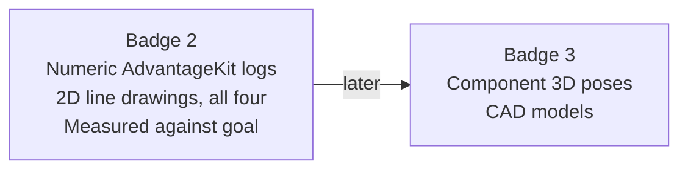

## Position Feedback Scope

Badge 2 mechanisms use motor-relative position feedback and a documented starting reference.
Do not add CANcoder or other absolute-position sensor implementations, magnet-offset setup,
or remote, fused, or synchronized absolute feedback. Those tasks belong to
[Badge 3: Pivot Reference, Limits, and Profiles](/badges/badge-3-pivot).
The supplied swerve template retains its steering sensors; this boundary applies to the
mechanism library the student builds.

For the CTRE pivot comparison, select the internal motor sensor and the configured reduction.
Set the simulation starting angle explicitly. A configured initial angle does not establish
an unknown physical mechanism's reference. The broader linked examples may include absolute
feedback; leave that branch out of the Badge 2 implementation.

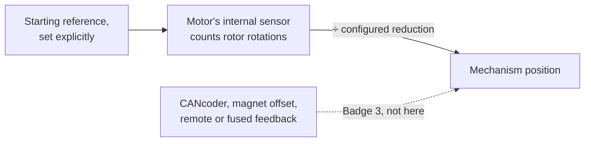

## References to Review

- [Rollers](/frc/roller-example), [Flywheels](/frc/shooter-example), [Pivots](/frc/pivot-example),
  and [Elevators](/frc/elevator-example)
- [Units and Interpolation](/frc/math-toolbox-units-and-interpolation#the-units-library)
- [Feedforward](/frc/feedforward), [PID Control](/frc/pid-control), and
  [Trapezoidal Motion Profiling](/frc/trapezoidal-motion-profiling)
- [Why Motion Magic](/frc/why-motion-magic), [Control Requests](/frc/control-requests), and
  [TalonFX Simulation](/frc/talonfx-simulation)

The reference catalog includes broader implementations. The required work on this page selects the
parts used by Badge 2. Torque-current control and independent characterization belong to Badge 3.

## Library Contract

Each family under `org/<name>/mechanisms/<family>/` contains a component, an IO interface, an
`@AutoLog` inputs class, configuration records, a general simulation, and a focused test. The
component owns goals, limits, readiness, and logging. The IO owns measurements, actuator requests,
and the selected control implementation. Each input snapshot is processed by AdvantageKit before the
component reads it.

The parent subsystem supplies a log path and calls the component once per robot loop. The same
public methods serve REAL, SIM, and REPLAY. Only the constructor selection changes. In Bench REAL
mode, only the selected mechanism gets the selected motor's IO; unselected components use empty IO.
All four general models run in SIM, and every component uses empty IO in REPLAY. Construct those
choices explicitly in `RobotContainer`.

The pivot family shows the shape every family repeats. Only the subsystem is scheduled; the
component behind it never sees which IO it was given.

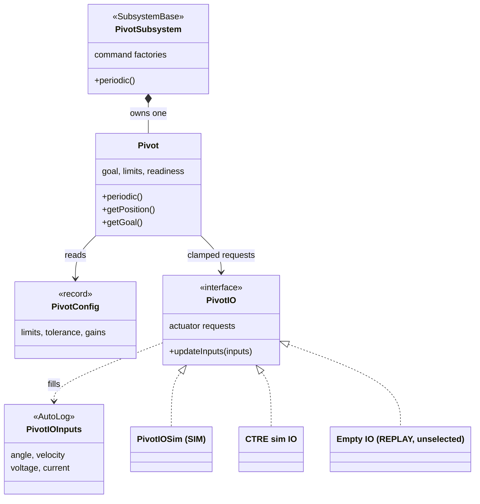

One robot loop runs in a fixed order. The component reads its inputs only after AdvantageKit has
processed them, so REPLAY sees the same values the robot logged. The button's command runs after
every subsystem's `periodic()`, and its goal passes through the component's clamp on the way to
the IO.

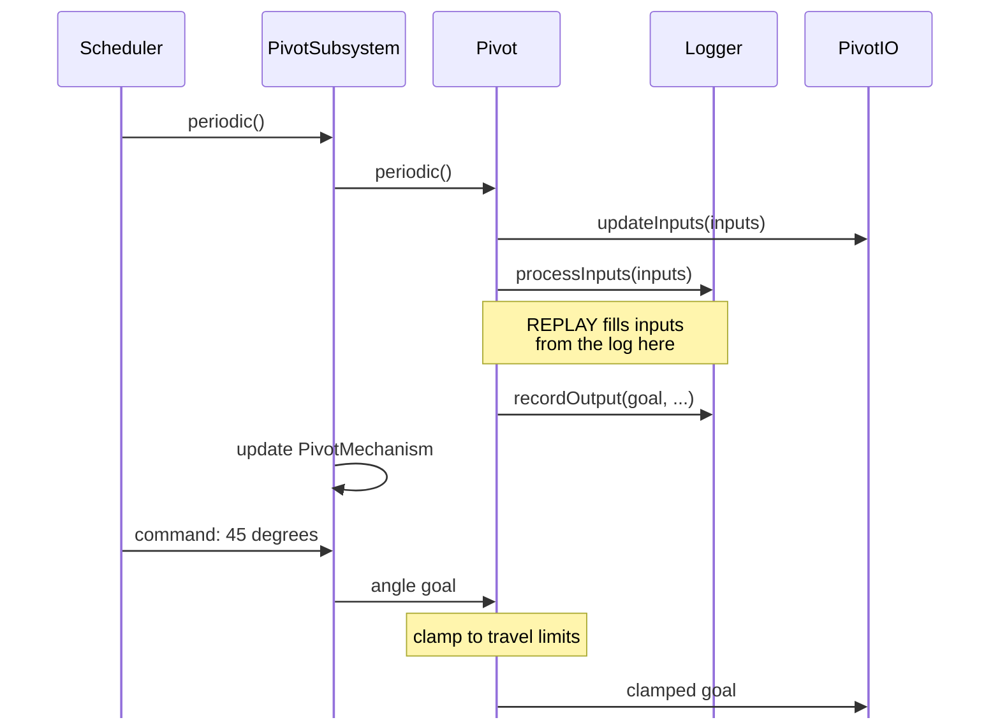

## Reuse the Configuration Pattern

Extend the
[motor configuration pattern from Step 7](/badges/badge-2-first-mechanism#configuration-to-hardware)
as each family is added. Keep controller-specific records for settings whose meaning depends on the
vendor. Reuse a shared value record only when its units, meaning, and validation agree across the
consumers. The required physical adapter remains the provided-controller roller; this exercise does
not add another hardware port.

Keep mechanism geometry and operating goals separate from device setup. Elevator drum radius, travel
limits, and mass belong with the elevator model or mechanism configuration. CAN identity and
supported controller settings belong with the hardware adapter. Give simulation records their model
parameters and check them in configuration tests before running the model. The student tests changed
configuration values and traces any new setting to the code that consumes it.

Using the elevator as the example, each record feeds only the code that needs its values:

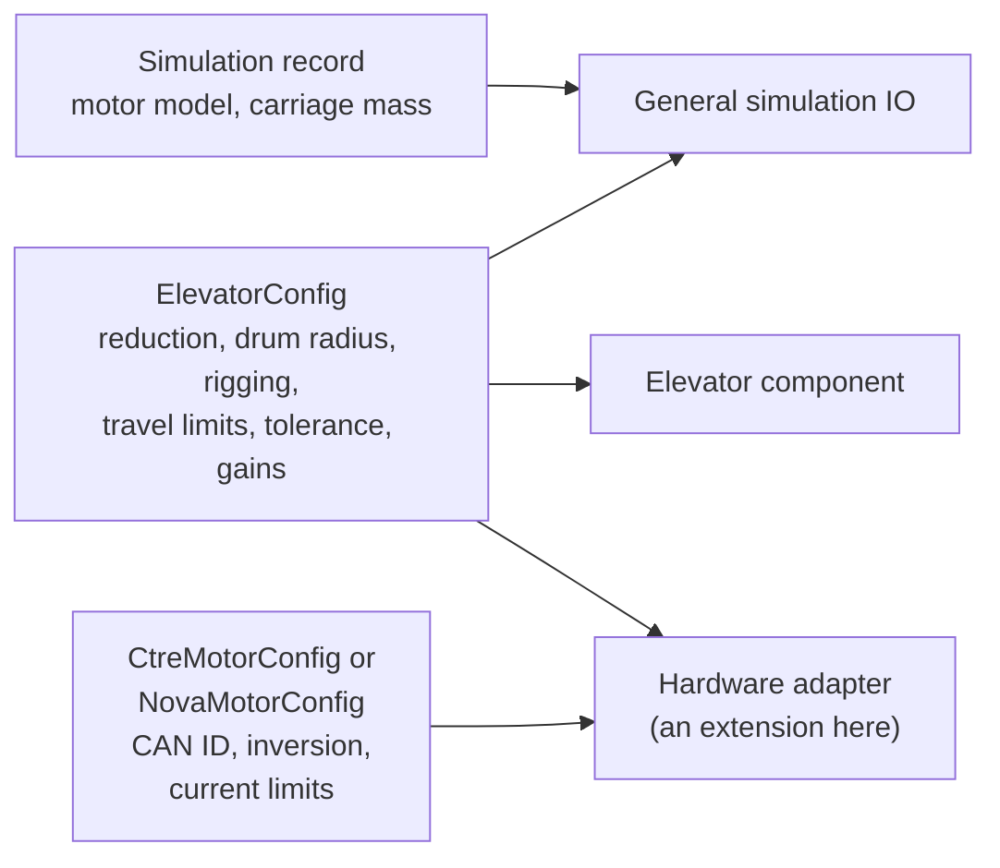

## Cobra2026 Connection

Compare
[`Flywheel.java`](https://github.com/frc4451/Cobra2026Private/blob/main/src/main/java/org/robotzgarage/frc2026/subsystems/flywheel/Flywheel.java),
[`Pivot.java`](https://github.com/frc4451/Cobra2026Private/blob/main/src/main/java/org/robotzgarage/frc2026/subsystems/pivot/Pivot.java)
and
[`Elevator.java`](https://github.com/frc4451/Cobra2026Private/blob/main/src/main/java/org/robotzgarage/frc2026/subsystems/elevator/Elevator.java)
with their shared
[`SingleRoller.java`](https://github.com/frc4451/Cobra2026Private/blob/main/src/main/java/org/robotzgarage/frc2026/subsystems/rollers/single/SingleRoller.java)
base. Identify the quantities each component exposes, its goal and measured state, and the behavior
added for that mechanism. Use the comparison to explain the student's typed contracts; Cobra's
inheritance tree is not an additional badge requirement.

In `ElevatorConfig`, trace `drumRadius` and `drumCircumference()`. Convert the badge's recorded drum
diameter to radius explicitly and independently check the travel calculation. Keep the badge's
physics in the IO layer and its voltage-control baseline; Cobra's component-level simulation and
additional control modes are comparison material.

Cobra's tree, for comparison only:

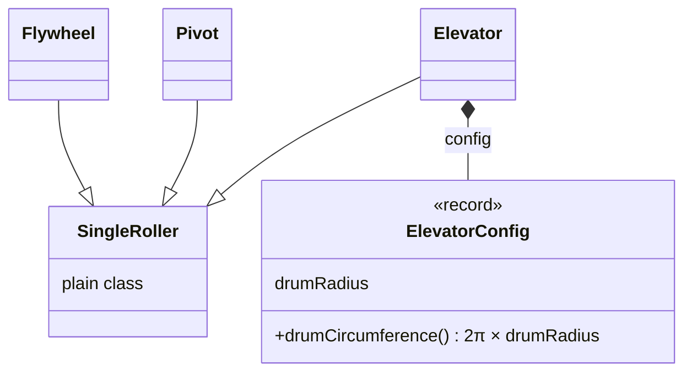

## Typed Mechanism Contracts

| Family | Goal | Measurements | General Model |
| --- | --- | --- | --- |
| Roller | `Voltage` | `Angle`, `AngularVelocity`, voltage and current | `DCMotorSim` |
| Flywheel | `AngularVelocity` | Speed, voltage and current | `FlywheelSim` |
| Pivot | `Angle` | Angle, angular velocity, voltage and current | `SingleJointedArmSim` with gravity |
| Elevator | `Distance` | Height, `LinearVelocity`, voltage and current | `ElevatorSim` with gravity |

Limits and tolerances use the same measurement types as their goals. Gear reduction and rigging
multipliers are dimensionless. Numeric controller gains carry a written unit convention. Conversion
occurs at the numeric model or vendor API boundary.

Before motion tests, the student proves equivalent inputs: 90 degrees and 0.25 rotations produce the
same pivot goal; 1 foot and 12 inches produce the same elevator goal. A second assertion checks the
number sent across the IO boundary. Typed inputs alone do not catch an incorrect conversion inside
the adapter.

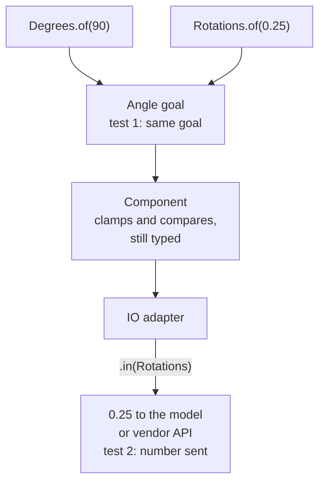

## Bench Integration

Keep global bench selection in `Constants.java`. Each subsystem has a folder and a matching
`RollerConstants`, `FlywheelConstants`, `PivotConstants` or `ElevatorConstants` file. Put the
example button targets directly in `RobotContainer`, as in the solution:

| Port | Mechanism | A | B | X / Y |
| --- | --- | --- | --- | --- |
| 0 | Roller | +3 V | -3 V | Unused |
| 1 | Flywheel | 30 rotations/s | 15 rotations/s | Unused |
| 2 | Pivot | 45 degrees | 15 degrees | -3 V / +3 V |
| 3 | Elevator | 20 in | 8 in | -3 V / +3 V |

Hold one button at a time; release or disable to stop. Commands belong to the subsystem and
bindings belong to `RobotContainer`. Reassign one gamepad between ports in simulation. Pivot and
elevator X/Y exercise manual voltage near both limits. A general physics model's hard stop alone
does not verify a vendor controller's software limit; inspect that separately in its device sim.

The same bindings as a picture. In SIM all four ports are live; in REAL only the mechanism selected
in `Constants.java` gets bindings:

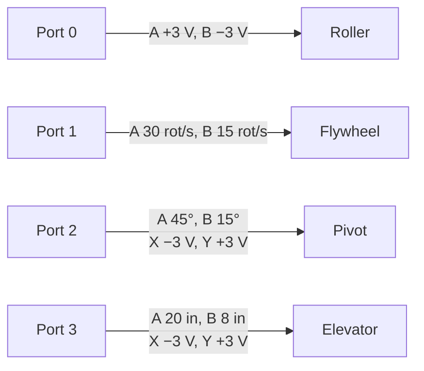

## Component Behavior

The roller retains Step 7's voltage and stop behavior. The flywheel accepts a speed goal and reports
readiness from measured speed within a named tolerance. After a new goal, readiness reflects the new
error. The student plots spin-up and coast-down and distinguishes a requested speed from a measured
speed.

The pivot accepts a bounded angle goal. Its general simulation uses a software motion profile,
voltage-producing feedback, and arm feedforward. The model's geometry and gravity setting match the
chosen axis. The student tests an out-of-range finite goal and both finite travel limits before a
normal move.

The elevator accepts a bounded height goal, reports measured height and velocity, and includes
gravity in its general simulation. Its software profile and feedback produce voltage in the IO
implementation. The student documents the starting reference, positive direction, reduction, loaded
drum radius, mass, and travel limits. A simulated reference is an initial condition; it is not
evidence that a physical elevator has been referenced.

What each family does with a request, and where readiness comes from:

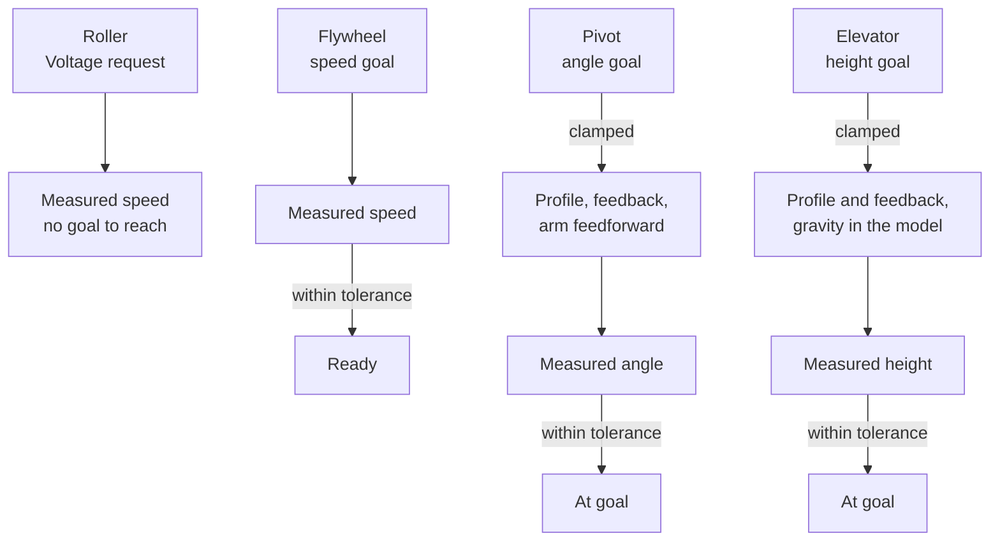

## Software Profile Before Motion Magic

The student first builds a general `PivotIOSim` following
[Trapezoidal Motion Profiling](/frc/trapezoidal-motion-profiling). Each update advances one profile,
calculates voltage from its intermediate reference and measured state, bounds the voltage, advances
the physics once, and publishes the new inputs. The log contains final goal, profile reference, and
measured angle as separate signals.

The student then follows [TalonFX Simulation](/frc/talonfx-simulation) to build one CTRE pivot path
using Talon FXS or Talon FX in simulation. That IO sends `MotionMagicVoltage`; the device generates
the intermediate reference. The student removes the external software profile from that selected
path and keeps the same component goals. The selected CTRE pivot can run without that controller
attached.

The component and its clamped goal stay the same in both paths. What moves is the owner of the
intermediate reference.

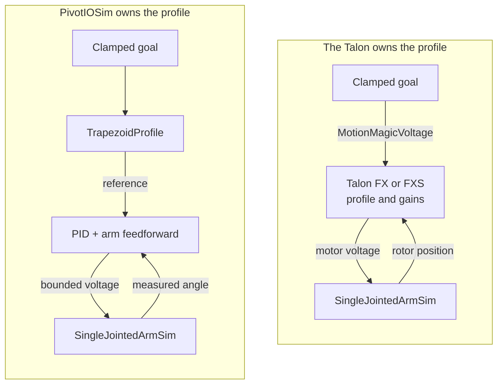

The vendor comparison retains the supply, motor-voltage, rotor-feedback, direction and ratio
checks. Use one synchronous IO update owner with `TimedRobot.kDefaultPeriod` for the Badge 2
baseline. Device tests must also allow Phoenix communication and status refresh to run, and close
the devices afterward. Notifier-based mechanism updates belong to Badge 3.

Motion Magic is a CTRE capability. A Nova hardware adapter is not expected to implement it. A
student using Nova for the physical roller still completes this separate simulation comparison and
explains the difference in ownership.

Keep numeric configuration assertions in tests and preserve normal goal clamping in the component.
Test finite requests below and above the travel range, accepted clamped goals and measured
readiness. Do not add handwritten throwing validators to robot-callable methods. Lombok-generated
null checks on records remain allowed; typed measures alone do not guarantee finite values.

## Voltage Control

Badge 2 requests voltage in its general control loops and uses `MotionMagicVoltage` for the CTRE
profile comparison. The provided-controller roller preserves that typed voltage contract using the
adapter explained in Step 7. Its Nova route sends volts through ThriftyLib's native voltage control.
Torque-current control is introduced in Badge 3.

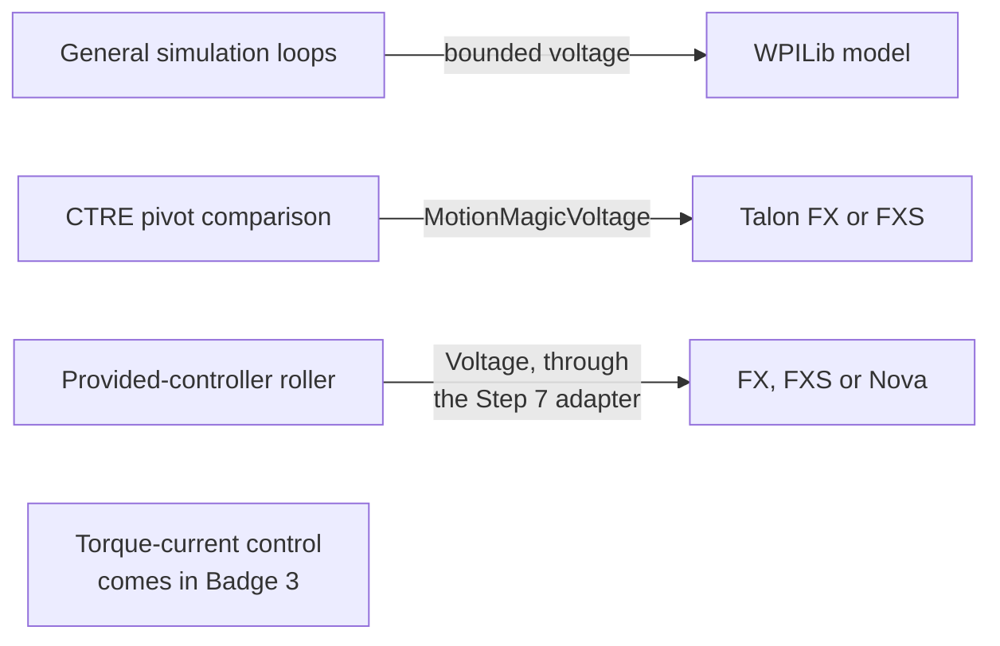

## Elevator Conversion

The [Elevators](/frc/elevator-example) lesson provides the worked conversion. The student
distinguishes motor rotor revolutions, drum revolutions, cable travel, and carriage travel. Let
<Equation tex="N" /> be motor revolutions, <Equation tex="G" /> be motor revolutions per drum
revolution, <Equation tex="D" /> be effective drum diameter in inches, and <Equation tex="S" /> be
carriage travel divided by cable travel. Carriage displacement <Equation tex="h" /> in inches is:

<Equation display tex="h = \frac{N}{G}\,\pi D\,S" />

This equation assumes constant effective diameter and no slip. For direct rigging,
<Equation tex="S=1" />. Ten motor revolutions through a 10:1 reduction turn the drum once. With a
2 in diameter, carriage travel is approximately 6.28 in. These values are a calculation example,
not the physical fixture's settings.

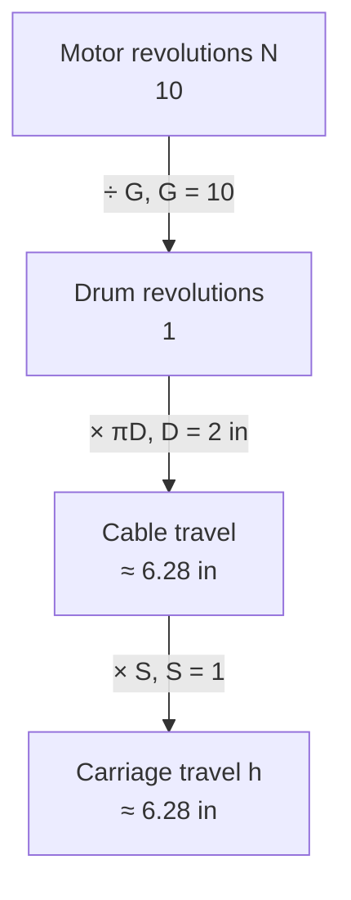

<Equation tex="S" /> is the rigging factor, `riggingFactor` in `ElevatorConfig`. With direct
rigging the carriage is tied to the cable and moves as far as the cable, so
<Equation tex="S=1" />. A moving pulley that halves carriage travel has <Equation tex="S=0.5" />. A
cascade moves the top stage farther than the cable; raise the carriage a known distance, measure
the cable wound onto the drum, and record the ratio instead of assuming it.

Write configuration values in inches with typed measures, such as `Inches.of(1)` for the drum
radius. WPILib's geometry-based `ElevatorSim` constructor accepts drum radius in metres, so convert
once at that call with `.in(Meters)`. The student converts diameter to radius once, with
<Equation tex="r=D/2" />, and identifies that value in the model configuration. The motor rotor's
diameter is not the drum diameter. A belt pulley uses its effective pitch diameter; a wound cable
uses its loaded drum diameter.

The student predicts and tests three separate changes: double diameter, double reduction, and change
the rigging multiplier. For the same motor revolutions, doubling diameter doubles travel; doubling
reduction halves travel. The rigging multiplier describes carriage motion relative to cable motion.
It also changes the load seen at the drum, so changing a distance conversion alone is not a complete
new physics model.

The required dynamic simulation uses direct rigging. Other rigging layouts are checked with
conversion calculations; extending the physics to them requires a consistent load and travel model.
The student also explains why cable building up in layers changes effective diameter and can make a
constant conversion inaccurate.

## Establish a Simulation Baseline

A baseline is a saved configuration that completes a stated test. The mentor helps establish it
before the student compares changes.

1. The student records motor model, reduction, inertia or mass, dimensions, gravity, reference,
   supply, and travel range. A bounded open-loop check establishes direction and conversion first.
2. The student and mentor select a reachable goal, tolerance, and maximum test time. Position moves
   start with conservative profile velocity and acceleration. Initial integral gain is zero.
3. Following [Feedforward](/frc/feedforward), the student identifies the effort needed for motion or
   gravity. Flywheel feedforward relates voltage to speed; arm and elevator feedforward account for
   their different gravity behavior. Gains use the units of the selected loop.
4. The mentor helps add proportional feedback. The student compares goal, profile reference where
   present, measured response, voltage, and current. Enable state, direction, units, gravity, and
   output saturation are checked before changing gains.
5. The student saves the configuration and passing log. A change to gearing, diameter, mass, or
   inertia requires another baseline check. General and vendor-controlled simulations may need
   different numeric gains; values are not copied without checking their units.

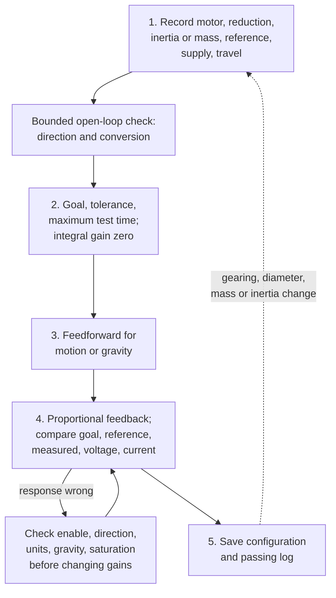

For example, 3 V at 20 rotations per second and 6 V at 40 rotations per second give a two-point
slope of 0.15 V per rotation per second. That is an illustrative starting estimate from steady,
unsaturated samples. Independent characterization and performance refinement come in Badge 3.

## The Math Behind PID

The student and mentor use a fixed position setpoint to discuss two calculations from
[PID Control](/frc/pid-control#the-three-terms). Error is requested position minus measured
position.

- Error falling from +8 in to +4 in in 0.5 s has an average rate of minus 8 in/s. For a positive D
  gain, that decreasing error gives a negative D contribution.
- Error staying at +4 in for 2 s adds +8 inch-seconds to an accumulation that starts at zero.
  Later zero error stops further accumulation but does not erase the stored amount.

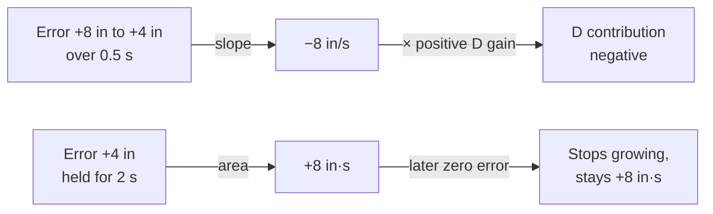

The student explains the signs and units beside an existing mechanism graph. These are guided
calculations, not instructions to enable I or D. Formal derivatives, integrals, and the worksheet
remain in Badge 3. The student saves a timestamped elevator log with setpoint, position, and
velocity for that later application.

## Read the Four Mechanisms in 2D

Building these visualizations is required student work. Implement a small `LoggedMechanism2d`
drawing for each family in your `Badge2Bench`: roller, flywheel, pivot and elevator. The finished
solution is a reference for comparison; opening its drawings alone does not complete this task.
You may share a spinner drawing helper between roller and flywheel, but wire and verify both.

A canvas contains
roots (fixed attachment points) and ligaments (lines with lengths and angles). Read
[What a Mechanism Drawing Shows](/frc/what-a-mechanism-drawing-shows) and
[Measured Against Goal](/frc/measured-against-goal). Use line drawings only. Component 3D poses,
CAD models and mounting transforms belong to Badge 3.

| Family | Measured drawing | Goal display |
| --- | --- | --- |
| Roller | A four-spoke spinner driven by measured speed; a signed speed bar. | None: its command requests voltage, not a position or speed target. Plot requested voltage beside measured speed. |
| Flywheel | The same measured-speed spinner and thin speed bar. | A wider speed bar shows the active velocity goal. Both bars use the same scale. |
| Pivot | A thin arm at the measured angle. | A wider arm at the accepted position goal, after clamping. |
| Elevator | A thin vertical line with length equal to measured height. | A wider line with length equal to the accepted height goal. |

Keep names and line widths distinct as well as colors. In the reference, measured lines are blue
and goal lines are gray. Spinner spokes turn orange for negative speed and gray near zero;
the speed bar points left for negative speed and right for positive speed. The animation runs at
5 percent of measured speed so a fast wheel is readable. Its phase is display animation, not an
encoder-position measurement. Speed bars reach full length at 60 rotations per second and saturate
visually beyond that; numeric plots retain the actual values. These display choices never limit
motor output. Keep the display radius, speed scale and animation factor in the subsystem constants.

The subsystem updates its drawing immediately after the component's normal `periodic()` call:

```java
this.pivot.periodic();
this.mechanism.update(this.pivot.getPosition(), this.pivot.getGoal());
Logger.recordOutput("Pivot/Mechanism2d", this.mechanism.getMechanism());
```

Name the visualization classes `RollerMechanism`, `FlywheelMechanism`, `PivotMechanism` and
`ElevatorMechanism`, and place them in `org.robotzgarage.frc2027.mechanisms.visualizations`, inside
the `mechanisms` package. Pass display dimensions and scales from each subsystem's constants into
the visualization constructor; reusable visualization code must not import robot-specific constants.
Use `mechanism` for the visualization field and `roller`, `flywheel`, `pivot` or `elevator` for the
controlled component.

In [Step 9](/badges/badge-2-mechanism-composition), reuse these helpers in `Badge2Swerve`.
Each superstructure gets a local visualizer beside its behavior and constants files, such as
`CobraIntakeMechanism.java`. That class constructs the component views and handles visualization
logging, while the parent supplies processed measurements and active goals. Build the parent
behavior first, then its visualization; do not duplicate the reusable drawing logic.

This snippet is the pivot path. Elevator uses typed distance; spinners use typed angular velocity.
The drawing reads processed IO inputs in REAL, SIM and REPLAY. It never constructs a controller,
advances physics or calls the component a second time. Schematic drawing dimensions are separate
from physical gearing and dimensions. On a bare-motor bench, the pivot/elevator picture represents
the configured encoder conversion, not proof of an attached arm or carriage.

The pivot path from input to screen. The other three families follow the same path with their own
measured and goal lines:

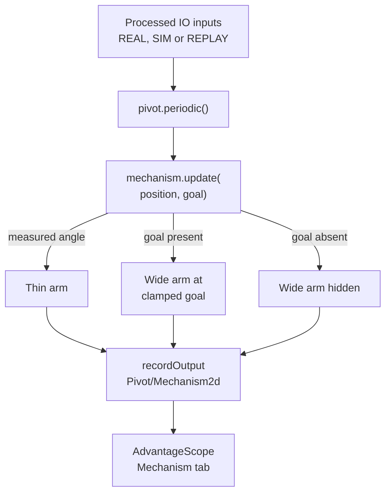

### Build and submit your drawings

1. Create the canvas, roots and lines for each family using the table above. Choose names and
   dimensions, and store display constants with the owning subsystem.
2. Implement the update methods using typed measurements. Add goal indicators only where the
   mechanism has a goal, and hide them when that goal is absent.
3. Connect each drawing to its subsystem's processed inputs and log it from `periodic()`. Keep
   animation separate from motor control and physics.
4. Write the drawing tests described below, then run your implementation in simulation and save
   a log demonstrating each family.
5. Link your drawing classes, subsystem update calls, tests, saved log and AdvantageScope layout
   or viewing instructions in your project README. Include a paused measured-versus-goal comparison.

During review, trace one measurement from IO through your update method to a line in the saved
log. Explain which values set its angle or length and how an inactive goal is hidden. In Step 9,
you will reuse these helpers in the three local superstructure visualizers.

### Compare a request with a measurement

Use the reference bench's Driver Station ports: roller 0, flywheel 1, pivot 2 and elevator 3.
SIM provides all four; REAL operates only the mechanism selected before deployment. Moving a
gamepad between ports does not change the deployed mechanism. Use the bindings visible in
RobotContainer, with one exercise button pressed at a time.

1. Hold roller A for positive voltage and B for reverse. Explain the spinner direction and the
   measured coast-down after release. A stopped command does not imply zero measured speed.
2. Hold flywheel A for 30 rotations per second, then release and hold B for 15. Compare the wider
   goal bar with the measured bar during spin-up. The spinner must remain still if measured speed
   is zero even when a nonzero goal is requested. Readiness comes from the measured tolerance check,
   not from the animation or an elapsed timer.
3. Hold pivot A for 45 degrees or B for 15 degrees. Hold elevator A for 20 inches or B for
   8 inches. Pause during motion and explain why the goal line can lead the measured line. These
   are positions relative to the startup reference, not an additional move per button press.
4. Release or disable. The goal indicator disappears after the next periodic update, while the
   measured drawing remains. For pivot/elevator, X requests -3 V and Y requests +3 V; these manual
   voltage commands also clear the position goal. Hiding a goal does not establish a gravity hold.
5. Repeat a position request outside configured travel in a test. Draw the accepted clamped goal,
   and use the numeric clamp status to explain why it differs from the original request. A drawing
   reaching its endpoint does not prove the vendor's software limit blocked manual voltage.

### Inspect a saved log

Open the saved WPILOG in AdvantageScope and add a Mechanism tab. Select the output under
`RealOutputs/Roller/Mechanism2d`, `Flywheel/Mechanism2d`, `Pivot/Mechanism2d`, or
`Elevator/Mechanism2d`, using the matching RealOutputs prefix. Display numeric velocity or position,
goal, mode and requested output at the same timestamp. Save the log, layout or reproduction steps,
and one paused view showing measured-versus-goal lag.

In the drawing tests, provide a measurement and a deliberately different goal, then inspect the
serialized line angles, lengths and goal visibility. Include an absent goal and reverse spinner
motion. Test the actual controller bindings separately. No SmartDashboard command widgets are
needed; controllers operate the bench and AdvantageScope displays the evidence.

Playing a saved log and rerunning code with replayed inputs are different operations. The first
shows recorded outputs. The second regenerates outputs from the code's current state and replayed
inputs; it must not create another physics model. Preserve the source revision and log paths with
replay evidence. Badge 3 extends this foundation into robot-specific reference checks and component
3D/CAD visualization.

## Simulation Checks

For every required family, tests use the public measurement path, check direction and conversion,
and exercise its relevant goal and limit behavior. All active models report current to one battery
owner. REPLAY constructs no motor, physics model, or notifier. The capability table distinguishes
general simulations, the FX and FXS roller device simulations, SimThriftyNova physics adapter,
selected CTRE pivot simulation, and physical FX, FXS or Nova roller, and unimplemented extensions.

The one battery owner in SIM:

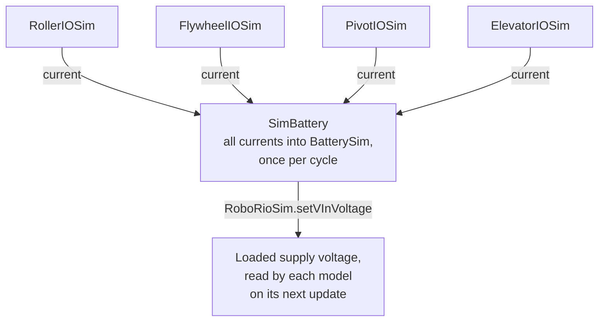

## Rows

| # | Work | Done When |
| --- | --- | --- |
| 7.1 | Roller | The Step 7 simulation, provided-controller IO, physical evidence, and run/stop tests remain passing. |
| 7.2 | Flywheel | The general simulation reaches a speed goal; tests check readiness within tolerance and after a changed goal. |
| 7.3 | Pivot | The general simulation follows a software profile with gravity; tests check finite out-of-range goals, both limits, direction, and measured readiness. |
| 7.4 | Elevator | A working `ElevatorSim` uses direct rigging, gravity, diameter-to-radius conversion, and a software-controlled height goal; tests prove conversion and both limits. |
| 7.6 | Vendor profile comparison | One CTRE pivot simulation compares `MotionMagicVoltage` with the software profile, with documented update ownership and cleanup. |
| 7.8 | Direction and conversion | Each family records positive direction, units, reduction, and expected conversion results; the elevator includes diameter and rigging predictions. |
| 7.9 | Capability table | Every required component, IO, simulation, and test is named; physical and simulated evidence are identified separately. |
| 7.10 | Typed interfaces | All four contracts use typed goals, measurements, limits, and tolerances; equivalent-unit and IO-boundary checks pass. |
| 7.11 | Software profile first | Goal, intermediate reference, and measurement are logged separately before the CTRE comparison. |
| 7.12 | Reproducible baselines | Each closed-loop model has saved configuration, goal, tolerance, test result, and log; the elevator log includes timestamps, height, velocity, and setpoint. |
| 7.13 | Build four mechanism drawings | The student implements and tests a logged 2D line drawing for each family, links the source and evidence in the README, and traces a measured input to its displayed line. Pivot/elevator show accepted position goals, flywheel shows a speed goal, and roller has no invented goal. Tests check distinct values and absent-goal visibility; a saved log is compared with numeric plots. |

The linear rail and the full FXS simulation matrix are not part of the required path. Additional
controller implementations remain available as extensions. A physical elevator demonstration is
optional.

## Badge Check

<StepsBox title="Mechanism Library Badge Check">

1. The student builds from a clean clone and runs the four families' tests.
2. The mentor selects one goal and asks the student to predict the result and explain the measured
   response.
3. The student calculates elevator travel from motor rotations, changes diameter or reduction, and
   verifies the prediction. The student identifies the radius passed to `ElevatorSim`.
4. The student shows the software-profiled pivot and the CTRE comparison, naming the profile owner
   in each.
5. The student explains one goal-clamping or limit test and shows the saved baseline and elevator
   log.
6. The mentor selects a capability-table entry. The student identifies what was tested in
   simulation, what was demonstrated physically, and what remains an extension.

7. The student shows the code they built for all four 2D drawings, traces a measured input to a
   displayed line, explains a measured/goal mismatch, and shows release,
   manual voltage and disable behavior. No component 3D drawing is required.

</StepsBox>

<Sources items={[
  {"source": "cobra", "path": "src/main/java/org/robotzgarage/frc2026/subsystems/flywheel/Flywheel.java", "note": "Implementation reading for the Cobra2026 comparison in this lesson."},
  {"source": "cobra", "path": "src/main/java/org/robotzgarage/frc2026/subsystems/pivot/Pivot.java", "note": "Implementation reading for the Cobra2026 comparison in this lesson."},
  {"source": "cobra", "path": "src/main/java/org/robotzgarage/frc2026/subsystems/elevator/Elevator.java", "note": "Implementation reading for the Cobra2026 comparison in this lesson."},
  {"source": "cobra", "path": "src/main/java/org/robotzgarage/frc2026/subsystems/rollers/single/SingleRoller.java", "note": "Implementation reading for the Cobra2026 comparison in this lesson."},
  {
    "source": "wpilib",
    "path": "docs/software/wpilib-tools/robot-simulation/physics-sim.html",
    "note": "General motor, flywheel, arm and elevator models."
  },
  {
    "source": "wpilib-javadoc",
    "path": "edu/wpi/first/wpilibj/simulation/ElevatorSim.html",
    "note": "Drum radius, gearing, mass, gravity, limits and measured outputs."
  },
  {
    "source": "wpilib",
    "path": "docs/software/advanced-controls/controllers/feedforward.html",
    "note": "Feedforward model and gain units."
  },
  {
    "source": "wpilib",
    "path": "docs/software/advanced-controls/controllers/trapezoidal-profiles.html",
    "note": "Software motion-profile states and constraints."
  },
  {
    "source": "ctre",
    "path": "docs/api-reference/device-specific/talonfx/motion-magic.html",
    "note": "Device-generated Motion Magic profiles."
  },
  {
    "source": "ctre",
    "path": "docs/api-reference/simulation/simulation-intro.html",
    "note": "Vendor simulation exchange and timing."
  },
  {
    "source": "advantagekit",
    "path": "data-flow/recording-inputs/io-interfaces/",
    "note": "Logging and replay across the common IO boundary; processInputs records inputs, or fills them from the log in replay, right after updateInputs (the loop diagram)."
  },
  {
    "source": "wpilib",
    "path": "docs/software/commandbased/command-scheduler.html",
    "note": "Subsystem periodic methods run before scheduled commands execute, the order in the loop diagram."
  }
]} />
