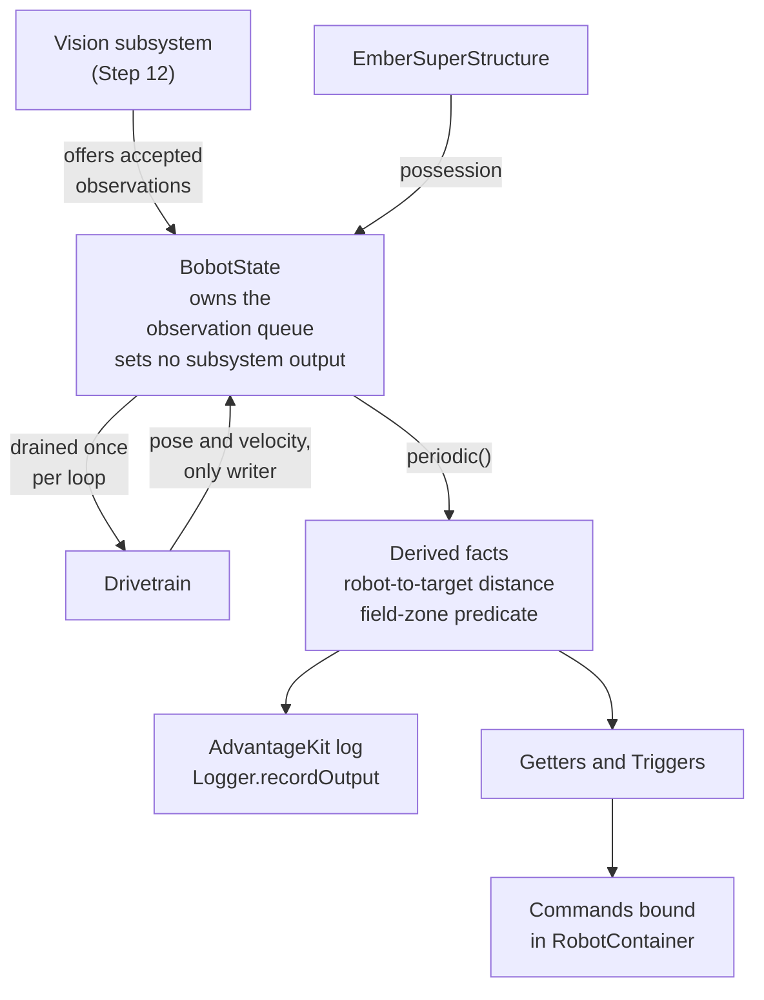
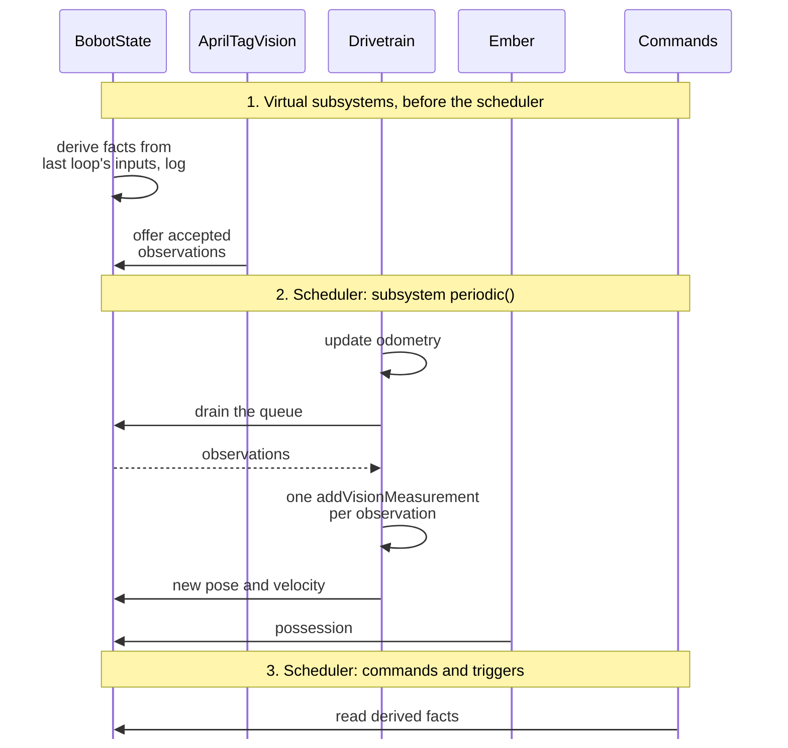

In Step 13, the student builds one deliberately shared object in `Badge2Swerve`: a
`BobotState`-style class that stores robot-wide observations and derived facts. It holds the pose,
velocity, the vision observation queue started in Step 12, at least one target-relative calculation,
and at least one field-zone predicate. It exposes them through narrow getters, records, and
`Trigger`s.

The ownership follows Cobra's `BobotState`. `BobotState` owns the observation queue; the vision
subsystem adds to it only through a `BobotState` method, and the drivetrain is the only class that
drains it. The drivetrain is also the only writer of the pose it estimates. Other mutable
collections are copied on entry with `List.copyOf`, and getters return the stored unmodifiable
snapshot instead of the caller's list. A record with another mutable component makes a defensive
copy in its constructor and accessor. `BobotState` does not own a motor, component, or subsystem,
and nothing calls it to set an output. Subsystems keep their local state (the intake's deployment,
the flywheel's readiness), while `BobotState` may combine those facts into a derived readiness
condition without setting their motors.

## References to Review

- [BobotState](/frc/bobot-state)
- [VirtualSubsystem](/frc/virtual-subsystem)
- [VARC](/frc/varc)
- [Lombok](/frc/lombok)
- [Why State Machines](/frc/why-state-machines)
- [Enums and Records: Shallow Immutability](/java/fundamentals/enums-and-records#shallow-immutability)
  and the `copyOf` row of
  [Factory Methods: Naming Conventions](/java/fundamentals/factory-methods#naming-conventions), for
  the collection check below

## Check Collection Ownership

The student passes a mutable list of observation records to a small test object, stores a
`List.copyOf` snapshot, and then changes the caller's list. The stored snapshot should keep its
original entries. The student also verifies that callers cannot add entries through the returned
snapshot. This protects the list structure; a record containing mutable data still needs its own
defensive copies. The student applies that distinction to the observation types before adding them
to `BobotState`.

## Cobra2026 Connection

Start with
[`BobotState.java`](https://github.com/frc4451/Cobra2026Private/blob/main/src/main/java/frc/robot/bobot_state/BobotState.java):
find the observation queues, offer methods, pose state and derived decisions. Then follow a queue
drain and pose write in
[`Drive.java`](https://github.com/frc4451/Cobra2026Private/blob/main/src/main/java/frc/robot/subsystems/drive/Drive.java).
This shows the distinction between publishing an observation, consuming it once and exposing the
resulting robot state.

Cobra exposes queue getters and several estimation paths. The badge deliberately narrows that
interface: keep the queue private and permit only the drivetrain to drain it. Copying a public
mutable queue would lose that ownership boundary. Read
[`VirtualSubsystem.java`](https://github.com/frc4451/Cobra2026Private/blob/main/src/main/java/org/robotzgarage/frc2026/util/VirtualSubsystem.java)
and its invocation in
[`Robot.java`](https://github.com/frc4451/Cobra2026Private/blob/main/src/main/java/frc/robot/Robot.java)
to confirm when shared state and vision update relative to the scheduler. The badge does not require
Cobra's targeting or object-detection systems.

## Guided Example

Start with estimated pose and one fixed field target. Derive the robot-to-target distance once per
loop, log the value, expose it through a narrow getter, and build one `Trigger` from a stated range
condition.

### Construct Once, Publish from Components

Construct `new BobotState()` once in `RobotContainer`, before constructing `AprilTagVision`. As in
Cobra, the constructor takes no subsystem, supplier or callback arguments. Components publish
observations through static setters; other components and commands use static getters. No writer
handle is needed.

```java
// In Drive.periodic(), after applying odometry and accepted vision:
BobotState.setFieldToRobot(this.getPose());
BobotState.setRobotRelativeSpeeds(this.getChassisSpeeds());
BobotState.setLastAppliedObservations(applied);

// In EmberSuperStructure.periodic(), after Logger.processInputs:
BobotState.setShooterHasPiece(this.hasPiece());
```

These are partial snippets in their owning subsystems. `AprilTagVision` supplies accepted
observations through `BobotState::offerVisionObservation`; Drive calls
`BobotState.drainVisionObservations()` once per loop. Use `@Getter` and `@Setter` on shared
immutable values such as pose and possession. Copy mutable velocity values and observation lists at
the boundary. Derived targeting facts have getters only. The responsible publisher for each field is
a code convention, not an exclusive runtime handle.

### What the Object Does

Once per robot loop, through the [`VirtualSubsystem`](/frc/virtual-subsystem#the-class) pattern, the
Badge 2 `BobotState`:

- receives the current estimated pose and the robot-relative or field-relative velocity from the
  drivetrain, which is the only writer of the pose;
- owns the vision observation queue from Step 12: the vision subsystem offers each accepted
  observation through a `BobotState` method, and the drivetrain drains the queue into its pose
  estimator;
- calculates at least one target-relative transform or distance
  (`fieldToHub.relativeTo(fieldToRobot)` and its translation's `getNorm()`, in the
  [VARC](/frc/varc#what-a-varc-holds) shape);
- calculates at least one field-zone predicate (inside the alliance zone, within shooting range of
  the hub);
- copies other mutable inputs on entry and exposes only narrow values or unmodifiable snapshots,
  never a caller-owned mutable collection;
- publishes the derived values to AdvantageKit logs with `Logger.recordOutput`;
- provides one or more `Trigger`s built on derived facts, for `RobotContainer` to bind;
- makes no motor, component or subsystem output call.

The diagram shows who writes into `BobotState`, which class drains its observation queue, and
where the derived facts go.



One loop runs in this order, as the [BobotState lesson](/frc/bobot-state#the-flow-through-one-loop)
describes for Cobra:

1. `VirtualSubsystem.periodicAll()` (Cobra's `runPeriodically()`) runs before the scheduler, in the
   order the instances were constructed. Construct `BobotState` before `AprilTagVision`:
   `BobotState.periodic()` recomputes its derived facts from the previous loop's published pose and
   possession, then logs them; next the vision subsystem from Step 12 processes its cameras and
   offers accepted observations to the `BobotState` queue.
2. The scheduler runs subsystem `periodic()` methods. The drivetrain updates odometry, drains the
   queue into its pose estimator with one `addVisionMeasurement` per observation, and writes the new
   pose and velocity into `BobotState`. Ember publishes possession from its processed inputs in
   its own `periodic()`, including false when possession is absent or invalid.
3. The scheduler runs commands and polls triggers, which read the derived facts.

The same loop drawn as calls. `BobotState` derives its facts before the drivetrain writes the new
pose, so the commands in phase 3 read facts computed from the previous loop's pose.



The [Why State Machines](/frc/why-state-machines) lesson explains where a full state-driven
superstructure would take this next. Badge 2 stops before it: the object derives facts, and commands
and triggers decide what to request.

### Lombok Applied on Purpose

Step 5 added Lombok to the project. Here it is used where it removes routine code without hiding a
decision:

- `@Builder` constructs immutable configuration or observation records.
- `@Getter` exposes read-only derived state.
- `@NonNull` guards required construction inputs.
- Use field-level `@Setter` for published inputs, including pose and shooter possession. Derived
  facts remain read-only; mutable inputs use copying setters and getters.
- The project builds, the student explains which methods Lombok supplies, and tests demonstrate
  generated null checks through the builder, with numeric configuration assertions in tests.

## Independent Change

Add one field-zone predicate chosen for the student's simulated route and bind its trigger to a
command on a Step 9 subsystem. The student chooses the zone boundary, logs the inputs and result,
and verifies the transition in simulation.

Bind the trigger for teleop only, for example `inZone.and(RobotModeTriggers.teleop()).onTrue(...)`.
An autonomous composition may already require the Step 9 subsystems its child commands use. A
trigger that schedules another command on one of those subsystems during autonomous interrupts the
whole routine. The [capstone](/badges/badge-2-capstone#capstone-requirements) uses the fact inside
the routine instead.

| # | Work | Lesson | Done when |
|---|---|---|---|
| 12.1 | A `VirtualSubsystem` | [VirtualSubsystem](/frc/virtual-subsystem#writing-one) | `BobotState extends` the `VirtualSubsystem` base class from Step 12, is constructed once with no arguments before `AprilTagVision`, and its `periodic()` runs every loop before the vision subsystem and the command scheduler's subsystems |
| 12.2 | Pose and velocity in | [BobotState](/frc/bobot-state#the-flow-through-one-loop) | The drivetrain writes the estimated pose and velocity into `BobotState`; no other class writes them |
| 12.3 | Observations in | [BobotState](/frc/bobot-state#the-flow-through-one-loop) | Accepted Step 12 observations are offered to the queue `BobotState` owns through a `BobotState` method; only the drivetrain drains it |
| 12.4 | One target calculation | [VARC](/frc/varc#writing-one) | A distance or transform to a fixed target is recomputed every loop from the current pose and logged |
| 12.5 | One zone predicate | [BobotState](/frc/bobot-state#zones-and-game-logic-as-triggers) | A field-zone predicate is computed from the pose and logged |
| 12.6 | Defensive ownership | [BobotState](/frc/bobot-state#adding-to-it-without-ruining-it) | Other mutable collections are copied on entry, getters return unmodifiable snapshots or individual values, only the drivetrain drains the observation queue, and no method sets a subsystem output |
| 12.7 | Triggers | [BobotState](/frc/bobot-state#zones-and-game-logic-as-triggers) | At least one `Trigger` built on a derived fact is bound in `RobotContainer`, for teleop only, to a command on a Step 9 subsystem |
| 12.8 | Lombok on purpose | [Lombok](/frc/lombok#rules-for-using-it) | `@Builder`, `@Getter` and `@NonNull` appear where the list above allows; the project builds and the student demonstrates the generated API through calls and tests |
| 12.9 | Subsystem state stays home | [Why State Machines](/frc/why-state-machines#when-to-reach-for-it) | Intake deployment and flywheel readiness live in their subsystems; `BobotState` may combine them into a derived readiness fact and does not set their motors |

## Badge Check

The evidence is one trace, in code and in a log.

<StepsBox title="Robot State Badge Check">

1. The student picks one value that starts at a sensor or simulation input (a module encoder, a
   gyro, a simulated camera) and traces it through the IO inputs, the pose estimator, into
   `BobotState`, into a derived fact, into a `Trigger`, and into the command that trigger schedules,
   pointing at each line of code.
2. The student opens a saved log and shows the same trace: the input, the pose, the derived value,
   the trigger's state and the command's start, on one AdvantageScope timeline.
3. The student builds the project and demonstrates a builder call and a generated getter. The
   student explains which validation and ownership decisions remain handwritten.
4. The mentor names a value and asks whether it belongs in `BobotState` or in a subsystem. The
   student answers with the three tests from
   [Adding to it without ruining it](/frc/bobot-state#adding-to-it-without-ruining-it).
5. The mentor asks what happens if a command calls a setter on `BobotState` to "fix" the pose. The
   student explains why the log would stop explaining the robot.

</StepsBox>

<Sources items={[
  {"source": "cobra", "path": "src/main/java/org/robotzgarage/frc2026/util/VirtualSubsystem.java", "note": "Implementation reading for the Cobra2026 comparison in this lesson."},
  {"source": "cobra", "path": "src/main/java/frc/robot/Robot.java", "note": "Implementation reading for the Cobra2026 comparison in this lesson."},
  {"source": "wpilib", "path": "docs/software/commandbased/binding-commands-to-triggers.html", "note": "<code>Trigger</code> objects built from a <code>BooleanSupplier</code> and bound to commands."},
  {"source": "wpilib-javadoc", "path": "edu/wpi/first/wpilibj2/command/button/Trigger.html", "note": "<code>Trigger</code> composition and binding methods."},
  {"source": "java-api", "path": "java.base/java/lang/Record.html", "note": "Records are shallowly immutable carriers; final component references do not make referenced mutable objects deeply immutable."},
  {"source": "java-api", "path": "java.base/java/util/List.html", "note": "<code>List.copyOf</code> creates the unmodifiable snapshots used at the ownership boundary."},
  {"source": "advantagekit", "path": "data-flow/recording-outputs/", "note": "<code>Logger.recordOutput</code> for every derived value."},
  {"url": "https://projectlombok.org/features/GetterSetter", "label": "Project Lombok: @Getter and @Setter", "note": "What the read-only getters generate, and why setters are a design decision."},
  {"url": "https://projectlombok.org/features/NonNull", "label": "Project Lombok: @NonNull", "note": "The null check generated on required construction inputs."},
  {"url": "https://projectlombok.org/features/Builder", "label": "Project Lombok: @Builder", "note": "Builders on immutable records."},
  {"source": "cobra", "path": "src/main/java/frc/robot/bobot_state/BobotState.java", "note": "The ownership this step follows: <code>BobotState</code> owns the observation queues and the global pose, and vision offers through <code>BobotState</code> methods."},
  {"source": "cobra", "path": "src/main/java/frc/robot/subsystems/drive/Drive.java", "note": "The drivetrain as the only class that polls the queues and calls <code>BobotState.setGlobalPose</code>."},
  {"source": "wpilib-javadoc", "path": "edu/wpi/first/wpilibj2/command/button/RobotModeTriggers.html", "note": "<code>RobotModeTriggers.teleop()</code>, used to keep a zone trigger out of autonomous."},
  {"source": "riptide", "path": "src/main/java/frc/robot/bobot_state/BobotState.java", "note": "A public FRC 4451 <code>BobotState</code>: pose, observation queue, target trackers, logged every loop."},
  {"source": "riptide", "path": "src/main/java/frc/robot/bobot_state/varc/TargetAngleTracker.java", "note": "A public per-target calculation recomputed each loop, the shape row 12.4 asks for."},
  {"source": "riptide", "path": "src/main/java/frc/robot/util/VirtualSubsystem.java", "note": "The public <code>VirtualSubsystem</code> base class."},
  {"source": "ember", "path": "src/main/java/frc/robot/bobot_state/BobotState.java", "note": "The first <code>BobotState</code>, where the pattern started."}
]} />
