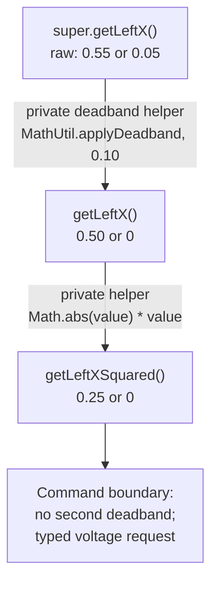
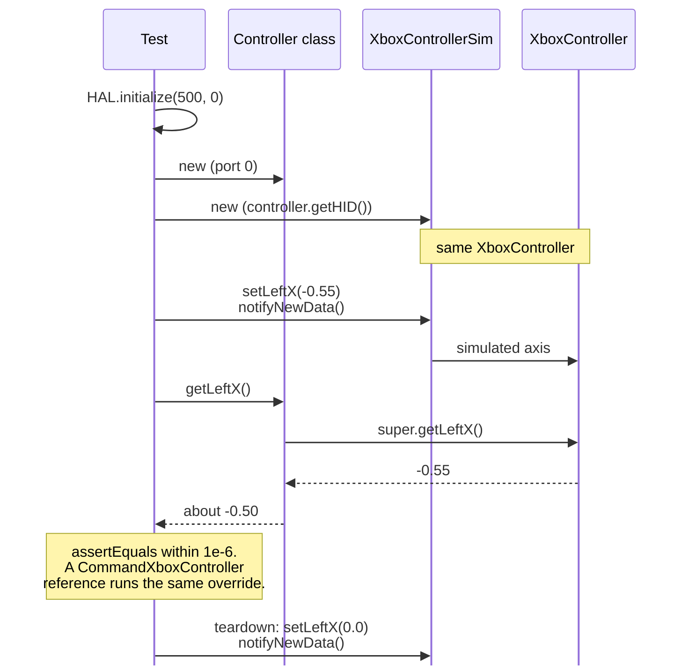

Step 6 adds the first automated tests to `Badge2Bench`, the project where individual mechanisms are
built. These tests exercise pure Java configuration and decision logic, so a failure points to one
rule and runs without a simulated motor controller. The step then builds the student's controller
class in the same project and tests its inputs. Mechanism and HAL simulation tests come later in
[Unit Tests in Simulation](/frc/unit-tests-in-simulation).

## Verify the Test Setup

Open `Badge2Bench/build.gradle` from the Skeleton template recorded in Step 5. AdvantageKit
v26.0.2's templates, the Skeleton included, declare
`testImplementation 'org.junit.jupiter:junit-jupiter:5.10.1'`,
`testRuntimeOnly 'org.junit.platform:junit-platform-launcher'`, and a `test` block that calls
`useJUnitPlatform()`. Confirm those lines remain present. Use the preserved v26.0.2 template's
original `build.gradle` as the source of truth.

Also confirm that `wpi.java.configureTestTasks(test)` remains in the build. WPILib documents that
Java tests live under `src/test/java/`, and Gradle runs them during a normal robot build.

Record the JUnit dependency text and version in the evidence table. This makes the source of the
version reviewable and prevents a later copy from silently introducing a different testing stack.

## Guided Example

Create these two complete files. The package path under `src/main/java/` and `src/test/java/` must
match the package declaration.

`src/main/java/frc/robot/config/MechanismLimits.java`:

```java
package frc.robot.config;

public record MechanismLimits(double minPosition, double maxPosition) {
  public double clamp(double requestedPosition) {
    return Math.max(this.minPosition, Math.min(this.maxPosition, requestedPosition));
  }

  public boolean contains(double position) {
    return position >= this.minPosition && position <= this.maxPosition;
  }
}
```

`src/test/java/frc/robot/config/MechanismLimitsTest.java`:

```java
package frc.robot.config;

import static org.junit.jupiter.api.Assertions.assertEquals;
import static org.junit.jupiter.api.Assertions.assertFalse;
import static org.junit.jupiter.api.Assertions.assertTrue;

import org.junit.jupiter.api.Test;

public class MechanismLimitsTest {
  @Test
  public void keepsValueInsideRange() {
    MechanismLimits limits = new MechanismLimits(0.2, 1.4);

    assertEquals(0.8, limits.clamp(0.8), 1e-9);
  }

  @Test
  public void clampsBothEdges() {
    MechanismLimits limits = new MechanismLimits(0.2, 1.4);

    assertEquals(0.2, limits.clamp(-0.5), 1e-9);
    assertEquals(1.4, limits.clamp(2.0), 1e-9);
  }

  @Test
  public void containsAValueInTheMiddle() {
    assertTrue(new MechanismLimits(0.2, 1.4).contains(0.8));
  }

  @Test
  public void containsBothExactLimits() {
    MechanismLimits limits = new MechanismLimits(0.2, 1.4);
    assertTrue(limits.contains(0.2));
    assertTrue(limits.contains(1.4));
  }

  @Test
  public void excludesAValueAboveTheMaximum() {
    assertFalse(new MechanismLimits(0.2, 1.4).contains(1.41));
  }
}
```

`@Test` marks a method for JUnit to run. `assertEquals(expected, actual, tolerance)` checks a
floating-point result: the expected value comes first, the value returned by the code comes second,
and the tolerance permits a small rounding difference. `assertTrue` and `assertFalse` check
boolean results. These methods use finite values and an ordered range, which configuration tests
verify separately. The robot-callable record clamps requests without throwing exceptions.

Run the tests, then run the build and open `build/reports/tests/test/index.html`. The report should
list five passing tests.

<CodeTabs>
<CodeTab label="PowerShell">

```powershell
.\gradlew.bat test
.\gradlew.bat build
```

</CodeTab>
<CodeTab label="Terminal">

```bash
./gradlew test
./gradlew build
```

</CodeTab>
</CodeTabs>

These tests cover a normal result, both clamp directions, inclusive limits and an outside value.
They check behavior that could change during a refactor; they do not repeat the implementation line
by line.

## Cobra2026 Connection

Use
[`MotorConfigs.java`](https://github.com/frc4451/Cobra2026Private/blob/main/src/main/java/org/robotzgarage/frc2026/util/MotorConfigs.java)
as a code-reading comparison when choosing boundary cases. State the expected rejection or accepted
value before reading the implementation's result; the reference code is not the test oracle. The
student still tests finite values, units and the configured bounds required by this lesson.

The controller exercise below links
[`GarageCommandXboxController.java`](https://github.com/frc4451/Cobra2026Private/blob/main/src/main/java/org/robotzgarage/frc2026/util/GarageCommandXboxController.java).
Trace the inherited axis read, deadband and signed square, then write independent expected results
for the student's smaller controller class. A reference implementation does not replace the
student's tests.

## See a Useful Failure

Temporarily change the upper clamp assertion from `1.4` to `1.3`. Run the tests and read the
failure's expected value, actual value, test method, and source line. Restore `1.4`, run the tests
again, and keep the passing version. The failed run is practice evidence; the incorrect assertion
does not remain in the repository. In PowerShell, use `.\gradlew.bat test`; in macOS or Linux
terminals, use `./gradlew test`.

## Independent Change

Apply the guided assertion patterns to the
[motor configuration record from Step 5](/badges/badge-2-io-and-generated-code#guided-lombok-example).
These tests construct records and builders without constructing an IO implementation or motor
controller. Extend the guided `contains()` checks with a below-minimum case before testing the real
configuration values.

Write tests that prove:

- Direct and builder construction preserve the same valid settings and produce equal records.
- Generated `@NonNull` checks reject missing required reference values where annotated; optional
  defaults produce the documented values.
- The configured device ID matches the fixture and is in range. Do not expect a primitive ID to
  distinguish an omitted builder argument from zero.
- Configured reductions are finite and positive, and current limits are finite, positive and within
  the fixture's approved bounds. Test the records after any default handling.
- The independent setting from Step 5 is preserved and consumed as documented.

Follow the solution's `ConfigurationBoundaryTest`: assertions inspect the actual constants before
deployment. A deliberately invalid configuration should fail a test, not throw from robot runtime
code. Use `assertThrows` only for generated null checks here. Step 2's standalone Java validation
exercise remains separate.

Use expected values taken from the written configuration contract. Give each test a name that states
the behavior it checks. The student explains why a passing record test establishes valid
construction but does not prove that the IO applied the settings. That trace and the physical
evidence follow in Step 7.

## Build a Robot Controller Class

The student recreates a focused part of Cobra's
[GarageCommandXboxController](https://github.com/frc4451/Cobra2026Private/blob/main/src/main/java/org/robotzgarage/frc2026/util/GarageCommandXboxController.java)
in `Badge2Bench`. This connects Java inheritance to a robot behavior the student can operate and
test. Review [Inheritance](/java/fundamentals/inheritance),
[Runtime Polymorphism](/java/fundamentals/runtime-polymorphism), and
[RobotContainer and Bindings](/frc/robot-container-and-bindings) first.

Cobra's class extends `CommandXboxController`, overrides stick getters to apply a deadband, adds
sign-preserving squared getters and stick-motion triggers, changes the default trigger threshold,
and supplies rumble commands. The student builds a smaller `GarageCommandXboxController` in the
project's own utility package, with the three processed stick axes the drivetrains use: left X, left
Y and right X. On swerve, the left stick commands translation and right X commands rotation; on the
Kit Bot, the template's `arcadeDrive` uses left Y for forward and backward and right X for turning.
[Step 7](/badges/badge-2-first-mechanism#extend-the-controller-bindings) adds command bindings and a
configured analog-trigger threshold, and
[Step 9](/badges/badge-2-mechanism-composition) copies the class
into `Badge2Swerve` to drive the chassis. Timed rumble is an optional extension. Right Y and
repeating rumble are also optional.

### Follow One Input

With the mentor, trace Cobra's left-X path from `super.getLeftX()` through the private deadband
helper to `getLeftX()` and `getLeftXSquared()`. A deadband removes small inputs around center;
WPILib's `MathUtil.applyDeadband` also rescales the remaining range. Squaring with
`Math.abs(value) * value` preserves direction while reducing intermediate magnitudes.

The student then writes the corresponding left-X behavior in their own class:

1. Extend `CommandXboxController` and pass the Driver Station port to `super(port)` in the
   constructor. Keep deadband and trigger threshold in named constants or validated constructor
   configuration.
2. Override `getLeftX()` with `@Override`, reading the parent implementation through
   `super.getLeftX()` and applying the deadband once. Calling the overriding method from inside
   itself would recurse.
3. Add `getLeftXSquared()` using the already processed getter and a private sign-preserving helper.
   Keep the raw, deadbanded, and squared values distinguishable in the demonstration; do not apply
   another deadband in the consumer.

Use an illustrative deadband of 0.10 for the check. Raw inputs 0.05 and -0.05 produce zero. Raw
inputs 0.55 and -0.55 produce approximately 0.50 and -0.50 after rescaling, then 0.25 and -0.25
after signed squaring. The values are dimensionless controller inputs; conversion to a mechanism's
typed voltage request belongs at the command boundary.

The left-X path with the illustrative deadband of 0.10, for a raw input of 0.55 and one of 0.05:



### Independent Controller Change

Add the same deadband and signed-squaring behavior for left Y and right X without copying the
complete Cobra class. Use private helpers to keep the shared input policy in one place.

Finally, assign the same controller object to a variable declared as `CommandXboxController`.
Calling `getLeftX()` through that variable still runs the student's override. The student explains
this runtime dispatch and why the added `getLeftXSquared()` method is unavailable through that
declared type without changing the reference type. The mentor then asks which method would need
updating if the deadband changed.

### Show the Inputs

Construct one instance of the controller in `Badge2Bench`'s `RobotContainer` on a documented Driver
Station port. Run **Simulate Robot Code**, use simulated joystick inputs in the Sim GUI, and use
temporary diagnostic output to compare the raw HID value, processed getter, and squared getter.
Demonstrate centered input, both signs, the deadband boundary, and full-scale input on all three
axes. No physical gamepad or mechanism is required. Record the source and observed values in the
README.

## Test the Controller Inputs

Turn the controller demonstration into automated tests. The class under test is the student's
`GarageCommandXboxController` from the section above. These tests read inputs; they do not need
command scheduling or a mechanism model.

`getHID()` returns the `XboxController` the class reads from, and `XboxControllerSim` sets that
controller's simulated axes. Initialize HAL first, as
[Unit Tests in Simulation](/frc/unit-tests-in-simulation#a-command-against-a-paused-clock) does, and
call `notifyNewData()` after setting an axis so the next getter call reads it. This proposed test
shows one axis; the student's package and class names may differ:

```java
package frc.robot.util;

import static org.junit.jupiter.api.Assertions.assertEquals;
import static org.junit.jupiter.api.Assertions.assertTrue;

import edu.wpi.first.hal.HAL;
import edu.wpi.first.wpilibj.simulation.XboxControllerSim;
import edu.wpi.first.wpilibj2.command.button.CommandXboxController;
import org.junit.jupiter.api.AfterEach;
import org.junit.jupiter.api.BeforeEach;
import org.junit.jupiter.api.Test;

public class GarageCommandXboxControllerTest {
  // Simulated axes are stored as float, so exact decimals differ by about 1e-8.
  private static final double TOLERANCE = 1e-6;

  private GarageCommandXboxController controller;
  private XboxControllerSim sim;

  @BeforeEach
  public void setup() {
    assertTrue(HAL.initialize(500, 0));
    this.controller = new GarageCommandXboxController(0);
    this.sim = new XboxControllerSim(this.controller.getHID());
  }

  @AfterEach
  public void teardown() {
    this.sim.setLeftX(0.0);
    this.sim.notifyNewData();
  }

  @Test
  public void leftXAppliesDeadbandThenSignedSquare() {
    this.sim.setLeftX(-0.55);
    this.sim.notifyNewData();

    assertEquals(-0.50, this.controller.getLeftX(), TOLERANCE);
    assertEquals(-0.25, this.controller.getLeftXSquared(), TOLERANCE);
  }

  @Test
  public void parentTypedReferenceRunsTheOverride() {
    CommandXboxController asParent = this.controller;
    this.sim.setLeftX(0.55);
    this.sim.notifyNewData();

    assertEquals(0.50, asParent.getLeftX(), TOLERANCE);
  }
}
```

Check centered input, both signs, the deadband boundary, and full-scale input on each implemented
axis. With deadband 0.10, raw values ±0.55 should yield approximately ±0.50 after deadband and ±0.25
after signed squaring. The tolerance of `1e-9` used for `MechanismLimits` is too tight here because
of the float storage. Restore simulated input state during teardown.

In the proposed test, the simulator and the controller class share one `XboxController`:



Name the tests for the behavior they prove and retain their results in the evidence table. Trigger
scheduling and rumble lifecycle checks follow in
[Step 7](/badges/badge-2-first-mechanism#extend-the-controller-bindings), after commands have a
subsystem to operate.

## Rows

| # | Work | Done when |
|---|---|---|
| 5.1 | Verify JUnit setup | The evidence table records the JUnit Jupiter dependency and version from the preserved template; `useJUnitPlatform()` and `wpi.java.configureTestTasks(test)` remain present |
| 5.2 | Add pure configuration logic | `MechanismLimits.java` contains the clamp and inclusive `contains` behavior; it imports no WPILib or vendor class |
| 5.3 | Test normal and edge behavior | The five supplied tests and the motor configuration tests pass, covering direct/builder equivalence, missing values, reduction, current limits, and the independent setting; numeric bounds are asserted in tests |
| 5.4 | Read a failure and restore it | The student shows the temporary failed result, explains expected versus actual, restores the correct assertion, and shows a passing rerun |
| 5.5 | Keep the build healthy | The PowerShell or Terminal commands shown above pass for both `test` and `build`; the HTML report is linked from the evidence table or its location is recorded |
| 3.6 | Build the controller subclass | Left X, left Y and right X apply deadband and signed squaring; the student adds left Y and right X independently, shows simulated values, and explains inheritance, private helpers, overriding, and dispatch through a parent-typed reference |
| 5.6 | Test controller inputs | The controller passes axis boundary, signed-squaring, and parent-reference dispatch tests with simulated inputs |

Row 3.6 keeps its identifier from when the controller class was part of Step 3.

## Badge Check

<StepsBox title="Testing Fundamentals Badge Check">

1. The student shows the exact JUnit dependency supplied by the recorded template release and points
   to `useJUnitPlatform()` and `wpi.java.configureTestTasks(test)`.
2. The student demonstrates the controller inputs in simulation, predicts a getter call through a
   parent-typed reference, then shows the controller input tests and explains one boundary assertion
   and the parent-reference check.
3. The student runs the PowerShell or Terminal test command shown above and opens the report showing
   all configuration tests passing.
4. The mentor gives one valid motor setting and one invalid or omitted setting. The student predicts
   the direct-constructor and builder results, identifies the tests, and explains why no hardware is
   created.
5. The student repeats the temporary failure exercise, reads the useful fields in the failure,
   restores the assertion, and reruns the tests successfully.
6. The student changes one rule or boundary in `MechanismLimits`, updates the tests to express the
   agreed behavior, and completes a passing build with the command for their operating system.

</StepsBox>

If Gradle reports that `org.junit.jupiter` does not exist, first confirm that the test file is under
`src/test/java/`, then compare `build.gradle` with the recorded template release. If no tests are
found, check the `@Test` imports, package path, and `useJUnitPlatform()` before adding dependencies.

<Sources items={[
  {"source": "cobra", "path": "src/main/java/org/robotzgarage/frc2026/util/MotorConfigs.java", "note": "Implementation reading for the Cobra2026 comparison in this lesson."},
  {"source": "cobra", "path": "src/main/java/org/robotzgarage/frc2026/util/GarageCommandXboxController.java", "note": "The source design for the smaller student-written controller subclass."},
  {"source": "wpilib-javadoc", "path": "edu/wpi/first/wpilibj2/command/button/CommandXboxController.html", "note": "The parent controller API and overridable axis getters."},
  {"source": "wpilib-javadoc", "path": "edu/wpi/first/math/MathUtil.html", "note": "Deadband rescaling used in the numeric input demonstrations."},
  {"source": "advantagekit-templates", "path": "kitbot_2026/src/main/java/frc/robot/RobotContainer.java", "note": "<code>DriveCommands.arcadeDrive</code> driven by left Y and right X on the Kit Bot."},
  {"source": "wpilib-javadoc", "path": "edu/wpi/first/wpilibj/simulation/XboxControllerSim.html", "note": "Simulated controller inputs and notification used to test the controller subclass."},
  {"source": "wpilib", "path": "docs/software/wpilib-tools/robot-simulation/unit-testing.html", "note": "JUnit 5 availability, the Java test source set, assertions, test reports, and running tests from WPILib VS Code."},
  {"url": "https://github.com/wpilibsuite/GradleRIO", "label": "GradleRIO repository", "note": "The official GradleRIO build command behavior, including tests during <code>build</code>."},
  {"url": "https://github.com/Mechanical-Advantage/AdvantageKit/blob/v26.0.2/template_projects/template/build.gradle", "label": "AdvantageKit v26.0.2 template build.gradle", "note": "The exact JUnit Jupiter 5.10.1 dependency, launcher dependency, JUnit Platform task, and GradleRIO test configuration shipped by the recorded template release."},
  {"url": "https://junit.org/junit5/docs/current/user-guide/", "label": "JUnit 5 User Guide", "note": "JUnit Jupiter test discovery, annotations, and assertions."}
]} />
