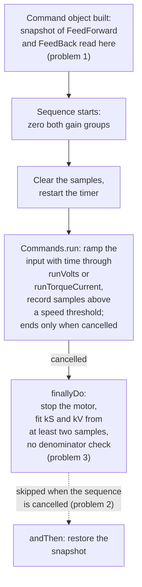
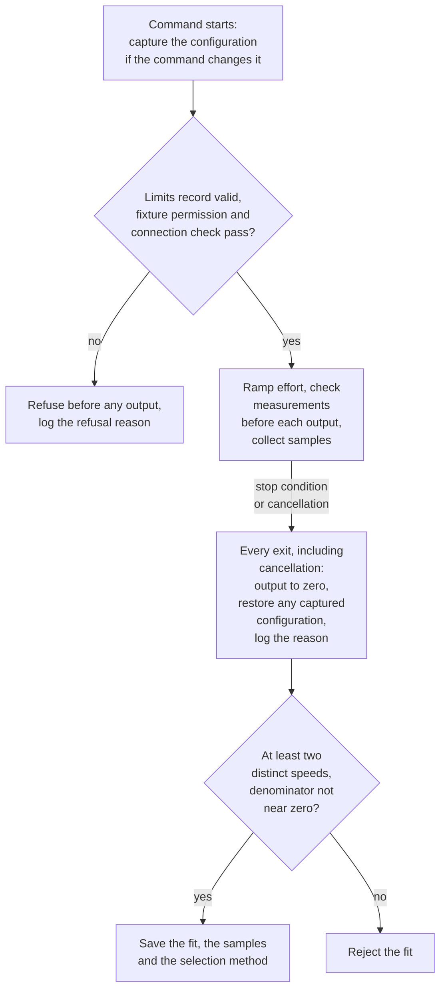
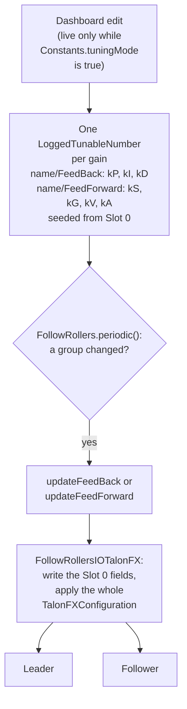

The student characterizes the flywheel, controls its measured speed, and validates the tuning on a
separate run. Start after the calculus, output-capability and roller work in Steps 2 through 4, in
the `Badge3Starter` fork. The student reads the Cobra classes named on this page in the fork. The
student implements each change in a new `FlywheelIO` for the follow-roller flywheel in the migrated
ROBOTZ Garage library (`org.robotzgarage.frc2027`, from [Step 1](/badges/badge-3-start)).

Most of this step runs in simulation. B3-05.2 needs one hardware characterization run on the
fixture. Before it, complete the [setup sheet](/badges/badge-3-hardware#complete-the-setup-sheet)
and the [first enable](/badges/badge-3-hardware#first-enable) from Step 13.

Research these before writing the characterization command:

- [Feedforward](/frc/feedforward), for `kS` and `kV` and their units in volts and amperes.
- [Tunable Constants and Characterization](/frc/tunable-constants-and-characterization), for the
  least-squares fit and its checks.
- [Manual Tuning: Flywheel](/frc/manual-tuning-flywheel) and
  [Shooter Example](/frc/shooter-example), for speed control and the wheel model.
- [Ending Cleanly](/frc/commands#ending-cleanly), for what `end(boolean interrupted)` runs on
  cancellation.
- [Command Groups](/frc/command-groups) and WPILib's
  [Command Compositions](https://docs.wpilib.org/en/stable/docs/software/commandbased/command-compositions.html),
  for how a sequence advances and for the `finallyDo()` and `handleInterrupt()` decorators.

## Trace the Flywheel in Cobra

In the fork, trace a `Shooter` command to `FlywheelFollower`, then the `FollowRollersIO` contract
and its `FollowRollersIOTalonFX` and `FollowRollersIOSimTalonFX` adapters.

Then find where SIM physics advances for the shooter. Two `moi` values look like candidates: the one
in `ShooterConstants.shooterFlywheelConfig` and the one in
`ShooterConstants.flywheelFollowersConfigSim`. Trace which one reaches a model that is stepped every
loop, starting from the shooter IO that `RobotContainer` builds in SIM and from the `FlywheelSim`
inside `FlywheelFollower`. Record which one a change to simulated inertia must edit, and explain why
changing the other would leave the response unchanged.

## Characterize before Refining Feedback

Cobra's `Shooter.quasistaticCharacterization` delegates to its `FlywheelFollower`, which extends
`FollowRollers`; the routine itself is `FollowRollers.quasistaticCharacterization`. Adapt it into a
bounded command owned by the parent subsystem. A quasistatic test slowly increases effort so
acceleration contributes less to the measured response. Some acceleration can remain in the data, so
check the samples.

### Configure the Experiment before Enabling It

Give the characterization command a limits record with no default values: the student supplies every
fixture value. Decide which quantities the record must hold to bound effort, rate, time, speed and
direction, and write down what each one prevents. Decide which values to refuse before any output,
and log the refusal reason. Cobra's entry points to wrap are `Shooter.quasistaticCharacterization`,
the feeder and intake roller characterizations, and the intake pivot's
`Intake.endeffectorFeedForwardCharacterization`. Have each entry take a fixture-permission supplier,
which reports whether the fixture conditions recorded with the mentor hold for this run. Allow
output only when both that supplier and the subsystem's connection check pass.

The pivot entry waits for [Step 7](/badges/badge-3-pivot#establish-manual-reference): its permission
supplier needs the reference-validity gate that step adds, along with a finite measured position and
travel margin. Step 7 completes it under row B3-07.4, so B3-05.2 covers the flywheel, feeder and
intake roller entries.

Before writing the stop logic, answer these in the fork's README:

- Which measurements are checked before each output, and what does the command do when one is
  invalid?
- Which conditions stop the command, and what reason does each one log?
- When the command is cancelled, which code runs, and how does a test show that the output reached
  zero?

Choose the physical limits with the mentor and record them before using the physical fixture;
software tests cannot choose them.

### Adapt Cobra's Routine

Read Cobra's routine for three problems:

1. It reads the configuration snapshot when the command object is built, not when the command
   starts, so a change made between binding and running is lost.
2. It zeroes the gains, then collects samples in a `Commands.run(...)` that only ends when it is
   cancelled. The restoration is chained after it with `.andThen(...)`, and cancelling the sequence
   skips that step, so the zeroed gains stay applied.
3. Its fit checks the sample count but not a near-zero regression denominator.

Its `finallyDo` stops the motor on every exit; keep that part.

Cobra's routine runs in this order, with the three problems marked:

Problems 1 and 2 matter only to a command that changes motor controller configuration. The ramp
reaches the motor through `FollowRollersIOTalonFX.runVolts` or `runTorqueCurrent`. Read which
control requests those send, then answer in the fork's README: does a `VoltageOut` or
`TorqueCurrentFOC` ramp use the Slot 0 gains? If the command must change configuration, capture it
when the command starts and restore it on every exit, including cancellation; otherwise leave the
configuration unchanged.

Collect timestamp, requested and measured effort, speed, direction, and output mode. Exclude
stationary samples from a moving-region fit and inspect acceleration and saturation. Fit voltage or
current against speed using consistent units, require at least two distinct speeds, and reject a
zero or near-zero regression denominator. Save the samples and the method used to select them.

Together with the limits and permission rules above, those requirements give the adapted command
this outline. The stop conditions and refusal reasons inside it are the student's to choose:

Cobra also has `FollowRollers.steadyStateCharacterization`, which
`Shooter.steadyStateCharacterization` exposes: it holds each of a series of fixed inputs, waits for
speed to settle, and fits only those settled points. Before running both, predict whether the
quasistatic `kV` will come out higher or lower than the steady-state `kV` for the same flywheel, and
explain the prediction from the acceleration term. Then compare the two fits and explain any
difference.

## Tune and Compare Speed Control

Validate the resulting gain choice on a separate run, then tune feedback against speed-error and
settling targets the student defines with the mentor and records before tuning. Compare Talon FX
voltage and torque-current control and Talon FXS voltage control. A requested speed starts each run;
measured speed determines the result. Change one output mode or gain at a time and predict rise time
and error. Run each comparison from the same initial state for the same duration and goal, and
compare the saved traces. Keep the goal or profile, the measurement, and the output on separate
traces.

The Starter has no Talon FXS follow-roller adapter: the Talon adapters in `rollers/follow` are
`FollowRollersIOTalonFX` and `FollowRollersIOSimTalonFX`. Build the Talon FXS comparison in the
migrated `FlywheelIO`, starting from `SingleRollerIOTalonFXS` and `SingleRollerIOSimTalonFXS`.

Cobra records the shooter's second motor in `ShooterConstants.flywheelFollowersConfig`, a
`TalonFXConfigFollower` with its own CAN ID and inversion. In the migrated flywheel, record it in
the Badge 2 library's `CtreMotorConfig` as an aligned or opposed follower, beside the leader's
settings.

The simulated flywheel has no friction, so a friction feedforward (`kS`) tuned on the real robot can
hold measured speed above the goal in simulation. If measured speed settles above the goal by more
than the readiness tolerance, readiness never passes in simulation. Compare the simulation's
friction with `kS`, and give the simulation its own gains instead of editing the real ones.

Keep the gain units beside every value. SysId is encouraged as extra exploration alongside the
required Cobra adaptation.

### Tune Gains Live

Cobra changes gains while the robot runs, so a tuning pass does not need a redeploy for each value.
Trace the path in the fork. `FollowRollers` builds one `LoggedTunableNumber` per gain under
`<name>/FeedBack` and `<name>/FeedForward`, seeded from the controller's Slot 0. Its `periodic()`
passes a changed group to `updateFeedBack` or `updateFeedForward`. The numbers are live only while
`Constants.tuningMode` is true.
[Tunable Constants and Characterization](/frc/tunable-constants-and-characterization#the-tuning-loop)
teaches the tuning loop and how to edit the numbers from AdvantageScope.

In Cobra, a dashboard edit reaches the motor controllers along this path:

Carry live tuning into the migrated `FlywheelIO`, with one set of gains for each output mode: the
Slot 0 voltage gains and a separate torque-current set. Before writing it, answer these in the
fork's README:

- `FollowRollersIOTalonFX.updateFeedBack` applies its whole stored `TalonFXConfiguration` to the
  leader and the follower. Read CTRE's
  [Configuration](https://v6.docs.ctr-electronics.com/en/stable/docs/api-reference/api-usage/configuration.html)
  page, then decide what the migrated IO sends instead and why.
- `apply()` waits for the device to respond. When does the migrated code send gains, and what would
  sending them on every loop cost?
- How does the student see on the dashboard that a gain change was refused or failed?
- A dashboard value lasts until the code restarts. Where do the final values go, and with which
  units?

Tune with `tuningMode` on, copy the final values into the constants, then make the validation run
with `tuningMode` off. The evidence then shows the values the robot keeps.

## Connect Measured Speed to a Shot

The saved speed response becomes the input to
[Step 6: FuelSim Launch Experiment](/badges/badge-3-fuelsim-experiment). Step 6 owns the launch
model, scoring shot, controlled miss and model assumptions. Finish the speed-control evidence here
before changing launch parameters. Keep the controller configuration, fitted data and separate
validation run for the Step 6 launch experiment.

## Independent Change

The mentor selects a different flywheel goal or simulated inertia. The student predicts spin-up,
settling and steady speed, repeats the run from the same initial conditions, and explains the
measured response. To change simulated inertia, edit the `moi` value identified in
[Trace the Flywheel in Cobra](#trace-the-flywheel-in-cobra).

When this step's simulation rows pass, the physical torque-current demonstration for this mechanism
(B3-13.1) can follow; see
[Required Demonstrations](/badges/badge-3-hardware#required-demonstrations).

## Badge Check

S means simulation, H means hardware, and W means written reasoning. The student records an evidence
link and an explanation in the student's own words for each row in the fork's README. The mentor
asks the student to explain a change and its result, checks each row, then signs and dates the step
on the [sign-off sheet](/documents/badges/badge-3/badge-3-sign-off.pdf).

| Row | Work | Done When |
| --- | --- | --- |
| B3-05.1 | Flywheel speed control | S: Compare Talon FX voltage and torque-current speed control and Talon FXS voltage control with typed angular velocity, separate mode-appropriate gains, tolerances and response logs. |
| B3-05.2 | Characterize and validate | S/H/W: Adapt Cobra's quasistatic characterization for the flywheel, feeder and intake roller entries, record units and stopping conditions, derive or justify gains, then validate them on a separate run. SysId remains encouraged exploration. |

## For the Mentor

`Badge3MentorSolution` replaces Cobra's routine with `CharacterizationCommands` and its tests in
`CharacterizationCommandsTest`; `CHARACTERIZATION.md` explains its limits, refusal reasons and entry
methods. Its flywheel adapters, including the Talon FXS pair, are under
`org/robotzgarage/frc2027/mechanisms/flywheel`. The legacy `QuasistaticExample` in
`curriculum-reference` shows configuration capture and restoration, and `EXPERIMENTS.md` in
`Badge3MentorSolution` lists matched comparison conditions. Compare them with the student's command
after the student has designed their own.

For live tuning, read `TunableGains` in the library, the flywheel adapters' `applyVoltageGains` and
`applyTorqueGains`, and `LiveGainTuningTest`. `Badge2MechanismReference` carries the voltage half.

<Sources items={[
  {
    "source": "ctre",
    "path": "docs/api-reference/device-specific/talonfx/closed-loop-requests.html",
    "note": "Output types and closed-loop units, read to decide which requests use the Slot gains."
  },
  {
    "source": "ctre",
    "path": "docs/api-reference/device-specific/talonfx/open-loop-requests.html",
    "note": "VoltageOut and the open-loop request naming, including FOC-only requests."
  },
  {
    "source": "ctre-javadoc",
    "path": "com/ctre/phoenix6/controls/TorqueCurrentFOC.html",
    "note": "The TorqueCurrentFOC request class and its fields, read with VoltageOut for the Slot 0 question."
  },
  {
    "source": "ctre-javadoc",
    "path": "com/ctre/phoenix6/controls/VoltageOut.html",
    "note": "The VoltageOut request class and its fields, read with TorqueCurrentFOC for the Slot 0 question."
  },
  {
    "source": "wpilib",
    "path": "docs/software/advanced-controls/controllers/feedforward.html",
    "note": "The kS and kV feedforward terms the quasistatic fit estimates."
  },
  {
    "source": "wpilib",
    "path": "docs/software/commandbased/command-compositions.html",
    "note": "Sequences start each command only after the previous one finishes, so a command that never finishes blocks the rest; finallyDo() runs on every end and handleInterrupt() only on interruption."
  },
  {
    "url": "https://github.com/wpilibsuite/allwpilib/blob/v2026.2.1/wpilibNewCommands/src/main/java/edu/wpi/first/wpilibj2/command/SequentialCommandGroup.java",
    "label": "WPILib SequentialCommandGroup.java (v2026.2.1)",
    "note": "end(interrupted) ends only the running command; later commands in the sequence are not started."
  },
  {
    "source": "wpilib",
    "path": "docs/software/advanced-controls/system-identification/introduction.html",
    "note": "What system identification is, the SysId tool, and the simple-motor model whose kS, kV and kA it fits."
  },
  {
    "source": "ctre",
    "path": "docs/api-reference/wpilib-integration/sysid-integration/plumbing-and-running-sysid.html",
    "note": "Setting up and running a SysId routine with Phoenix 6 signal logging."
  },
  {
    "source": "cobra",
    "path": "src/main/java/org/robotzgarage/frc2026/subsystems/rollers/follow/FollowRollers.java",
    "note": "The quasistatic routine students adapt (build-time snapshot, restoration skipped on cancel, the unguarded fit), the steady-state routine, and the FeedBack and FeedForward tunables that periodic() pushes on change."
  },
  {
    "source": "cobra",
    "path": "src/main/java/org/robotzgarage/frc2026/subsystems/rollers/follow/FollowRollersIOTalonFX.java",
    "note": "runVolts, runTorqueCurrent, updateFeedBack and updateFeedForward, read to find which requests the ramp sends and what each update applies."
  },
  {
    "source": "cobra",
    "path": "src/main/java/org/littletonrobotics/LoggedTunableNumber.java",
    "note": "The tunable number: dashboard values only while Constants.tuningMode is true, and hasChanged per caller."
  },
  {
    "source": "ctre",
    "path": "docs/api-reference/api-usage/configuration.html",
    "note": "Applying config groups and the cost of apply(), read for the live-tuning questions."
  },
  {
    "source": "cobra",
    "path": "src/main/java/org/robotzgarage/frc2026/subsystems/rollers/follow/FollowRollersIOSimTalonFX.java",
    "note": "The SIM adapter, one of the places the moi trace leads."
  },
  {
    "source": "cobra",
    "path": "src/main/java/org/robotzgarage/frc2026/subsystems/flywheel/FlywheelFollower.java",
    "note": "The FlywheelSim inside FlywheelFollower, one of the two models the moi trace starts from."
  },
  {
    "source": "cobra",
    "path": "src/main/java/frc/robot/subsystems/shooter/ShooterConstants.java",
    "note": "shooterFlywheelConfig and flywheelFollowersConfigSim, the two moi values."
  },
  {
    "source": "cobra",
    "path": "src/main/java/frc/robot/subsystems/shooter/Shooter.java",
    "note": "The shooter's quasistatic and steady-state characterization entry points, delegating to FlywheelFollower."
  },
  {
    "source": "cobra",
    "path": "src/main/java/frc/robot/RobotContainer.java",
    "note": "The SIM shooter IO construction in RobotContainer, where the moi trace begins."
  }
]} />

<LinkGrid title="Continue" section="badges" links={[{"label": "Step 6: FuelSim Launch Experiment", "id": "badge-3-fuelsim-experiment"}, {"label": "Badge 3: Advanced FRC", "id": "badge-3"}]} />
