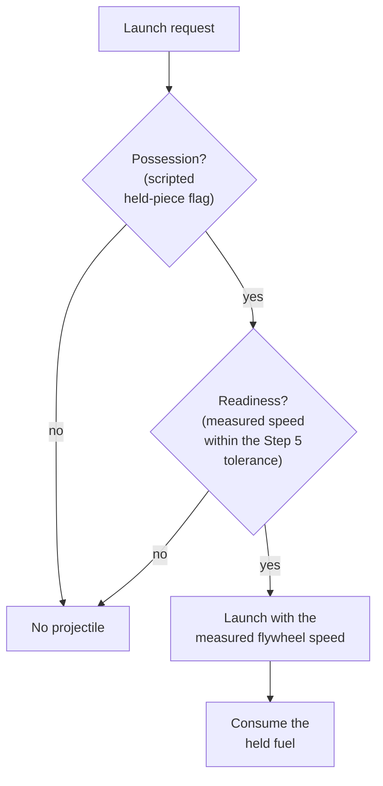
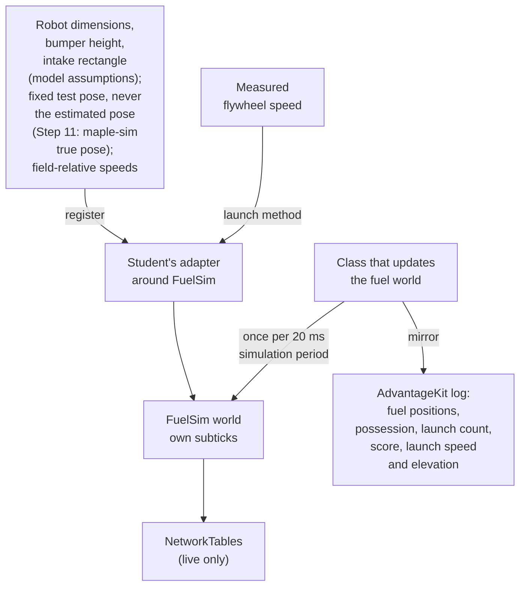
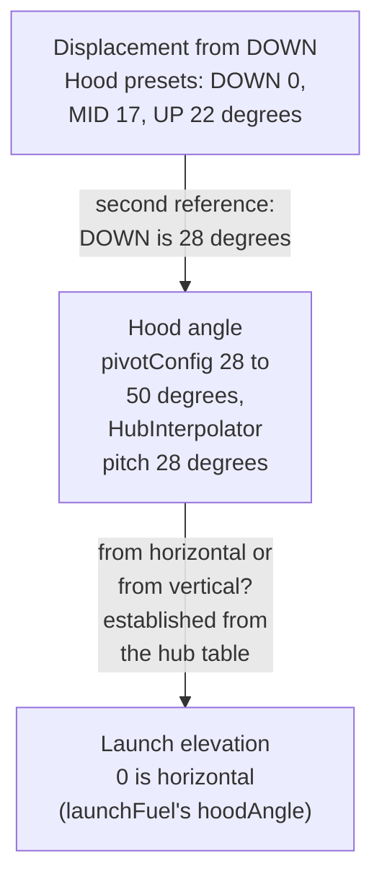
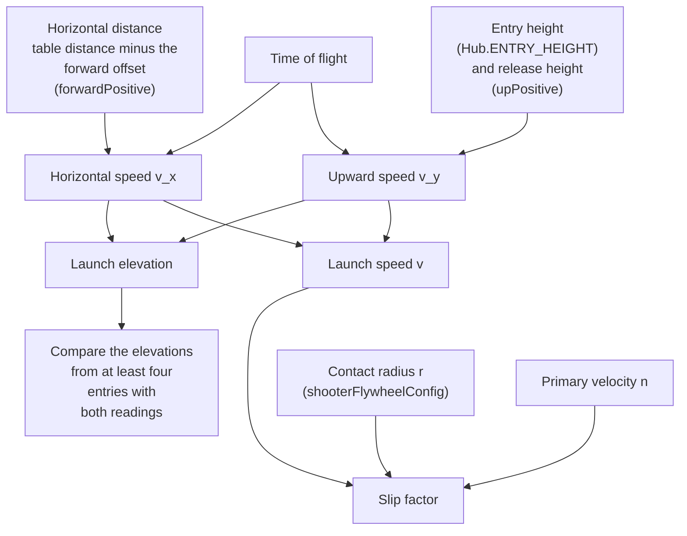

The student connects a measured flywheel response to one simulated shot. Complete this required step
in the Badge3Starter fork after
[Step 5: Flywheel Characterization and Tuning](/badges/badge-3-flywheel). Its fixed-elevation
experiment can run alongside the pivot work in [Step 7](/badges/badge-3-pivot); both are needed for
final autonomous integration. The Step 6 launch experiment provides the evidence for rows B3-06.1
and B3-06.2 in the [Badge Check](#badge-check).

Research these first:

- [FuelSim](/frc/fuelsim), for installing, registering and launching.
- [Shooter Example](/frc/shooter-example), for converting wheel speed to surface speed.
- [Pose Geometry](/frc/pose-geometry), for `RobotToShooter` arrow naming, and its
  [3D section](/frc/pose-geometry#the-3d-versions) for `Transform3d`.

## Add FuelSim to the Fork

Cobra has no fuel simulation. FuelSim is a single file. Copy `FuelSim.java` from the pinned upstream
revision, commit `37eff89`, into the fork as FuelSim's README directs, and edit the package line to
match its new folder. Copy the MIT license notice from FuelSim's `LICENSE.md` at the same commit
into the fork with it. Record the commit in the fork's README. Copying a newer version from `main`
later is a dependency change that needs a rebuild and repeated experiments.

FuelSim works in meters and meters per second.
`launchFuel(launchVelocity, hoodAngle, turretYaw, launchHeight)` takes `hoodAngle` as a launch
elevation, where 0 is a horizontal launch. It throws an `IllegalStateException` if no robot has been
registered with `registerRobot`. It always releases the fuel at the registered robot's center,
raised by `launchHeight`. For a release offset from the robot center, compute the release position
and velocity in the adapter and call `spawnFuel(position, velocity)`. `Hub.BLUE_HUB.getScore()`
reports the blue hub's score. `stepSim()` advances the physics once; a robot loop that calls
`updateSim()` must call `start()` first.

## Work the Launch Numbers First

Work through this example before writing code. A flywheel at a measured 22 rotations per second
turns at approximately 138.23 radians per second. The slip factor is the fraction of the wheel's
surface speed the fuel leaves with. With a 2 in wheel radius and a slip factor of 0.85, the launch
speed is approximately 235 inches per second (19.6 ft/s):

<Equation display tex="138.23\;\mathrm{rad/s} \times 2\;\mathrm{in} \times 0.85 \approx 235\;\mathrm{in/s}" />

Changing only the slip factor to 0.50 gives approximately 138 inches per second (11.5 ft/s) from the
same measured flywheel speed. These are simulation experiment values, not hardware recommendations.

The worked shots launch from field position (2.00 m, 4.02 m), heading zero, at a 60-degree launch
elevation and a 32 in release height. Field positions stay in meters because WPILib's field frame is
metric. Before running them, calculate the drag-free peak height of each launch. Write the release
height as <Equation tex="h_0" />, the launch speed as <Equation tex="v" />, the launch elevation as
<Equation tex="\theta" />, and the gravitational acceleration as
<Equation tex="g = 386\;\mathrm{in/s^2}" />. The upward speed <Equation tex="v_y" /> is the launch
speed times the sine of the launch elevation. The peak height is the release height plus the upward
speed squared divided by twice the gravitational acceleration:

<Equation display tex="v_y = v\sin\theta, \qquad h_{\text{peak}} = h_0 + \frac{v_y^2}{2g}" />

Compare the peak height with the hub's entry height, `Hub.ENTRY_HEIGHT` in the pinned file (1.83 m,
about 72 in). Predict which launch can score and which cannot. The launch that cannot score is the
controlled miss. Then run both in step 1 of
[Make the Student Adaptation](#make-the-student-adaptation) and check the change in the hub's score.
Another model or geometry may produce a different result, so check the score change rather than
assuming every launch scores.

The 2 in radius, the 32 in release height and the 60-degree launch elevation used on this page are
teaching values, not Cobra's. Cobra's hood angles run from 28 to 50 degrees. In
[Apply Cobra's Hood and Table Conventions](#apply-cobras-hood-and-table-conventions), the student
works out what they mean for the launch. Find Cobra's own values in `ShooterConstants`: the wheel
radius in `shooterFlywheelConfig`, and the release height in the builder that produces
`robotToShooter`. Record both, and note what `getTransform2d()` discards from that builder.

## Rule Out an Impossible Launch

At each launch, calculate the same drag-free peak height from the measured launch state. If that
optimistic peak is below the hub's entry height (`Hub.ENTRY_HEIGHT`), inspect release height,
wheel-speed conversion, contact radius, and slip factor before adjusting drag. Passing the height
check does not establish horizontal aim, a descending entry, or a score.

Take the contact radius (the wheel radius where the fuel touches) from an independent source, such
as Cobra's `shooterFlywheelConfig` or a measured wheel. The independent source is needed because
wheel speed and launch speed alone identify only the product of radius and slip factor.

Before changing model parameters, choose which shots are fitting cases (used to adjust the model)
and which are validation cases (held back to test it afterward). Retain misses, and compare
repeatability as well as score.

## Own the Fuel World

Write a small adapter around FuelSim. Its fuel list and physics constants are `protected`, which
Java makes visible to any class in the same package. An adapter placed in FuelSim's package can read
fuel positions without subclassing; extend the class only if the design needs it. Give the adapter
one launch method that checks possession and readiness, uses the measured flywheel speed, and
consumes the held fuel only after launching. Calling it again with no held fuel produces no
projectile.

In this step, readiness means the measured flywheel speed is within the Step 5 tolerance, and
possession is a scripted held-piece flag. [Step 9](/badges/badge-3-states) replaces both with the
subsystem's readiness policy.

A launch request in this step passes these checks:



Register the robot's dimensions, a pose supplier for physics, and field-relative speeds. Take the
bumper-inclusive width and length, the bumper height and the intake's pickup rectangle from Cobra's
CAD or a measurement of the robot. Record each value and its source in the README as a model
assumption. The intake rectangle also sets the robot-to-intake offset Steps 10 and 12 use. The
Starter has no true-pose source, so in this step register a fixed test pose, such as the worked
shots' (2.00 m, 4.02 m) at heading zero. Step 11 replaces it with maple-sim's true pose. Never
register the estimated pose from the pose estimator: robot control uses the estimated pose, and the
fuel world needs a true pose the estimator cannot influence. Update the fuel world once per 20 ms
simulation period; FuelSim owns its internal subticks. In a unit test, call `stepSim()` directly.

FuelSim publishes its state to NetworkTables, which is live only. For saved evidence, have the class
that updates the fuel world mirror fuel positions, possession, launch count and score into the
AdvantageKit log. At each launch event, also record launch speed and launch elevation. FuelSim's
launch speed is in meters per second: convert the 0.85 launch's 235 in/s (about 5.97 m/s) and check
that the logged value matches. For replay, consume the saved robot inputs and inspect the original
recorded world outputs. Running a fresh fuel world is a new experiment, and its outputs are new
results rather than reconstructed evidence.

The adapter, the class that updates the fuel world, and the log connect like this:



## Apply Cobra's Hood and Table Conventions

This section's evidence supports B3-06.2. Keep the Step 6 launch experiment separate from Cobra's
calibration data: the hood reference and the hub table.

`Hood` sets its DOWN, MID and UP presets to 0, 17 and 22 degrees of displacement from DOWN.
`HoodConstants.pivotConfig` (28 through 50 degrees, starting at 28) and `HubInterpolator` (a fixed
pitch of 28 degrees) use a second reference in which DOWN is 28 degrees. In the fork, find the
commented `.plus(Degrees.of(28.0))` on the CANcoder magnet offset in `HoodConstants`; it is the only
trace of that offset in the hood code. Cobra's code never states whether those 28 degrees are
measured from horizontal or from vertical, so a hood angle cannot go to `launchFuel` until the
student establishes which.

Every hub shot uses DOWN. In the `NEAR_ALLIANCE` zone the hood bindings in `RobotContainer` select
DOWN, and every `HubInterpolator` entry has the same 28-degree pitch. MID and UP are feeding
positions with their own tables. The hub table can therefore establish the launch elevation at DOWN,
and only at DOWN.

The hood quantities connect as follows; the last link is the one the student establishes:



### Work Out the Launch Elevation from the Hub Table

Each `HubInterpolator` entry records a time of flight: the fuel's time in the air from leaving the
shooter to entering the hub, as the class's Javadoc defines it. That time was observed on the robot
independently of any angle convention, so it can decide between the two readings. Before
calculating, write down which reading of the 28 degrees seems more likely and why. Work in feet and
seconds, with gravity at <Equation tex="g = 32.2\;\mathrm{ft/s^2}" />.

1. Copy every `HubInterpolator` entry into a table in the fork's README: the distance to target in
   feet, the primary velocity in rotations per second, and the time of flight in seconds.
2. Record the fixed geometry from `ShooterConstants` and FuelSim, converted to feet. The release
   height is the `upPositive` value in the `robotToShooter` builder, and the release's forward
   offset from the robot center is `forwardPositive`. The hub entry height is `Hub.ENTRY_HEIGHT`,
   1.83 m in the file (about 6.0 ft).
3. For each entry, find the horizontal distance the fuel travels: the table distance, which is
   measured from the robot center to the hub center, minus the forward offset.
4. Calculate the horizontal speed <Equation tex="v_x" />: horizontal distance divided by time of
   flight. This ignores drag, so it is an average over the flight.
5. Calculate the upward speed at release, <Equation tex="v_y" />. The fuel reaches the entry height
   <Equation tex="h_{\text{entry}}" /> at the time of flight <Equation tex="t" />, so
   <Equation tex="h_{\text{entry}} = h_0 + v_y t - 16.1\,t^2" />, where
   <Equation tex="h_0" /> is the release height. Solve for the upward speed:
   <Equation tex="v_y = \frac{h_{\text{entry}} - h_0 + 16.1\,t^2}{t}" />.
6. Calculate the launch elevation <Equation tex="\theta" />, the angle whose tangent is the upward
   speed divided by the horizontal speed: <Equation tex="\theta = \arctan\frac{v_y}{v_x}" />. Then
   calculate the launch speed <Equation tex="v" />, the square root of the sum of the two speeds
   squared: <Equation tex="v = \sqrt{v_x^2 + v_y^2}" />.
7. Repeat steps 3 through 6 for at least four entries spread across the table, for example 7, 10, 12
   and 15 ft, and record each result.
8. Compare the elevations with the two readings: 28 degrees above horizontal, and 28 degrees from
   vertical (62 degrees above horizontal). State which reading the data supports, how far the
   results scatter around it, and whether the original prediction held.
9. For each entry, calculate the slip factor <Equation tex="k_{\text{slip}}" /> it implies. Take
   the contact radius <Equation tex="r" /> from `shooterFlywheelConfig`, converted to feet, and the
   wheel speed <Equation tex="n" /> from the entry's primary velocity in rotations per second:
   <Equation tex="k_{\text{slip}} = \frac{v}{2\pi r n}" />.

Each calculation in that list feeds the next:



These calculations ignore drag, treat the hub center as the entry point, and rely on a table whose
original measurements are not documented. Treat the result as a reading of evidence, not a
measurement; physical calibration can replace it later.

### Fit and Check the Slip Factor in FuelSim

Cobra's `ShooterConstants.robotToShooter` is a two-dimensional `Transform2d`. Start from what the
student noted about `getTransform2d()` in
[Work the Launch Numbers First](#work-the-launch-numbers-first). The builder's `upPositive` value
was taken from the fuel's center in Cobra's Week 1 CAD. Build the three-dimensional
`RobotToShooter` release transform from the two-dimensional transform and that release height, and
record where the height came from. Measuring it on the robot is an optional check. Use the
transform with `spawnFuel` for an offset release (see
[Add FuelSim to the Fork](#add-fuelsim-to-the-fork)). Use measured mechanism states.

Before fitting, declare the fitting and validation cases in the README: for example, 7, 9, 11, 13,
15 and 17 ft for fitting and 8, 10, 12, 14 and 16 ft for validation. Launch each fitting case in
FuelSim with air resistance on, from a stationary robot facing the hub center at the table distance.
Use the launch elevation from the previous section and that release transform. For a range of slip
factors, record whether each case scores and the time from release until the hub counts it. Choose
the slip factor that scores every fitting case with the smallest difference from the table's flight
times.

Then run the validation cases with that slip factor unchanged. Record which cases score and how far
their flight times differ from the table. Do not edit the table or adjust a validation case to make
it pass.

Record which geometry is established and which slip factor, drag, or timing parameters remain
estimates. For physical shots, declare fitting and validation cases the same way before adjusting
the model. Retain misses and repeatability results. Do not edit a working table to make a simulated
shot score.

### Name Each Quantity

Name each quantity as displacement, hood angle, or launch elevation, and convert once. Write a
conversion test that checks DOWN against the launch elevation the hub table supports. For MID and
UP, record the conversion as a stated assumption to check on the robot or in CAD, because the hub
table cannot confirm feeding positions. Explain which mistake a test of a single preset would miss.

Preserve the supplied hub table entries. They were collected manually with stationary robot-center
to hub-center distances from fused odometry, at a fixed hood setting. An offset shooter position
still matters for aiming and release, but it must not change that table's stationary range
convention.

The automatic outputs are the speed and hood angle (the table's pitch) that
`TargetInterpolator.update()` calculates each loop. It uses the interpolator
`BobotState.getShooterInterpolator()` returns, which is `HubInterpolator` while the robot is in the
`NEAR_ALLIANCE` field zone. `ShootOnTheMoveCommand` reads the same interpolator.

Compare direct-table and automatic outputs at table entries and an intermediate range, with several
robot headings and zero velocity. Before running the comparison, read `update()` and predict which
distance it looks up at zero velocity.

## Make the Student Adaptation

1. Reproduce the worked scoring shot and controlled miss in a FuelSim test in the fork. Record the
   model version, initial state, measured speed, radius, slip factor, launch elevation, release
   height, and score change.
2. Connect the launch method to the student's measured flywheel input and one explicit launch event.
   Keep a fixed launch elevation and release height for this first experiment. Confirm that a goal
   change does not instantly become the launch speed.
3. Predict the effect of one changed parameter. Repeat from the same initial conditions, save the
   trace, and compare the prediction with the result.
4. Demonstrate that not-ready and empty requests do not launch. Cancel the launch command while the
   flywheel spins up and confirm that no fuel launches.
5. Write reproduction instructions for another member.

The student explains model assumptions separately from controller performance. A successful
simulated shot does not calibrate slip factor, drag or contact behavior for a physical shooter.

Step 10 connects this world to PhotonVision, and Step 11 replaces the fixed test pose with
maple-sim's true pose. Step 12 connects it to collection and replaces the fixed launch elevation
with the launch elevation converted from the measured hood position.

## Badge Check

S means simulation and W means written reasoning. The student records an evidence link and an
explanation in the student's own words for each row in the fork's README. The mentor asks the
student to explain a change and its result, checks each row, then signs and dates the step on the
[sign-off sheet](/documents/badges/badge-3/badge-3-sign-off.pdf).

| Row | Work | Done When |
| --- | --- | --- |
| B3-06.1 | FuelSim launch model | S/W: Pin the source and preserve its license; adapt an integration that uses measured simulated flywheel speed, wheel radius and an explicit slip factor, with its model assumptions stated. A fixed documented launch elevation and release height are allowed for this first experiment. |
| B3-06.2 | Controlled shot experiment | S/W: Predict and vary one parameter from a repeatable initial state. Show a scoring shot and controlled miss, log the launch and model outcome, and distinguish controller tuning from launch-model fitting. Explain Cobra's hood displacement, hood angle and launch elevation conventions, and show how the hub table's time of flight establishes the launch elevation at DOWN. |

## For the Mentor

The worked shot comes from `fuelMeasuredSpeedScoresAndControlledMissDoesNot` in
`curriculum-reference`, which launches through the `BadgeFuelWorld` adapter. Run it from that
project's folder:

<CodeTabs>
<CodeTab label="PowerShell">

```powershell
.\gradlew.bat test --tests frc.robot.curriculum.CurriculumTest
```

</CodeTab>
<CodeTab label="Terminal">

```sh
./gradlew test --tests frc.robot.curriculum.CurriculumTest
```

</CodeTab>
</CodeTabs>

In `Badge3MentorSolution`, `RobotFuelSimulation` logs the launch and the drag-free height check, and
`ShotGeometry` applies the hood convention. `CobraHubTableShotTest` fits the slip factor on the hub
table's fitting cases and checks the validation cases. `SHOT-CALIBRATION.md` records the result, the
calibration worksheet and the trial record, and `MIGRATION.md` records the interpolator's stationary
range convention.

<Sources items={[
  {"source": "fuelsim-37eff89", "path": "FuelSim.java", "note": "The pinned revision students copy into the fork: launchFuel units and its IllegalStateException, the robot-center release, spawnFuel, registration, Hub.ENTRY_HEIGHT and scoring, and the protected fuel list."},
  {"source": "fuelsim-37eff89", "path": "README.md", "note": "Installation by copying FuelSim.java and editing the package line, robot registration, start and updateSim."},
  {"source": "fuelsim-37eff89", "path": "LICENSE.md", "note": "The MIT license and copyright notice that go into the fork with the copied file."},
  {
    "source": "advantagekit",
    "path": "data-flow/recording-outputs/",
    "note": "Explicit saved outputs for world and launch evidence."
  },
  {
    "source": "cobra",
    "path": "src/main/java/frc/robot/subsystems/hood/Hood.java",
    "note": "The DOWN, MID and UP preset tunables at 0, 17 and 22 degrees."
  },
  {
    "source": "cobra",
    "path": "src/main/java/frc/robot/subsystems/hood/HoodConstants.java",
    "note": "The commented <code>.plus(Degrees.of(28.0))</code> on the CANcoder magnet offset, the only trace of the 28 degree offset; pivotConfig limits and starting angle in the reference where DOWN is 28 degrees (28 through 50 degrees)."
  },
  {
    "source": "cobra",
    "path": "src/main/java/frc/robot/bobot_state/interpolation/HubInterpolator.java",
    "note": "The hub table built at a fixed 28 degree hood setting."
  },
  {
    "source": "cobra",
    "path": "src/main/java/org/robotzgarage/frc2026/math/interpolation/TargetInterpolator.java",
    "note": "update(), which looks up the table from a lookahead distance each loop: the automatic outputs."
  },
  {
    "source": "cobra",
    "path": "src/main/java/frc/robot/bobot_state/BobotState.java",
    "note": "getShooterInterpolator() choosing HubInterpolator in the NEAR_ALLIANCE field zone."
  },
  {
    "source": "cobra",
    "path": "src/main/java/frc/robot/commands/ShootOnTheMoveCommand.java",
    "note": "The command that reads the shooter interpolator."
  },
  {
    "source": "cobra",
    "path": "src/main/java/frc/robot/subsystems/shooter/ShooterConstants.java",
    "note": "The two-dimensional robotToShooter transform built from a builder whose up component is Cobra's release height, and shooterFlywheelConfig's wheel radius."
  }
]} />

<LinkGrid title="Continue" section="badges" links={[{"label": "Step 7: Pivot Reference, Limits, and Profiles", "id": "badge-3-pivot"}, {"label": "Badge 3: Advanced FRC", "id": "badge-3"}]} />
