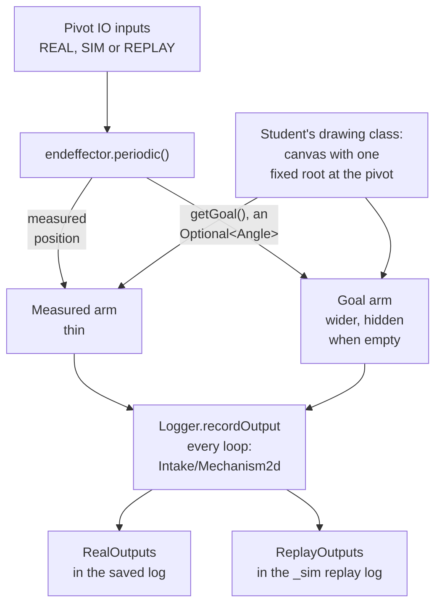
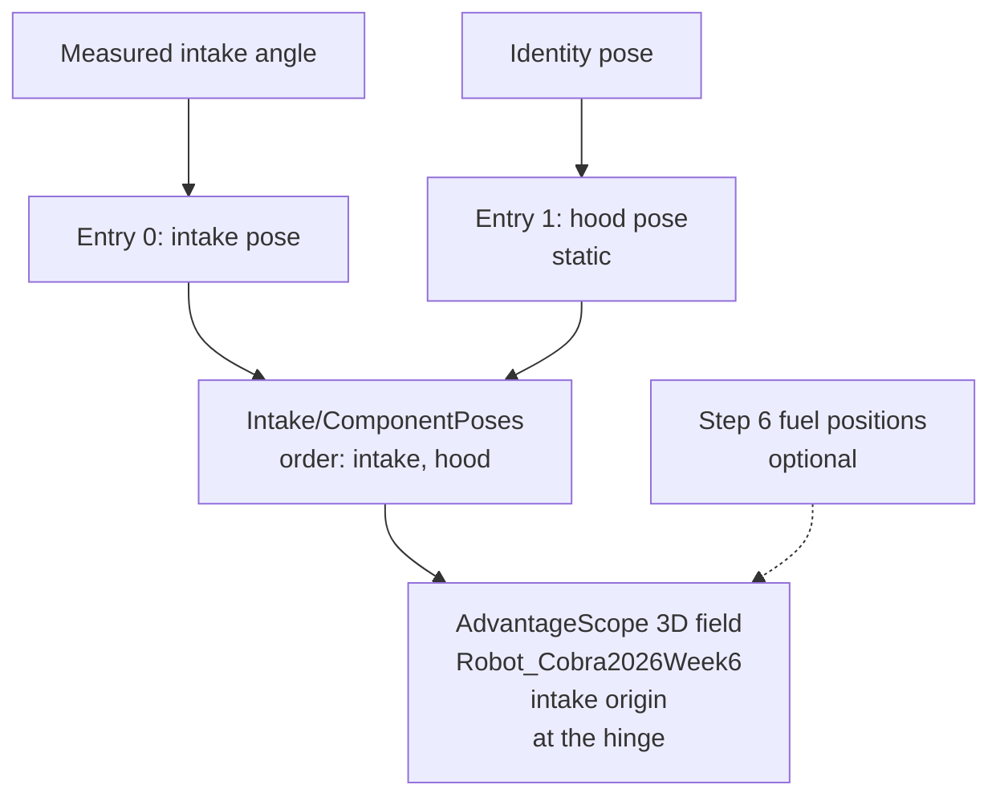

Badge 2 established numeric AdvantageKit logs, IO contracts, physics simulation and 2D
measured-versus-goal drawings for all four mechanism families. In Badge 3, the student applies that
drawing pattern to Cobra's intake, verifies it against saved logs and replay, and then animates
the intake CAD from the same measurements. Reuse the Badge 2 fundamentals instead of treating them
as new material. Start after the [Step 7 pivot work](/badges/badge-3-pivot) and finish before
[Step 9: Subsystem-Owned States](/badges/badge-3-states).

## Review the Three Objects

Review [What a Mechanism Drawing Shows](/frc/what-a-mechanism-drawing-shows) and
[Ligaments and Components](/frc/ligaments-and-components) before applying these three objects to
Cobra.

| Object | Job | Student Explanation |
| --- | --- | --- |
| `LoggedMechanism2d` | Owns the drawing canvas. | Choose a size that contains the motion. |
| `LoggedMechanismRoot2d` | Anchors a drawing at a position on that canvas. | Identify the pivot or fixed base. |
| `LoggedMechanismLigament2d` | Draws a segment attached to a root or another segment. | Identify its length and its angle relative to its parent. |

Give the drawing's lengths and root positions as typed `Distance` values, as the Badge 2 constants
do, and convert to meters at the drawing API.

A root-mounted ligament at 0 degrees points right, and positive angles turn counterclockwise, toward
up. Child angles are relative to their parent, so attaching a segment to an already rotated segment
changes its displayed direction.

Start with a single fixed root for the intake pivot. Moving roots and full robot drawings are
extensions after this example works.

The drawing only displays data. Physics stays in the IO implementation, control stays in the
existing component and subsystem, and the pivot reference comes from the Step 7 procedure. Keep
`RobotContainer` responsible for construction and bindings.

## Draw the Measured Pivot and Its Goal

Begin by reading the student's Badge 2 `CobraIntakeMechanism` from
[Badge 2 Step 9](/badges/badge-2-mechanism-composition#build-the-composed-2d-mechanisms). That
visualizer composed the Badge 2 `PivotMechanism` helper and recorded its own output as
`Intake/Pivot/Mechanism2d`. In Badge 3, the student moves the drawing into Cobra's `Intake`
subsystem, which records it as `Intake/Mechanism2d`. Read
[Badge 2: Keep the Visualizer beside Its Parent](/frc/mechanisms-per-subsystem#badge-2-keep-the-visualizer-beside-its-parent)
and [Naming the Key](/frc/mechanisms-per-subsystem#naming-the-key), then explain in the student's
notes what moved: the log key, and which object records it.

Then read what Cobra already has. In the fork, `IntakeConstants` defines `rootMechanismConfig` for a
canvas and root, and `measuredPivotMechanismConfig`, `setpointPivotMechanismConfig`, and
`goalPivotMechanismConfig` for Cobra's `PivotMechanism` helper, each a 12 in arm. Nothing builds or
logs them yet: `Intake` logs only whether the pivot is near its goal. Cobra's helper wraps a single
ligament whose `update(Angle)` sets its angle, and it has no method to hide a ligament. Its API
differs from Badge 2's `PivotMechanism`, which owned a canvas and took
`update(Angle, Optional<Angle>)`.

The student's drawing class owns the canvas and root; starting from `rootMechanismConfig` is one
option. The class attaches two ligaments to that root: a thin measured arm and a wider goal arm,
each with its own name and color. Cobra's arm configs share a line width of 10 and three similar
greens, so change the measured and goal configs to match that design. Then add a way to hide the
goal arm. Use an `Angle` for each value until the drawing API requires a numeric angle. The arm
lengths are schematic display dimensions, not physics parameters.

Cobra's `Pivot.getGoalPosition()` returns a plain `Angle` even when no goal is active. Before
drawing, give the pivot a `getGoal()` that returns `Optional<Angle>`, so the drawing can hide the
goal arm when no goal exists.

The subsystem owns the drawing and updates it immediately after `endeffector.periodic()`, the call
that processes the pivot's inputs (`Intake` names its pivot `endeffector`). In this illustrative
snippet from `Intake.periodic()`, `mechanismDrawing` is the student's drawing object, and `update`
and `getDrawing` are placeholder method names. Badge 2's helper, for example, exposes its canvas as
`getMechanism()`.

```java
this.endeffector.periodic();
this.mechanismDrawing.update(this.endeffector.getPosition(), this.endeffector.getGoal());
Logger.recordOutput("Intake/Mechanism2d", this.mechanismDrawing.getDrawing());
```

This is part of the existing `periodic()` method. Do not call `endeffector.periodic()` a second time
for the drawing. Publish the drawing every loop after changing it. Drawing updates run on the robot
thread even when the selected CTRE simulation advances its physics on a Notifier.

The diagram follows one loop from the pivot's inputs to the logged drawing.



Read [Measured Against Goal](/frc/measured-against-goal). Drive the measured arm from the processed
IO measurement in REAL, SIM, and REPLAY. Drive the goal arm from the requested goal, and hide it
when no goal exists. A stopped pivot can still have a measured position. Do not substitute a goal or
the simulator's private state for that measurement. If feedback is invalid, retain the corresponding
validity/status trace and explain that the last displayed position is not proof of current physical
position.

Decide whether `getGoal()` should be empty after the robot disables, and write down why. Cobra's
`Pivot` extends `SingleRoller`, so read `SingleRoller.stop()` and `SingleRoller.periodic()` in the
fork and predict what the pivot reports as its goal after a disable. Make the migrated pivot match
the written decision.

Distinguish the final requested goal from a profile's intermediate reference. A profile-reference
arm is an extension when that signal is available and correctly labeled. Cobra's
`setpointPivotMechanismConfig` fits that arm and can stay unused if the student skips the extension.
Do not label the final goal as the profile reference.

## Verify the Drawing before Trusting It

Before running these checks, record the expected orientation and units for each one.

1. Feed known measured angles of 0, 20, and 90 degrees into the drawing while the goal stays at
   60 degrees. Confirm the measured arm changes and the goal arm does not follow it.
2. Feed 0.25 rotations and confirm the measured arm matches the 90 degree drawing.
3. Remove the goal and verify the goal arm is hidden while the measured arm remains available.
4. Run a simulated pivot move. Compare the drawing with the numeric position and goal traces at
   the same timestamp. Inspect a point during motion where the two values differ.
5. Disable or interrupt the mechanism and compare its numeric state and drawing. The drawing must
   follow measured feedback; it must not animate a successful arrival solely because a command
   requested it.

Write a test that checks the drawing's serialized angles and goal visibility. The test supports the
exercise; the student also saves a log and demonstrates the timeline comparison.

## Review in AdvantageScope

Review [The Mechanism Tab](/frc/simulation-in-advantagescope#the-mechanism-tab) and
[The Line Graph](/frc/simulation-in-advantagescope#the-line-graph-commanded-versus-measured). Open
the saved WPILOG in AdvantageScope, add a Mechanism tab, and drag `RealOutputs/Intake/Mechanism2d`
into its control pane. Use the same timeline timestamp in a line graph of the pivot's position and
goal. Save the log, a screenshot with that timestamp, and enough layout instructions for another
member to reproduce the view.

For an AdvantageKit replay, follow [Replaying a Match](/frc/log-replay#replaying-a-match). The
Starter's `Robot` reads the selected log and writes the replay beside it with a `_sim` suffix, as
`<log>_sim.wpilog`. Compare the regenerated `ReplayOutputs/Intake/Mechanism2d` in that file with the
original output and recorded inputs. Explain the difference between playing back a log in
AdvantageScope and rerunning robot code with replayed inputs. The drawing requires no new physics or
hardware in REPLAY.

## Import and Animate the Intake CAD

After the 2D checks, complete the Week 6 intake exercise in
[Visualizing Cobra](/frc/visualizing-cobra) with the Week 6 Cobra AdvantageScope asset,
`Robot_Cobra2026Week6`. The mentor supplies its `advantagescope-assets` folder with the Starter.
Copy the folder into the root of the fork and follow its README. Confirm the intake is a separate
component in the supplied asset, record its units, align its origin with the hinge, and animate it
from the measured intake angle. Keep the hood static for this exercise. Compare known lengths and
the 0, 20, and 90 degree poses before interpreting a saved log. The CAD view has its own mounting
transform, so the 2D drawing and the CAD view need not face the same direction on screen.

Cobra logs no component poses, so add a component pose array. Read
[Component Poses](/frc/mechanisms-in-3d#component-poses) first, and
[Mounts and Moving Roots](/frc/mounts-and-moving-roots) if the student later moves the root. Log the
array, for example as `Intake/ComponentPoses`, and attach it in AdvantageScope's 3D field view. The
asset README orders the array as `[intake, hood]`. The intake entry comes from the measured angle,
and the hood entry is an identity pose that keeps the static hood where it was exported. Optionally
add the fuel positions the Step 6 adapter already logs to the same 3D field view.



Record the asset version, component order, transforms, and log with B3-08.2, and include the
reproduction steps in the B3-15.1 handoff. The drawing and the CAD animation are separate evidence,
and neither replaces the pivot reference and repeatability checks in B3-07.2 to B3-07.4.

## Badge Check

S means simulation, W means written reasoning, and M means mentor-observed review. The student
records an evidence link and an explanation in the student's own words for each row in the fork's
README. The mentor asks the student to explain a change and its result, checks each row, then signs
and dates the step on the [sign-off sheet](/documents/badges/badge-3/badge-3-sign-off.pdf).

| Row | Work | Done When |
| --- | --- | --- |
| B3-08.1 | Canvas, root, and ligaments | S/W: Build the measured/goal pivot drawing and explain dimensions, angle direction, relative angles, and ownership. Numeric logging and control remain independent of visualization. |
| B3-08.2 | Measurement and goal checks | S: Verify 0, 20, and 90 degrees, equivalent units, a distinct fixed goal, and absent-goal visibility. Compare a moving and disabled/interrupted run with the numeric position and goal traces at matching timestamps. Repeat the known-pose checks on the intake CAD animation. |
| B3-08.3 | Saved-log and replay review | S/W/M: Another member opens the saved view, locates a measured/goal mismatch, and explains it. Demonstrate regenerated replay output and distinguish replay from log playback. |

## For the Mentor

`Badge3MentorSolution` contains a complete small example: `IntakeMechanismDrawing` and
`IntakeMechanismDrawingTest`. Its `Intake` logs `Intake/Mechanism2d` and `Intake/ComponentPoses`,
and its drawing helper is `org.robotzgarage.frc2027.mechanisms.visualizations.PivotMechanism`. The
student copy of the CAD asset, with a student README, is in the solutions repository at
`badge_03/starters/advantagescope-assets`; the mentor solution keeps its own copy, which
`IntakeVisualizationTest` and `advantagescope-assets/tools/render_intake_animation.py` use.

<Sources items={[
  {"source": "advantagescope", "path": "tab-reference/mechanism/", "note": "Adding drawings and recording updated mechanism output each loop."},
  {"source": "advantagescope", "path": "tab-reference/3d-field/", "note": "Attaching a component pose array to a robot model for the intake CAD animation."},
  {"source": "advantagescope", "path": "more-features/custom-assets/", "note": "Exporting a robot asset with separate components and aligning each component's origin."},
  {"source": "advantagekit", "path": "data-flow/recording-outputs/", "note": "Calculated output logging and the RealOutputs and ReplayOutputs tables."},
  {"source": "cobra", "path": "src/main/java/frc/robot/subsystems/intake/IntakeConstants.java", "note": "rootMechanismConfig and the measured, setpoint and goal PivotMechanismConfig records, all width 10 in three greens, that nothing yet builds or logs."},
  {"source": "cobra", "path": "src/main/java/frc/robot/subsystems/intake/Intake.java", "note": "periodic() calls endeffector.periodic(), the point where the drawing update goes, and logs only whether the pivot is near its goal."},
  {"source": "cobra", "path": "src/main/java/org/robotzgarage/frc2026/subsystems/pivot/Pivot.java", "note": "Pivot extends SingleRoller, and getGoalPosition() returns a plain Angle."},
  {"source": "cobra", "path": "src/main/java/org/robotzgarage/frc2026/subsystems/rollers/single/SingleRoller.java", "note": "stop() and the disabled branch of periodic(), read for the goal-after-disable prediction."},
  {"source": "cobra", "path": "src/main/java/frc/robot/Robot.java", "note": "The REPLAY branch that writes the replayed log with a <code>_sim</code> suffix."},
  {"source": "cobra", "path": "src/main/java/org/robotzgarage/frc2026/subsystems/pivot/PivotMechanism.java", "note": "Cobra's single-ligament drawing helper and its update(Angle)."},
  {"source": "wpilib", "path": "docs/software/dashboards/glass/mech2d-widget.html", "note": "Ligament angles relative to the parent; a root ligament at zero points right and positive angles turn counterclockwise."}
]} />

<LinkGrid title="Continue" section="badges" links={[{"label": "Step 9: Subsystem-Owned States", "id": "badge-3-states"}, {"label": "Badge 3: Advanced FRC", "id": "badge-3"}]} />
