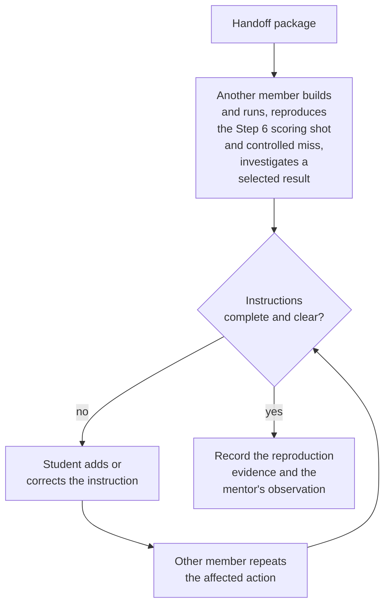
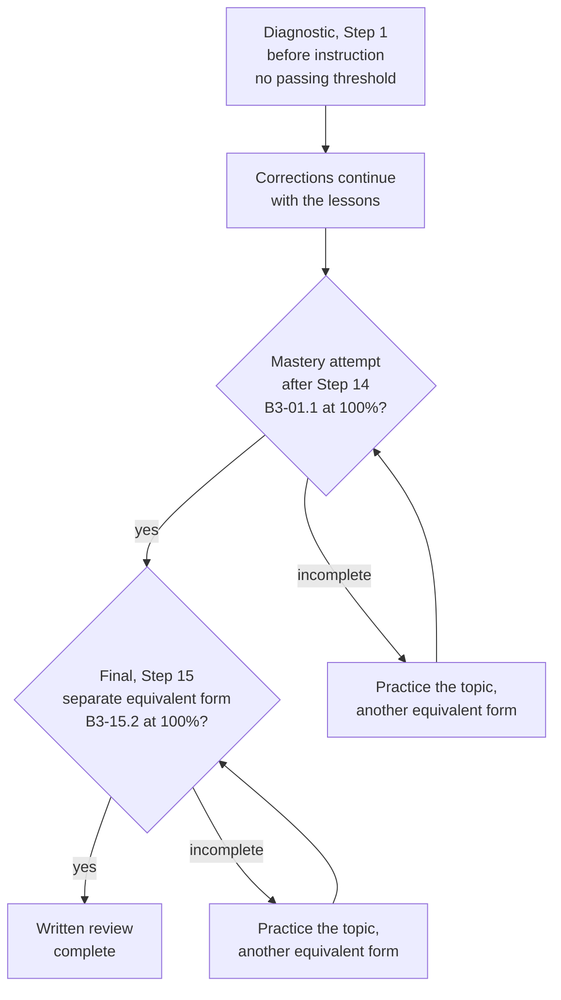

The student hands the project to another member and completes the final, the last independent form
of [Written Checks](/badges/badge-3-written-checks). The mentor reviews technical work, physical
demonstrations, written understanding, leadership and the handoff separately. Completing one
category does not substitute for another.

## Required Sheet

The [sign-off sheet (PDF)](/documents/badges/badge-3/badge-3-sign-off.pdf) summarizes the fifteen
current steps and provides a space for the mentor's signature and date on each step. The mentor
prints a fresh sheet or provides a working copy.

For each current required row, the student records the row identifier, an evidence link and an
explanation in the student's own words in the fork's README. The identifier points to the
requirement, so the README does not copy the requirement text. The mentor checks each row with the
student, then signs and dates the step. Each signature confirms the full requirements in the linked
step.

## Handoff Package

Provide these items:

- the project source and pinned dependencies;
- setup instructions, mode selection and simulation entry points;
- the setup sheets for the actual hardware, including the commissioning record;
- units and conversion conventions;
- gain records and reference procedures;
- representative logs and tests;
- troubleshooting instructions and known limitations.

The README identifies the `Badge3Starter` version the fork started from and distinguishes supplied
code from student additions.

Another member builds and runs the project from those instructions, reproduces the scoring shot and
controlled miss from the Step 6 controlled shot experiment, and investigates a selected result. The
student adds any missing instruction or corrects an unclear one. The other member then repeats the
affected action. Record the reproduction evidence and the mentor's observation.

Reuse matching reproduction and physical handoff evidence already gathered in the badge, such as the
[Step 13 handoff](/badges/badge-3-hardware#independent-handoff); repeat only missing or changed
actions. The Step 11 combined simulation's open-space and contact runs also need reproduction;
credit them under B3-11.4. One reproduction session can satisfy both B3-11.4 and B3-15.1 when it
covers both rows.

## Written Review

After Step 14, the student completes the independent mastery attempt, recorded under B3-01.1, at
100%. The student then completes the final, a separate independent equivalent form of
[Written Checks](/badges/badge-3-written-checks). The final result must be 100%. If an answer is
incomplete, the student practices the topic and attempts another equivalent form. Keep the attempts
and the correction record. Previously completed practical rows remain credited.

Written Checks sittings have no time limit and are closed-notes. The independent checks assess the
student's own explanation. The mentor may clarify wording without supplying an answer.

The [calculus worksheet](/badges/badge-3-calculus) and the
[Expo worksheet](/badges/badge-3-pivot#compare-expo) also require complete correct reasoning after
feedback. Notes are permitted on both worksheets, including the credited attempt.

## Sign-Off Record

Evidence links and signatures follow the [Required Sheet](#required-sheet) rule. The mentor reviews
B3-13.2 or B3-13.3 when it matches the prior physical route; both are extensions for a student who
used FX. The calculus rows, C1–C5, support B3-02.1. Record required simulation and physical
demonstrations separately even when one fixture contributes to several rows.

Before signing B3-15.3, the mentor checks each review category below. The categories are a checklist
for that one signature, not separate signatures.

| Review | Evidence |
| --- | --- |
| Technical work | All required simulation, code, experiments and failure runs. |
| Physical work | FX physical voltage baseline and roller/flywheel/pivot torque-current work, voltage and torque-current comparison, bounded characterization, manual and absolute pivot reference, travel and repeatability, selected Badge 2 motor controller evidence, CANrange and stationary camera. |
| Written work | Diagnostic corrections through instruction, independent 100% mastery attempt after Step 14, complete worksheets, and a separate independent 100% final. |
| Leadership | Diagnosis, substantive review, observed teaching and lesson feedback. |
| Handoff | Another member builds, reproduces and investigates. |

The Automation Team mentor makes the final leadership-readiness judgment and dates the badge record.
There is no event-attendance requirement. If equipment prevents a physical demonstration, its
step stays unsigned until the demonstration is complete; the other completed evidence remains
credited.

## Badge Check

W means written reasoning and M means mentor-observed review. The student records an evidence link
and an explanation in the student's own words for each row in the fork's README. The mentor asks the
student to explain a change and its result, checks each row, then signs and dates the step on the
[sign-off sheet](/documents/badges/badge-3/badge-3-sign-off.pdf).

| Row | Work | Done When |
| --- | --- | --- |
| B3-15.1 | Handoff | M: Supply setup, configuration, units, tuning results, representative logs, tests, limitations and troubleshooting instructions. Another member builds, reproduces the Step 6 scoring shot and controlled miss, and investigates using them; matching earlier evidence may count. |
| B3-15.2 | Final written check | W/M: Complete the independent final written check at 100%, with practice and reassessment as needed. |
| B3-15.3 | Final sign-off | M: The mentor checks the technical, physical, written, leadership and handoff categories in the Sign-Off Record, judges leadership readiness, then signs and dates the badge record. |

<Sources items={[
  {"url":"/documents/badges/badge-3/badge-3-sign-off.pdf","label":"FRC 4451 Badge 3 Sign-Off","note":"The printable fifteen-step summary with one mentor signature and date per step; full requirements remain in the linked steps."},
  {
    "source": "advantagekit",
    "path": "getting-started/traditional-replay/",
    "note": "Saved logs and replay that the handoff package includes."
  },
  {
    "source": "wpilib",
    "path": "docs/software/commandbased/subsystems.html",
    "note": "Subsystem ownership that the reviewer checks during the handoff."
  }
]} />

<LinkGrid title="Continue" section="badges" links={[{"label": "Written Checks", "id": "badge-3-written-checks"}, {"label": "Badge 3: Advanced FRC", "id": "badge-3"}]} />
