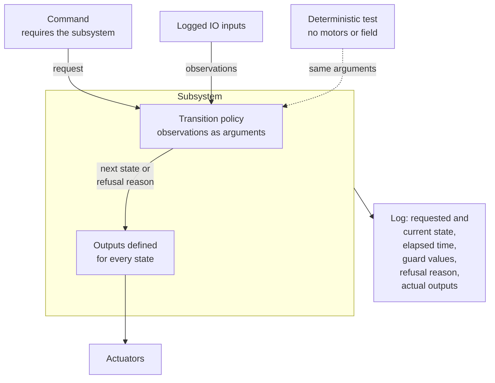
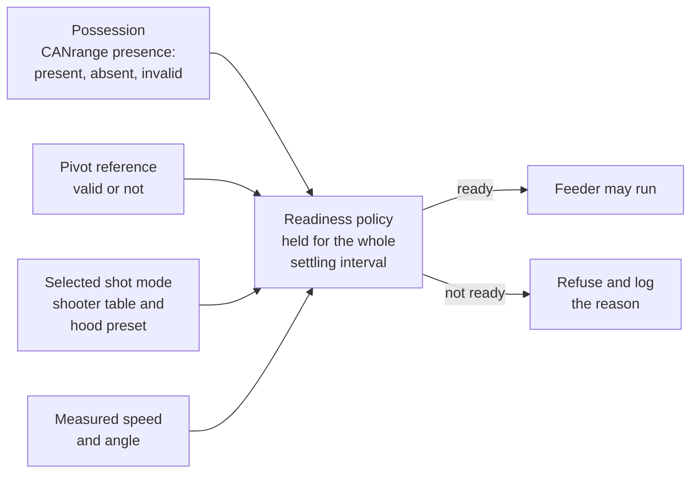

The student combines the refined mechanisms into behavior owned by a subsystem. Start after the
roller, flywheel and pivot simulation checks in Steps 4, 5 and 7, and the drawing work in Step 8.
FuelSim is needed for the later integrated launch, not for the first state-transition tests.
The step needs no hardware, so the physical demonstrations from Steps 4, 5 and 7 can happen
separately.

B3-09.1 follows the State-Driven Robot Code lessons. Read these first:

- [Why State Machines](/frc/why-state-machines)
- [Subsystem State Machines](/frc/subsystem-state-machines)
- [States, Commands and Triggers](/frc/states-commands-and-triggers)
- [Transition Graphs](/frc/transition-graphs)

The group continues with [The Superstructure](/frc/superstructure),
[A Superstructure for Cobra](/frc/superstructure-for-cobra), and
[Debugging State Machines](/frc/debugging-state-machines).

## Read Cobra's Bindings

Review [BobotState](/frc/bobot-state#zones-and-game-logic-as-triggers) and
[Composing Triggers](/frc/robot-container-and-bindings#composing-triggers) before reading Cobra's
bindings.

Cobra's shot-selection rules are triggers in `RobotContainer.configureOperatorBindings`, on the
operator controller (port 1). Cobra has two shooter tables, both distance-based interpolation
tables: the hub table, read through `BobotState.getHubInterpolator()`, and the dropoff table, read
through `BobotState.getDropoffInterpolator()`. Separate right-bumper bindings choose the shooter
table, and the right bumper, the field zone, the trench, and an intake-position trigger choose the
hood preset. `RobotContainer` also defines `configureHoodBindings` with a different automatic
mapping, but nothing calls it.

Fill in this binding table from `configureOperatorBindings` before designing the states. A
**guard** is the check a transition must pass; the last column records the guards that apply to
each condition.

| Condition | Hood Preset Requested | Shooter Table Requested | Guards That Apply |
| --- | --- | --- | --- |
| Right bumper held, near alliance zone | | | |
| Right bumper held, neutral zone | | | |
| Right bumper held, far alliance zone | | | |
| Right bumper held, near a trench | | | |
| Right bumper held, `intakeDown` true | | | |
| Right bumper released | | | |

The `intakeDown` trigger is `intake.isNearGoal(Degrees.of(90), Degrees.of(10))`. Before filling its
row, compare 90 degrees with the `endeffectorStart` and `endeffectorDeploy` angles in `Intake` and
predict which intake position drops the hood. Check the prediction in simulation.

The A Superstructure for Cobra lesson chooses the hood state from distance, while Cobra's bindings
choose it by field zone. Keep the zone rule unless the student records a reason to change it.

## Trace the Integrated Behavior

In the fork, trace the behavior the states replace. Start with the right-bumper shooting bindings
and the Step 1 A-button feed binding on the operator controller (port 1), then the trench and intake
triggers that drop the hood. Record which measured inputs from Drive, Intake, Feeder, Shooter, and
Hood reach each decision.

Trace what `Feeder.runFeederVoltage()` leaves running when it is interrupted. Read the command
factory for an end action, then check which binding stops the tower and the spindexer, and what
happens when `feeder.stopSpindexer()` interrupts the `runFeederVoltage()` command. Write down what
the state machine should output for the same interruption.

## Write the Transition Table First

Choose states that describe observable behavior, such as stowed, collecting, holding, preparing to
score, scoring, and faulted. For each transition, list the request, the required observations, the
outputs while waiting, the time bound, and the refusal reason. Also identify which measured
conditions permit the transition and which faults require an explicit recovery action.

The readiness policy is one guard: it receives logged observations and decides whether the feeder
may run. A selection with no guard of its own, such as the hood preset a zone asks for, can stay a
trigger in `RobotContainer` if the readiness policy verifies the result.

For example, a request to score while the flywheel is slow moves to preparing to score. The feeder
remains stopped until possession is confirmed, the pivot reference is valid, and measured speed and
angle satisfy the readiness policy for the whole settling interval. The settling interval is how
long the measurements must stay in tolerance before feeding. A requested goal is not evidence that
the mechanism reached it.

At this step, possession is a policy argument or a stub the student's tests set. Presence, the
CANrange reading from [Step 4](/badges/badge-3-roller#add-canrange-io) (present, absent, or
invalid), supplies the possession input once connected. The possession rows of the commissioning
record are filled in before the Step 4 physical test and reviewed in
[Step 13](/badges/badge-3-hardware#complete-the-setup-sheet). Until the reviewed values are entered,
the REAL possession input reports invalid, so the readiness policy refuses to feed.

Retain relevant clearance rules from Cobra's code. The physical conflict is still there after
the rule moves into a state machine, so the rule moves with it.
`BobotState.shouldStopFeedingFuelToShooter()` is one to preserve: outside the near alliance zone, it
stops feeding near a trench or where the hub blocks the shot.

## Connect Commands to Requests

Commands request behavior from the subsystem and declare its requirement. The subsystem evaluates
guards and owns actuator outputs. Avoid one command writing the roller while the subsystem's own
loop writes a different roller output in the same cycle.

Write the transition policy first as a class that receives observations as arguments, so a test can
drive it deterministically without motors or a field. Then adapt it into the subsystem, connect
logged IO, and define outputs for every state, including failure and interruption.

The diagram shows where each responsibility sits once the policy is inside the subsystem.

## Exercise the Refusals

Start from a known state for each test. Request a valid transition, a clearance violation, a
transition with an invalid reference, and scoring before readiness. Demonstrate timeout,
cancellation, disable, and explicit recovery. Log requested state, current state, elapsed time,
guard values, refusal reason and actual outputs, so a refusal shows what was asked for and what the
robot did.

For the independent change, the mentor supplies a new transition requirement or removes one
observation. The student predicts the refusal or timeout and proves it with the saved log. The
mentor reviews the transition table alongside the code to check that both describe the same
behavior.

Compare a normal run with the matching failure run;
[Debugging State Machines](/frc/debugging-state-machines#log-both-layers-every-loop) describes what
to log so the two runs can be compared.

## Keep the Shot Setup Together

Cobra chooses the shooter table and the hood preset in separate bindings, so a condition that
changes only the hood binding leaves the two out of step. For example, in the neutral zone, when
`intakeDown` becomes true the hood binding requests DOWN while the shooter binding keeps the zone's
table. `shouldStopFeedingFuelToShooter()` does not read the intake. Find the other conditions in
the binding table that produce a mismatch.

Define shot modes: each **shot mode** names a shooter table and its required hood preset together,
keeping the pairing the binding table records for each zone. Aiming, operator speed requests, hood
selection, and readiness all use the selected shot mode. Clearance can request DOWN; it does not
make the dropoff table valid at DOWN.

The readiness policy refuses feeding on a mismatch, and a changed shot mode starts a new settling
interval. Log the selected shot mode, hood goal and measurement, flywheel goal and measurement, and
the refusal reason together.

Test the shooting binding across zone changes and a trench-clearance condition, and test mismatch
refusal and the settling interval after recovery separately. These checks confirm that the shot
modes still share Cobra's one dropoff table; they do not establish its physical passing accuracy.

## Badge Check

S means simulation and W means written reasoning. The student records an evidence link and an
explanation in the student's own words for each row in the fork's README. The mentor asks the
student to explain a change and its result, checks each row, then signs and dates the step on the
[sign-off sheet](/documents/badges/badge-3/badge-3-sign-off.pdf).

| Row | Work | Done When |
| --- | --- | --- |
| B3-09.1 | Subsystem-owned states | S/W: Integrate roller, flywheel and pivot with guarded transitions, logging each request and resulting state, following the State-Driven Robot Code lessons. Commands request behavior; the subsystem owns transitions and actuators. |
| B3-09.2 | State failure behavior | S: Test valid and refused transitions, readiness failure, timeout, interruption and explicit recovery, including shooter-table and hood mismatch. Preserve the earlier clearance rules where relevant. |

## For the Mentor

`curriculum-reference` contains an isolated transition policy, `frc.robot.curriculum.Acquisition`.
`Badge3MentorSolution` has the integrated `frc.robot.subsystems.acquisition.Acquisition`,
`ShotMode`, `FeedPolicy`, and `RobotContainer.configureHood()`; `ShotModeSimulationTest` and
`FeedPolicyTest` cover the zone, trench, mismatch and settling-interval cases, and the log shows
them under `ShotSelection` and `Feeder/Refusal`. The mentor solution's `MIGRATION.md` records
Cobra's table and hood pairing for checking the student's binding table. Compare these with the
student's design after the student has built their own.

<Sources items={[
  {
    "source": "wpilib",
    "path": "docs/software/commandbased/subsystems.html",
    "note": "Command requirements and subsystem ownership behind owned transitions."
  },
  {
    "source": "advantagekit",
    "path": "data-flow/recording-inputs/io-interfaces/",
    "note": "Logged IO inputs that the transition guards read, so a refusal can be replayed."
  },
  {
    "source": "wpilib",
    "path": "docs/software/commandbased/binding-commands-to-triggers.html",
    "note": "Trigger composition in the zone, trench and bumper bindings the states replace."
  },
  {
    "source": "cobra",
    "path": "src/main/java/frc/robot/RobotContainer.java",
    "note": "The operator hood and shooter bindings, the unused configureHoodBindings, and the feed binding."
  },
  {
    "source": "cobra",
    "path": "src/main/java/frc/robot/bobot_state/BobotState.java",
    "note": "The field-zone and trench triggers the bindings read, getHubInterpolator() and getDropoffInterpolator(), and shouldStopFeedingFuelToShooter()."
  },
  {
    "source": "cobra",
    "path": "src/main/java/frc/robot/subsystems/shooter/Shooter.java",
    "note": "runShooterToHub() and runShooterDropOff(), which read the hub and dropoff tables."
  },
  {
    "source": "cobra",
    "path": "src/main/java/frc/robot/subsystems/intake/Intake.java",
    "note": "isNearGoal(angle, tolerance) behind the intakeDown trigger, and the endeffector preset angles."
  },
  {
    "source": "cobra",
    "path": "src/main/java/frc/robot/subsystems/feeder/Feeder.java",
    "note": "runFeederVoltage(), stop() and stopSpindexer(), traced for interruption behavior."
  }
]} />

<LinkGrid title="Continue" section="badges" links={[{"label": "Step 10: Object Detection and Acquisition Geometry", "id": "badge-3-object-detection"}, {"label": "Badge 3: Advanced FRC", "id": "badge-3"}]} />
