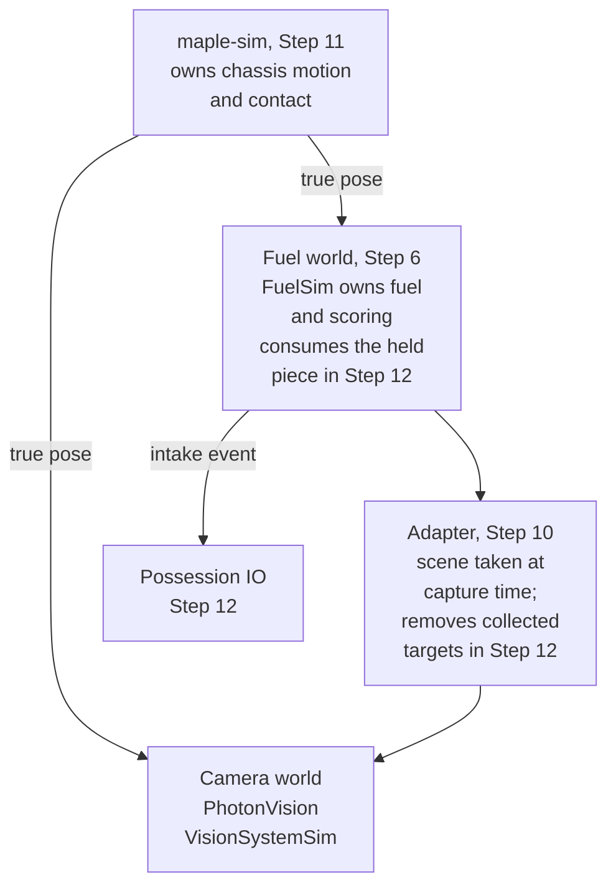

Badge 3: Advanced FRC is the Automation Team capstone. The student refines mechanisms, integrates
sensing and autonomous behavior, explains test evidence, and helps another member succeed. The
mentor assesses technical ownership and readiness for leadership.

Every student receives the same `Badge3Starter` (Cobra as it competed) and completes the full
migration in an individual fork. The migration rebuilds Cobra's reusable code in the ROBOTZ Garage
library's new package, `org.robotzgarage.frc2027`, using the configuration-record and IO wiring of
`Badge2MechanismReference`. The drivetrain and robot-specific shooting policy stay in the robot
project. Step 1 traces the code and plans the work, and the migration proceeds across Steps 3–12.
The completed `Badge2MechanismReference` stays available for comparison.

Badge 2 or mentor-verified equivalent work is the prerequisite. Supplied code establishes the
starting point; the student explains it and demonstrates the additions each step assesses.

## Step Order

| Step | Work | Main Evidence |
| --- | --- | --- |
| 1 | [Baseline, Diagnostic, and Work Plan](/badges/badge-3-start) | B3-01.1–B3-01.3 |
| 2 | [Calculus for Controls](/badges/badge-3-calculus) | B3-02.1 and C1–C5 |
| 3 | [Advanced Output Capabilities](/badges/badge-3-controls) | B3-03.1–B3-03.2 |
| 4 | [Roller Sensing and Jam Behavior](/badges/badge-3-roller) | B3-04.1–B3-04.3 |
| 5 | [Flywheel Characterization and Tuning](/badges/badge-3-flywheel) | B3-05.1–B3-05.2 |
| 6 | [FuelSim Launch Experiment](/badges/badge-3-fuelsim-experiment) | B3-06.1–B3-06.2 |
| 7 | [Pivot Reference, Limits, and Profiles](/badges/badge-3-pivot) | B3-07.1–B3-07.5 |
| 8 | [Logged Mechanism and CAD Visualization](/badges/badge-3-logged-mechanisms) | B3-08.1–B3-08.3 |
| 9 | [Subsystem-Owned States](/badges/badge-3-states) | B3-09.1–B3-09.2 |
| 10 | [Object Detection and Acquisition Geometry](/badges/badge-3-object-detection) | B3-10.1–B3-10.3 |
| 11 | [Combined Simulation with maple-sim](/badges/badge-3-maple) | B3-11.1–B3-11.4 |
| 12 | [One-Piece Autonomous](/badges/badge-3-acquisition) | B3-12.1–B3-12.7, including every failure run |
| 13 | [Hardware Evidence Completion](/badges/badge-3-hardware) | B3-13.1, B3-13.4, and B3-13.2 (FXS) or B3-13.3 (Nova) for the student's Badge 2 controller; review all advanced physical rows |
| 14 | [Diagnosis, Review, and Teaching](/badges/badge-3-review) | B3-14.1–B3-14.4, collected throughout |
| 15 | [Final Check, Handoff, and Sign-Off](/badges/badge-3-sign-off) | B3-15.1–B3-15.3; B3-01.1 closes first |

Each row identifier names its step: B3-08.2 is the second row of Step 8. C1–C5 are the calculus rows
of Step 2 and support B3-02.1. [Written Checks](/badges/badge-3-written-checks) follows the steps as
a reference page for the diagnostic in Step 1, the mastery attempt after Step 14, and the final in
Step 15.

The table gives the main learning sequence, and some steps overlap. Step 3 can start once Step 2 has
begun, and the calculus rows can continue alongside later steps. FuelSim and pivot work can proceed
alongside one another. Object-detection geometry can begin from the Badge 2 vision prerequisites.
Step 8 applies the Badge 2 logged 2D drawing pattern to Cobra's intake after the pivot work, then
animates the intake CAD from the same measurements before state integration. Leadership evidence
accumulates throughout.

The mentor reviews the Badge 2 hardware evidence at entry and reserves Cobra hardware appointments
while simulation, written work, and code review continue. Step 13's setup sheet and first-enable
sections are used from Step 4 onward. Each advanced physical demonstration, including each
mechanism's torque-current demonstration for B3-13.1, follows that mechanism's simulation rows.

Steps 10 to 12 build one combined simulation. Step 10 builds the adapter that drives the camera
world (the PhotonVision `VisionSystemSim`) from the fuel world (the FuelSim instance from Step 6).
Each scene is taken at capture time. Step 11 adds maple-sim, which owns chassis motion and contact,
and switches fuel physics and camera rendering to maple-sim's true pose; FuelSim still owns fuel and
scoring. Step 12 adds possession, removal of collected targets, and consumption. The Step 12
autonomous runs need the mechanism, state, observation and FuelSim work and B3-11.1 to B3-11.3
first. The B3-11.4 reproduction by another member can follow with the Step 15 handoff.

## Evidence and Support

The student keeps the evidence in the fork's evidence directory. For each required row, the student
records an evidence link and an explanation in the student's own words in the fork's README. The
mentor checks each row with the student, then signs and dates the step on the
[sign-off sheet](/documents/badges/badge-3/badge-3-sign-off.pdf). The student defines performance
targets before tuning and keeps both successful and failed runs. A live visualization does not
replace a saved log.

The diagnostic finds gaps without blocking instruction, and corrections continue with the lessons.
After Step 14, the student completes an independent 100% mastery attempt, then a separate
independent 100% final in Step 15. Written Checks sittings have no time limit and are closed-notes.

The Step 2 calculus worksheet and the Step 7 worksheet on Expo, CTRE's exponential Motion Magic
profile, are corrected to 100% with feedback. Notes are allowed on every worksheet attempt,
including the credited one. Completed practical evidence remains credited. See
[Written Checks](/badges/badge-3-written-checks). Earlier Badge 2 calculus work can count after
mentor review ([Step 2](/badges/badge-3-calculus#earlier-badge-2-work)).

The mentor provides Talon FX hardware for the advanced work; Badge 2 introduces the motor
controllers. The required physical checks are a physical voltage baseline, FX roller, flywheel and
pivot work, a voltage and torque-current comparison, characterization, CANrange, pivot references,
and stationary camera checks. Matching Badge 2 FX, FXS or Nova evidence counts toward them. The FXS
and Nova review rows apply only to the motor controller the student used in Badge 2; physical
versions for other controllers are optional. The advanced FX/FXS simulation comparisons are
required. Autonomous collection and scoring stay in simulation. Intentional physical jams, automatic
retry, QuestNav, Choreo, SystemCore and SPARK MAX instruction are outside the required path.

Two limited, simulation-only exercises are also required; each is assessed under its step's rows. In
Step 8 the student imports and animates the intake CAD model while the hood stays static. In Step 10
the student adds driver assistance that turns only the robot's heading toward an observed fuel
cluster.

## Materials and Release Status

Each step starts the student from material they can open:

- the relevant file in their fork of `Badge3Starter` (Cobra as it competed, on GitHub as
  Cobra2026Private)
- the GarageDocs lesson that teaches the topic
- the pinned vendor documentation

The mentor supplies the Starter, the completed `Badge2MechanismReference`, and the Week 6 Cobra
robot model for AdvantageScope (`Robot_Cobra2026Week6`).

The mentor records the package revision and its open validation items before instruction begins. Two
items are known: Cobra's shot is calibrated only in simulation, from the hub table's flight times,
and the Starter has only its own limited verification procedure (Step 1). Neither blocks the
student's rows; each row closes with the student's own evidence.

## For the Mentor

Steps 1 and 3 through 14 each end with a For the Mentor note naming the matching files in the mentor
solution. Begin with `TRAINING-MATERIALS.md` in `Badge3MentorSolution`. It identifies the Starter,
the Badge 2 reference, the migrated Cobra, and the legacy `curriculum-reference` examples, and maps
each step to its reference file and test. The mentor keeps the projects' dependency versions and
commands separate, and keeps the answer keys and worked examples outside student packages.
`ROW-EVIDENCE.md` distinguishes supplied demonstrations from student evidence, and
`SOURCE-FINDINGS.md` keeps the findings behind the pages' Sources notes. `PILOT-RECORD.md` records
the student pilot. It keeps active work, equipment waiting, mentor assistance, and any work done at
home as separate entries. If the pilot runs long, the mentor revises the support and keeps every
required outcome. A successful build and a passing mentor test suite show that the references work;
they do not close student rows.

<Sources items={[
  {
    "source": "advantagekit",
    "path": "data-flow/recording-inputs/io-interfaces/",
    "note": "The IO boundary and recorded-input model that the migration and replay evidence rely on."
  },
  {
    "source": "wpilib",
    "path": "docs/software/commandbased/subsystems.html",
    "note": "Subsystem ownership of actuators, assessed by the state and command rows."
  }
]} />

<LinkGrid title="Continue" section="badges" links={[{"label":"Step 1: Baseline, Diagnostic, and Work Plan","id":"badge-3-start"},{"label":"Written Checks","id":"badge-3-written-checks"},{"label":"Step 15: Final Check, Handoff, and Sign-Off","id":"badge-3-sign-off"}]} />
